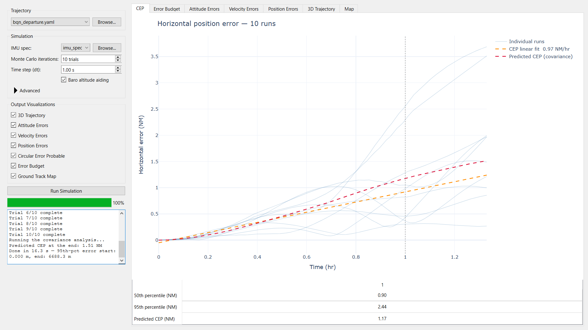
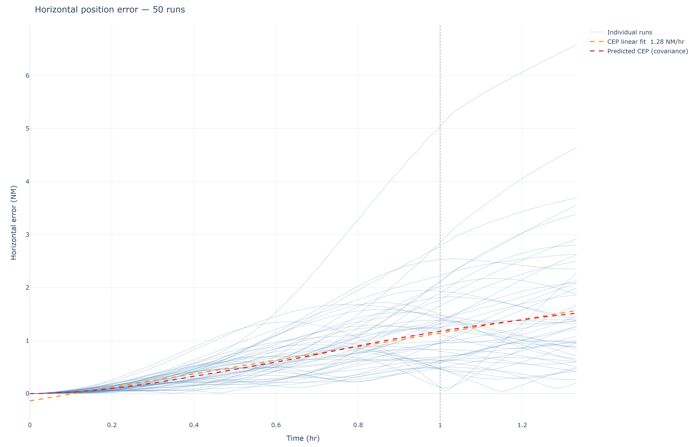
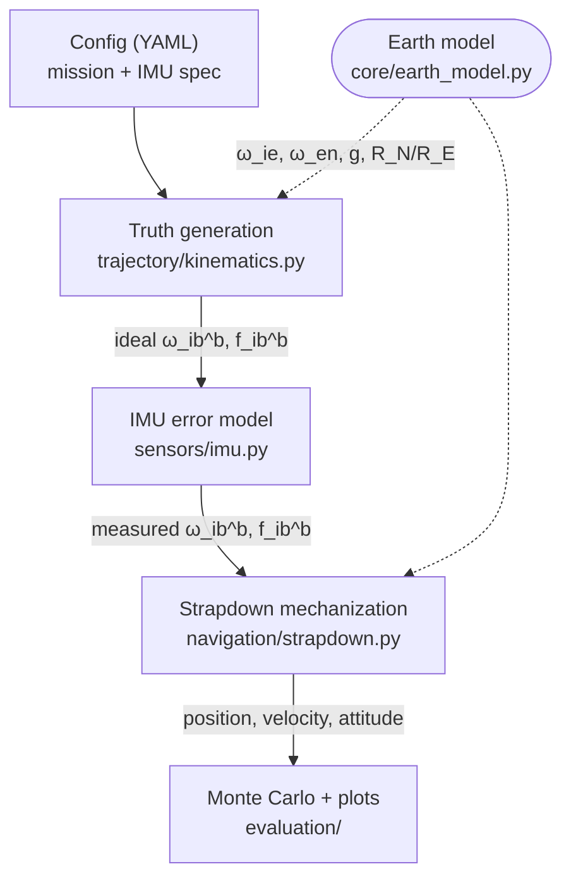

# ins_sim

**Inertial Navigation Simulation & GUI** — an open-source 6-DOF, WGS-84
strapdown INS Monte Carlo simulator with a PySide6 desktop front end.

[](https://github.com/jorgieo/ins_sim/actions/workflows/release.yml)
[](https://github.com/jorgieo/ins_sim/actions/workflows/docs.yml)
[](https://github.com/jorgieo/ins_sim/releases/latest)
[](LICENSE)

[Documentation](https://jorgieo.github.io/ins_sim/) ·
[Download](https://github.com/jorgieo/ins_sim/releases/latest)

| Desktop GUI | Monte Carlo output |
| :---------: | :----------------: |
|  |  |

## Overview

`ins_sim` generates a truth flight trajectory, derives the gyro and
accelerometer outputs a perfect IMU would produce along that trajectory
(ω_ib^b and f_ib^b in Groves notation), corrupts them with an IMU error
model specified from a sensor datasheet (angular/velocity random walk,
Gauss-Markov bias drift, turn-on bias repeatability, scale-factor and
misalignment errors, initial-alignment errors), and runs a strapdown
mechanization to recover position, velocity, and attitude. A Monte Carlo
ensemble over independent noise realizations characterizes how navigation
error grows over time for a given IMU grade.

The simulation models rotating-Earth effects explicitly: Earth rate, transport
(craft) rate, WGS-84 radii of curvature, and Somigliana normal gravity are all
evaluated at the current latitude/altitude at every step, so the strapdown
mechanization is consistent with true inertial navigation rather than a flat,
non-rotating Earth approximation. An optional precision mechanization adds
coning, rotation and sculling corrections, and the truth can be oversampled to
give the outputs of an integrating IMU, against which the navigator's own
integration error shows. The vertical channel runs either baro-damped
(third-order fixed-gain loop, aided by a barometer with its own temperature,
altimeter-setting, weather and noise errors) or free-inertial, where it exhibits
the expected instability.

Results are explored in a desktop GUI whose visualizations are fully
interactive plotly pages rendered in-app.

## Download

Prebuilt portable bundles for **Windows** and **Linux** (x86-64 and ARM64) are
attached to every
[GitHub Release](https://github.com/jorgieo/ins_sim/releases/latest) — no
Python installation required:

- `ins_sim-vX.Y.Z-windows-x86_64.zip` — extract, then run `ins_sim.exe`
  inside the extracted folder.
- `ins_sim-vX.Y.Z-linux-x86_64.tar.gz` — `tar xzf`, then run
  `./ins_sim/ins_sim`.
- `ins_sim-vX.Y.Z-linux-aarch64.tar.gz` — ARM64 / aarch64 build (e.g.
  **Raspberry Pi 4/5 on the 64-bit Raspberry Pi OS**); `tar xzf`, then run
  `./ins_sim/ins_sim`. Check your CPU with `uname -m` (`aarch64`).

See the [Download & Install](https://jorgieo.github.io/ins_sim/download/)
page for platform notes (Windows SmartScreen, Linux runtime libraries,
Raspberry Pi).

## The GUI

Launch from source with:

```bash
pip install ".[gui]"
python -m ins_sim.gui
```

- Select a mission trajectory and IMU error specification from the
  `trajectories` and `imu_specs` folders next to the app (seeded with the
  packaged defaults; add your own files there or use *Browse…*).
- Set the trial count, integration time step, and baro altitude aiding
  (uncheck it to run the vertical channel free-inertial).
- Run the Monte Carlo ensemble in the background with live log output.
- Explore the results in interactive plotly tabs:
  - **CEP** — horizontal error growth for every trial, ensemble CEP, linear
    fit, and a percentile table by hour.
  - **Attitude / Velocity / Position errors** — ensemble mean and 3σ bands
    per axis.
  - **3D Trajectory** — all trial tracks, the truth track, and a 95th
    percentile error tube.
  - **Map** — ground track over OpenStreetMap tiles with a horizontal error
    envelope (map tiles are the only feature that needs an internet
    connection).

[Your first simulation](https://jorgieo.github.io/ins_sim/latest/get-started/first-run/)
walks through a first run, and the
[User guide](https://jorgieo.github.io/ins_sim/latest/guide/) explains every
control and result.

## CLI

A scripted run of the same engine (matplotlib summary figure plus a
standalone ground-track map HTML):

```bash
pip install -e ".[dev]"

# Default run: packaged BQN departure mission, nav-grade IMU, 20 trials
python main.py

# Custom mission, IMU spec, and ensemble size
python main.py --config path/to/mission.yaml --imu-spec path/to/imu.yaml \
               --trials 100 --dt 0.1 --seed 7
```

[Command-line runs](https://jorgieo.github.io/ins_sim/latest/guide/cli/)
explains the options and the output, and
[Your first script](https://jorgieo.github.io/ins_sim/latest/get-started/first-script/)
runs a simulation from Python.

To use a different mission profile or IMU grade, point `build_trajectory` /
`load_imu_spec` at your own YAML files; the
[Mission YAML](https://jorgieo.github.io/ins_sim/latest/reference/mission-yaml/)
and [IMU spec YAML](https://jorgieo.github.io/ins_sim/latest/reference/imu-yaml/)
references list every key:

```python
from ins_sim.trajectory.kinematics import build_trajectory
from ins_sim.sensors.imu import load_imu_spec

truth, v_sprint, R_turn = build_trajectory("path/to/your_mission.yaml", tau_i=0.1)
spec = load_imu_spec("path/to/your_imu_spec.yaml")
```

## Architecture

| Module | Role | Key implementations |
| ------ | ---- | ------------------- |
| `ins_sim/core` | Earth & gravity model | WGS-84 ellipsoid, radii of curvature, Earth/transport rates, Somigliana gravity + free-air correction |
| `ins_sim/trajectory` | Truth generation | Phase-based mission builder (ground roll, takeoff, climb, waypoints, loiters, speed ramps), ISA Mach conversion |
| `ins_sim/sensors` | IMU error model | ARW/VRW white noise, Gauss-Markov bias instability, turn-on repeatability, scale factor & misalignment |
| `ins_sim/navigation` | Strapdown mechanization | Quaternion attitude propagation, Coriolis/transport-rate compensation, optional coning/sculling corrections, baro-damped or free-inertial vertical channel |
| `ins_sim/evaluation` | Monte Carlo statistics | Empirical ensemble runs, percentile envelopes, CEP |
| `ins_sim/gui` | Desktop interface | PySide6 + QThread background workers, interactive plotly views in QtWebEngine |

Data flows from truth generation, through the IMU error model, into the
strapdown navigator, and is summarized by the Monte Carlo evaluation:



## Conventions

ins_sim follows the notation of P. D. Groves, *Principles of GNSS,
Inertial, and Multisensor Integrated Navigation Systems* (2nd ed., 2013),
in its documentation and in its Python names. The
[Notation & conventions](https://jorgieo.github.io/ins_sim/latest/theory/notation/)
page defines every symbol; in brief:

- **Symbols** — x_βα^γ is the motion of frame α relative to frame β,
  resolved in the axes of frame γ. In Python, `v_eb_n` is v_eb^n, the
  velocity of the body (b) relative to the Earth (e) in North-East-Down
  axes (n).
- **Frames** — the North-East-Down navigation frame (n) at the current
  position, and the body frame (b): x forward, y right, z down.
- **Attitude** — the body-to-NED transformation C_b^n, held as a
  `scipy.spatial.transform.Rotation`. Quaternions are scalar-last,
  `[x, y, z, w]`. Euler angles are `[roll φ, pitch θ, heading ψ]`, applied
  heading first (`Z-Y-X`).
- **Radii of curvature** — R_N is the meridian radius and R_E the
  transverse one. Many texts use R_N for the transverse radius.
- **Errors** — always the estimate minus the truth.
- **Units** — strict SI inside the simulator. The YAML files, the app and
  the command line use datasheet and aviation units (degrees, feet, knots,
  °/h, µg), converted when read.

## Development

```bash
# Editable install with dev dependencies
pip install -e ".[dev,gui]"

# Test suite
python -m pytest

# Local desktop bundle (onedir, at dist/ins_sim/)
pyinstaller ins_sim.spec --noconfirm

# Documentation site (http://127.0.0.1:8000)
pip install ".[docs]"
mkdocs serve
```

See [CONTRIBUTING.md](CONTRIBUTING.md) for the notation, naming and
documentation conventions, and [CHANGELOG.md](CHANGELOG.md) for what changed
in each version.

## License

This project's own source code is licensed under the [MIT License](LICENSE).

The downloadable release binaries additionally bundle third-party
components, most notably **Qt / PySide6**, which are redistributed under the
**GNU LGPL v3**. Attribution and the full license texts for all bundled
components are provided in [THIRD-PARTY-NOTICES.txt](THIRD-PARTY-NOTICES.txt)
and the [`licenses/`](licenses/) directory, both of which ship inside every
release bundle. Installing the library from source without the `gui` extra
pulls no LGPL-licensed dependencies.
