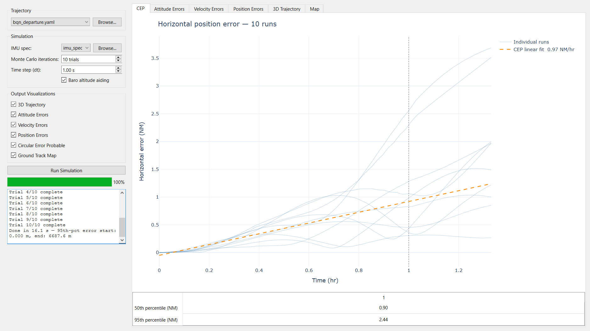
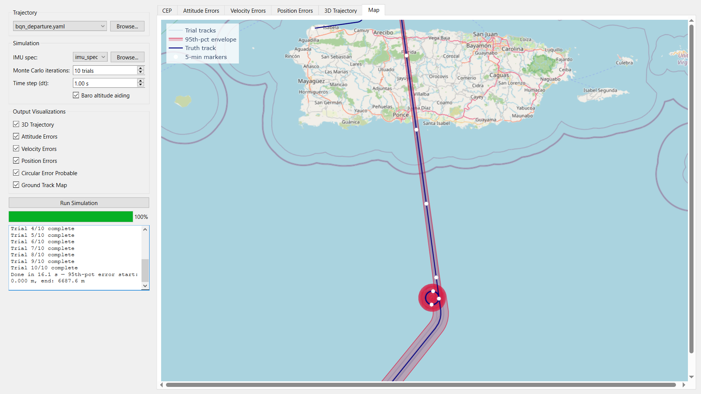
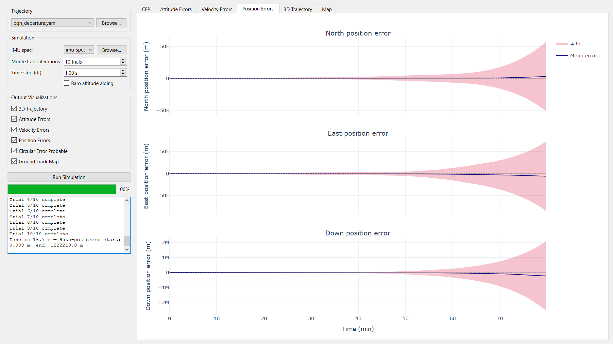

# Your first simulation

This tutorial runs the packaged mission in the desktop app, reads the main
results, and then shows the one thing an inertial navigator cannot do on
its own. It takes about ten minutes and needs no programming.

You need the app installed: see [Download & install](../download.md). The
map in step 6 also needs an internet connection, for its background tiles.

## 1. Open the app

Start the app: `ins_sim.exe` on Windows, `./ins_sim/ins_sim` on Linux, or
`python -m ins_sim.gui` if you run it from a source checkout.

The window has two parts. The **control panel** on the left holds every
setting. The **results area** on the right says *Run a simulation to see
results* until you do.

The first time it starts, the app creates two folders next to itself,
`trajectories` and `imu_specs`, and puts a copy of the packaged mission and
IMU spec in them. These are the files the two lists at the top of the
control panel show.

## 2. Look at the mission and the IMU

Two files describe a simulation:

- **The mission** (*Trajectory* list): `bqn_departure.yaml`. An 80-minute
  flight from Rafael Hernández Airport (BQN) at the north-west corner of
  Puerto Rico. The aircraft takes off, climbs to 15,000 ft and flies five
  circles in a holding pattern off the north coast. It then crosses the
  island to hold again south of it, and finally accelerates to Mach 0.8 for
  a sprint to the south-west: 440 nautical miles in all.
- **The IMU** (*IMU spec* list): `imu_spec.yaml`. A navigation-grade unit,
  of the ring-laser-gyro kind that airliners carry. Its gyro biases drift
  by about 0.01 °/h.

Leave both as they are.

## 3. Choose quick settings

The defaults, 50 trials at a 0.1 s time step, give the most precise
results but take about ten minutes. For a first look, set:

- **Monte Carlo iterations: 10 trials.** Each trial flies the same mission
  with a fresh draw of every sensor error, so ten trials show ten possible
  outcomes.
- **Time step (dt): 1.00 s.** The navigator updates once per second instead
  of ten times.

Leave **Baro altitude aiding** checked, and every box under **Output
Visualizations** checked: each one becomes a tab of results.

## 4. Run

Click **Run Simulation**. The log under the button reports each step, and
the progress bar fills as the trials complete. After about 15 seconds the
results appear:

## 5. Read the CEP tab

The first tab shows how far each trial's position estimate is from the
truth, horizontally, in nautical miles, over the flight's 1.3 hours. Every
faint line is one trial.

- The trials spread out because each one drew different sensor errors.
  Ten trials of the same IMU end anywhere from 0.3 to 3.7 nmi off.
- The **CEP**, the circular error probable, is the radius that holds half
  of the trials. The table under the plot gives it at each whole hour:
  0.90 nmi after one hour, while 95% of the trials are within 2.44 nmi.
- The dashed line is a straight-line fit to the CEP over the first hour.
  Its slope, here 0.97 nmi per hour, is the usual one-number summary of an
  INS: this IMU makes a "one nautical mile per hour" navigator, as expected
  of navigation grade.

The app always uses the same random seed, so the same settings give the
same numbers every time.

## 6. Look at the position errors and the map

Open the **Position Errors** tab. It shows the North, East and Down errors
over time: a dark line for the average over the trials, and a shaded band
of ±3 standard deviations around it. The North and East bands widen to
kilometres, but the Down band stays within metres. The barometric
altimeter holds the height, as the next step shows.

Then open the **Map** tab: the true track over Puerto Rico, every trial's
estimated track, and a shaded band that holds 95% of the trials. White
dots mark every five minutes. The band widens along the flight as the
errors grow. Hover over the track to read the time and the error.

## 7. Switch off the barometer

An inertial navigator measures height by integrating acceleration, and
that calculation is unstable. Gravity weakens with height, so a navigator
that thinks it is too high computes too little gravity. It then believes
it is accelerating upward, which makes its height error grow further.
Aircraft use a barometric altimeter to hold this in check, and so does the
simulator, unless you switch it off.

Uncheck **Baro altitude aiding**, click **Run Simulation** again and open
**Position Errors**:

The Down error now grows roughly tenfold every 20 minutes: about 600 m
(3σ) after 10 minutes, 35 km after 40 minutes and 2,000 km by the end. The
axis labels use SI prefixes: 50k is 50 km and 2M is 2,000 km. The height
error also corrupts the horizontal solution: the CEP after one hour is now
2.5 nmi instead of 0.9. The [Vertical channel](../theory/vertical-channel.md)
page explains the instability and the loop that tames it.

Check the box again before your next run.

## Next steps

- [Reading the results](../guide/results.md) explains every tab.
- [Modelling an IMU](../guide/imu-specs.md) has tactical-grade and MEMS
  specs to try, and shows how to enter your own sensor's datasheet.
- [Writing a mission](../guide/missions.md) shows how to fly your own
  route.
- [Your first script](first-script.md) runs the same simulation from
  Python.
- The [INS error model](../theory/error-model.md) explains why the errors
  grow the way they do.
