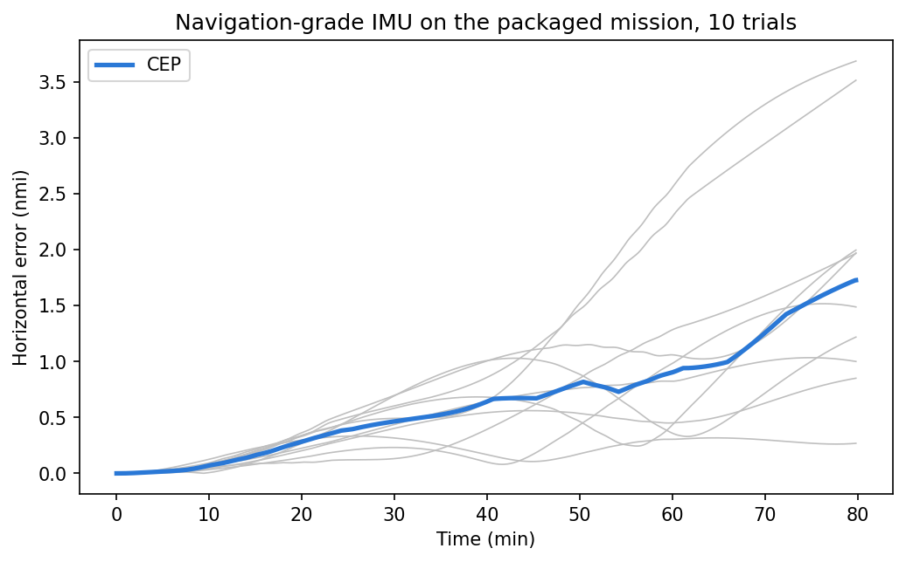

# Your first script

The desktop app is a thin layer over a Python package, and everything it
does you can do from a script. This tutorial repeats
[Your first simulation](first-run.md) in about 30 lines of Python: build
the truth, load the IMU spec, run the Monte Carlo trials, measure the
position error and plot it. You get the same numbers as the app.

## Install the package

You need Python 3.11 or later. Get the source and install it:

```bash
git clone https://github.com/jorgieo/ins_sim.git
cd ins_sim
pip install -e .
```

The `-e` keeps the installation linked to the folder, so a later
`git pull` updates it. Scripts do not need the desktop app's `gui` extra.

## The script

Save this as `first_script.py` anywhere and run it with
`python first_script.py`:

```python
--8<-- "docs/examples/first_script.py"
```

It prints:

```text
--8<-- "docs/examples/first_script.txt"
```

and saves the plot shown at the end of this page. The rest of the page
goes through it step by step.

## Step by step

### 1. The truth

```python
--8<-- "docs/examples/first_script.py:truth"
```

`build_trajectory` reads the mission file and flies it, phase by phase,
sampling the result every `tau_i` seconds: here once a second, like the
app's *Time step* of 1.00 s. The `truth` it returns holds, at each of the
4,791 samples, the true position, velocity and attitude, and the outputs a
perfect IMU would give along the way. The other two values it returns,
ignored here, describe the mission's sprint speed and turn radius.

### 2. The IMU spec

```python
--8<-- "docs/examples/first_script.py:spec"
```

`load_imu_spec` reads the YAML file, which is written in datasheet units,
and converts every value to SI. The bias instability, entered as
0.01 °/h, is held in rad/s; the script converts it back to check.

### 3. The Monte Carlo run

```python
--8<-- "docs/examples/first_script.py:run"
```

Each trial draws its own set of sensor errors, corrupts the perfect IMU
outputs with them, and runs the strapdown navigator from the true starting
point, with a drawn alignment error. The result holds every trial's
estimates: `mc.est_L_b` is the estimated latitude, an array of shape
(10, 4791), one row per trial. This step takes about ten seconds.

The `seed` fixes the random draws, so the run is repeatable. The app uses
42 as well, which is why this script reproduces its results.

### 4. The position error

```python
--8<-- "docs/examples/first_script.py:errors"
```

`position_error` subtracts the truth from each estimate and converts the
latitude, longitude and height differences to metres along North, East and
Down. The horizontal error is the length of the North and East components,
and its median across the trials at each moment is the CEP. After one hour
it is 0.90 nmi, the same as in the app's CEP table.

### 5. The plot

```python
--8<-- "docs/examples/first_script.py:plot"
```



Like the app's CEP tab, the plot shows each trial in grey and their median
in blue.

## Names that look like symbols

The variables follow the textbook symbols on the
[Notation & conventions](../theory/notation.md) page: `L_b` is the latitude
\(L_b\), and `delta_r_eb_n` is the position error
\(\delta\rvec{eb}{n}\). A prefix gives a value's role: `est_` for the
navigator's estimate, `meas_` for a sensor output and `delta_` for an
error, always the estimate minus the truth.

## Next steps

- The [Python API](../reference/api/index.md) documents every function,
  with its arguments' units and shapes.
- [Recipes](../guide/recipes.md) builds on this script: comparing IMUs and
  finding the error source that dominates.
- [Modelling an IMU](../guide/imu-specs.md) and
  [Writing a mission](../guide/missions.md) explain the two input files.
