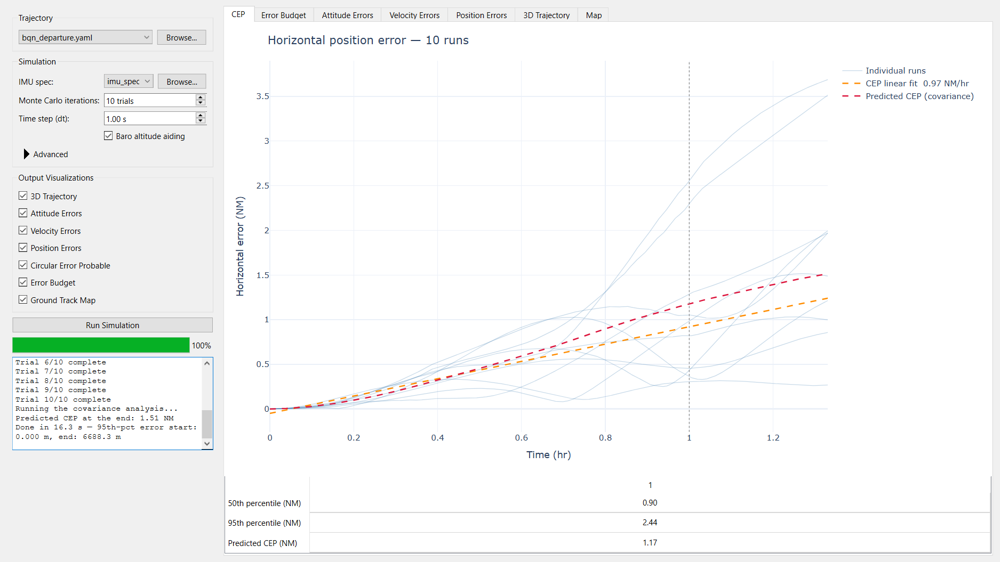
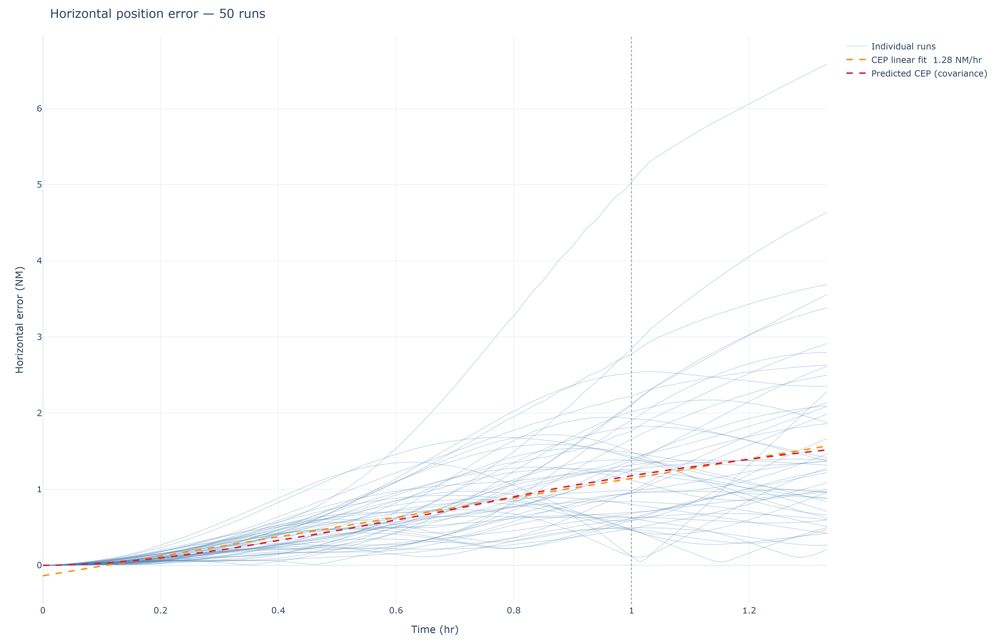

# User Guide

This guide walks through operating the desktop app, interpreting each
visualization, and authoring your own mission and IMU configuration files.

## Running your first simulation



1. **Select a trajectory.** The *Trajectory* list shows the mission YAMLs
   in the `trajectories` folder next to the app: the app's own folder for
   the downloaded bundle, or the current working directory when run from
   source. On first launch the folder is created and seeded with the
   packaged `bqn_departure.yaml`. Files you add or edit there appear the
   next time you open the list, and your edits are never overwritten.
   *Browse…* opens the same folder and accepts any mission file with a
   top-level `phases` list. If that location is not writable, the app uses
   `~/ins_sim/trajectories` instead.
2. **Select an IMU spec.** Same pattern, with the `imu_specs` folder and the
   packaged navigation-grade `imu_spec.yaml`. Files must have top-level
   `gyro` and `accel` sections.
3. **Set the ensemble size.** *Monte Carlo iterations* (default 50) trades
   statistical confidence against run time — ensemble statistics converge as
   \(1/\sqrt{N}\), so quadrupling the trials halves the noise on the
   percentile curves.
4. **Set the time step.** *Time step (dt)* (default 0.1 s) is the truth and
   integration sample interval. 0.1 s is the reference setting; 0.5–1.0 s
   runs much faster and is fine for quick looks at long-duration error
   growth.
5. **Choose the vertical channel.** *Baro altitude aiding* (checked by
   default) runs the third-order baro-damped vertical loop. Uncheck it to see
   the free-inertial vertical channel diverge — the instability is real
   physics, not a bug (see [Theory & Math](theory/index.md#vertical-channel)).
6. **Pick visualizations.** Each checked box becomes one tab after the run.
7. **Run.** The simulation executes on a background thread — the log pane
   streams progress (per-trial completion, timing, final 95th-percentile
   error) and the progress bar tracks the ensemble. The UI stays responsive
   throughout; controls re-enable when the run finishes.

## Reading the results

Every tab is an interactive plotly page — hover for values, drag to zoom,
double-click to reset.

**CEP (Circular Error Probable)** — every trial's horizontal error in
nautical miles against decimal hours, with the ensemble CEP drift-rate fit
(fitted to the pointwise 50th percentile over the first hour). Below the plot,
a table lists the 50th and 95th percentile error at each whole hour.



**Attitude / Velocity / Position Errors** — per-axis ensemble mean error with
±3σ bands, where σ is the sample standard deviation across trials. All three
are resolved along the local North, East and Down axes at the true position,
and every error is the estimate minus the truth (see
[Notation & conventions](theory/notation.md#errors)):

- *Attitude* shows the small rotation between the estimated and the true
  attitude: the North and East tilts, and the heading error (the rotation
  about Down), in degrees.
- *Velocity* and *Position* show the North, East and Down components. The
  position error is the latitude, longitude and height error converted to
  metres.

With baro aiding on, the Down channels stay bounded while North/East grow
with the classic INS error signature; with aiding off, watch the Down
channels run away.

**3D Trajectory** — the truth track (black), every trial's estimated track
(steel blue), and the crimson swept tube of the 95th-percentile radial error.

**Ground Track Map** — the mission over OpenStreetMap tiles with the
95th-percentile horizontal-error envelope drawn perpendicular to the track
and 5-minute markers along the truth path. The basemap tiles are the only
part of the app that needs an internet connection.

## Writing mission profiles

A mission YAML has three top-level sections — `departure`, `simulation_time`,
and `phases`. All angles are degrees, altitudes feet, speeds knots (or Mach);
everything is converted to SI internally.

```yaml
name: My Mission

departure:
  lat_deg:  18.4949        # start latitude
  lon_deg: -67.1294        # start longitude
  alt_ft:   237.0          # field elevation (MSL)
  nav_bank_angle_deg: 25.0 # bank angle used for inter-waypoint turns

simulation_time:
  dt_s: 0.1                # sample rate hint (GUI/CLI dt overrides it)

phases:
  - type: ground_roll
    ...
```

Phases execute in order; each starts from the state the previous one left
(position, speed, heading, altitude).

| Phase `type` | Keys | Behavior |
| ------------ | ---- | -------- |
| `ground_roll` | `heading_deg`, `run_length_m`, `speed_final_kt` | Accelerates along the runway heading over the given ground run. |
| `takeoff` | `heading_deg`, `pitch_deg`, `speed_kt`, `duration_s` | Rotates and climbs out at the given pitch and speed. |
| `climb` | `pitch_deg`, `speed_kt`, `to_altitude_ft` | Climbs at constant pitch/speed until reaching the target altitude. |
| `waypoint` | `lat_deg`, `lon_deg`, `alt_ft`, `speed_kt` *(optional)*, `loiter` *(optional)* | Flies a great-circle-style leg to the fix, turning at the departure-block bank angle. **If `speed_kt` is omitted the leg inherits the current speed** — e.g. a sprint leg flown at the Mach set by a preceding `speed_ramp`. |
| `speed_ramp` | `speed_end_kt` **or** `speed_end_mach`, `duration_s` | Linear acceleration/deceleration to the target speed. `speed_end_mach` converts via the ISA sound speed at the current altitude. |

The optional `loiter` block on a waypoint flies constant-bank circles on
arrival:

```yaml
loiter:
  n_turns:        5
  bank_angle_deg: 30.0
  direction:      right    # or left; default right
```

## Writing IMU specifications

An IMU YAML has `gyro`, `accel`, and optional `alignment` sections, all in
conventional datasheet units; `load_imu_spec` converts to SI at load time.

```yaml
name: Navigation-Grade RLG INS

gyro:
  arw_deg_per_rt_hr:        0.002   # Angular Random Walk [°/√hr]
  bias_instab_deg_per_hr:   0.01    # Bias instability, datasheet value [°/hr]
  bias_tau_s:               3600.0  # GM correlation time [s]
  repeatability_deg_per_hr: 0.01    # Turn-on bias repeatability 1σ [°/hr]
  scale_factor_ppm:         5.0     # Scale-factor error 1σ per axis [ppm]
  misalignment_urad:        50.0    # Axis misalignment 1σ per element [µrad]

accel:
  vrw_m_per_s_per_rt_hr:    0.005   # Velocity Random Walk [m/s/√hr]
  bias_instab_ug:           5.0     # Bias instability, datasheet value [µg]
  bias_tau_s:               3600.0  # GM correlation time [s]
  repeatability_ug:         25.0    # Turn-on bias repeatability 1σ [µg]
  scale_factor_ppm:         100.0   # Scale-factor error 1σ per axis [ppm]
  misalignment_urad:        50.0    # Axis misalignment 1σ per element [µrad]

alignment:
  tilt_std_deg:    0.0015   # initial N/E tilt error 1σ [°]
  heading_std_deg: 0.04     # initial azimuth error 1σ [°]
```

| Key | Physical meaning |
| --- | ---------------- |
| `arw_deg_per_rt_hr` / `vrw_m_per_s_per_rt_hr` | White-noise density. Integrated angle (velocity) uncertainty grows as ARW·√t (VRW·√t). |
| `bias_instab_*` + `bias_tau_s` | Bias instability as quoted on the datasheet (the floor of the Allan deviation), and the correlation time of the first-order Gauss-Markov process that models it. ins_sim sets the process spread so that its Allan deviation peaks at the datasheet value; see [Validation](validation/index.md#allan-deviation). |
| `repeatability_*` | Turn-on bias: a constant offset drawn once per trial. |
| `scale_factor_ppm` | Per-axis multiplicative error, drawn once per trial. |
| `misalignment_urad` | Sensor-triad axis misalignment, six independent small angles drawn once per trial. |
| `alignment:` block | Residual error of a stationary gyrocompass alignment, applied to the initial attitude of each trial. Physically, tilt ≈ accel repeatability / g and heading ≈ east-gyro repeatability / (Ω<sub>ie</sub> cos φ) — the packaged 0.04° corresponds to 0.01 °/hr at ≈18.5° N. |

`scale_factor_ppm`, `misalignment_urad`, and the `alignment` block are
optional and default to zero (exact passthrough), so minimal diagnostic specs
stay valid.

## Scripted workflows

The GUI and CLI drive the same engine. Headless run with the bundled
defaults, or any custom files:

```bash
python main.py --config path/to/mission.yaml --imu-spec path/to/imu.yaml \
               --trials 100 --dt 0.1 --seed 7
```

Or call the pipeline directly from Python:

```python
from ins_sim.trajectory.kinematics import build_trajectory
from ins_sim.sensors.imu import load_imu_spec
from ins_sim.evaluation.monte_carlo import run_monte_carlo, percentile_envelope

truth, v_sprint, R_turn = build_trajectory("mission.yaml", tau_i=0.1)
spec = load_imu_spec("imu_spec.yaml")

mc = run_monte_carlo(truth, spec, n_trials=100, seed=7, baro_aiding=True)
r95 = percentile_envelope(mc.est_r_lb_l, truth.r_lb_l, q=95)
```

Python names follow the symbols on the
[Notation & conventions](theory/notation.md) page: for example,
`truth.r_lb_l` is the true position relative to the start point, and
`mc.est_r_lb_l` holds every trial's estimate of it.

The documentation figures on this site are produced by exactly this pipeline
— see `tools/generate_doc_plots.py` in the repository.
