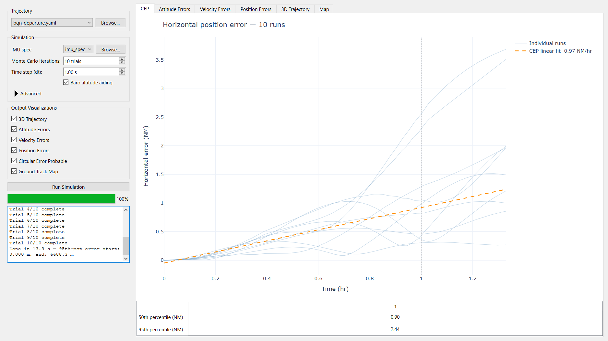

# User guide

This guide explains how to use ins_sim in practice: the desktop app's
controls on this page, then one page per task. If you have not run the app
yet, start with [Your first simulation](../get-started/first-run.md).

| Page | Read it to |
| ---- | ---------- |
| [Reading the results](results.md) | understand every results tab |
| [Writing a mission](missions.md) | fly your own route |
| [Modelling an IMU](imu-specs.md) | simulate your own sensor, from its datasheet |
| [Command-line runs](cli.md) | run simulations without the desktop app |
| [Recipes](recipes.md) | answer common questions: which error dominates, how many trials, which time step |

## The window

The **control panel** on the left holds the settings, from top to bottom:
the mission, the simulation settings, the result tabs to build, and the
**Run Simulation** button with its progress bar and log. The **results
area** on the right shows one tab per result once a run finishes.

## Missions and IMU specs

Every simulation needs two YAML files: a mission, chosen in the
**Trajectory** list, and an IMU spec, chosen in the **IMU spec** list.

The lists show the files in two folders, `trajectories` and `imu_specs`,
that the app creates next to itself the first time it starts:

| How you run the app | Where the folders are |
| ------------------- | --------------------- |
| The downloaded app | In the app's own folder, beside `ins_sim.exe` or `ins_sim` |
| From source (`python -m ins_sim.gui`) | In the folder you start it from |
| Either, when that folder is read-only | In `ins_sim` in your home folder |

Each folder starts with a copy of the packaged file: `bqn_departure.yaml`
and `imu_spec.yaml`. To add your own, save a new `.yaml` file in the
folder. The list picks it up the next time you open it, without a restart.
The app never overwrites your files. To get a packaged file back, delete
or rename your copy and restart the app.

A list only shows files that look right: a mission must have a `phases`
section, and an IMU spec must have `gyro` and `accel` sections. **Browse…**
adds a file from anywhere else, for the current session.

How to write the files is the subject of
[Writing a mission](missions.md) and [Modelling an IMU](imu-specs.md).

## Simulation settings

**Monte Carlo iterations** (1–1,000, default 50) is the number of trials.
Each trial flies the same mission with a fresh draw of every sensor error,
and the results are statistics over the trials. More trials give smoother,
more trustworthy statistics but take proportionally longer:
[Recipes](recipes.md#how-many-trials) suggests how many you need.

**Time step (dt)** (0.01–10 s, default 0.1 s) is the interval at which the
truth is sampled and the navigator updates, \(\tau_i\) on the theory
pages. The run time is proportional to the number of steps. As a guide, on
a desktop PC each trial of the packaged 80-minute mission takes:

| Time step | One trial | 10 trials | 50 trials |
| --------- | --------- | --------- | --------- |
| 1.0 s | about 1 s | about 15 s | about 1 min |
| 0.1 s | about 13 s | about 2 min | about 11 min |

A 1 s step is fine for a quick look at how the errors grow. Use 0.1 s for
final numbers.

**Baro altitude aiding** (checked by default) feeds a barometric
altimeter's height into the navigator's height channel. The altimeter errs
as the IMU spec's `baro` block says, or reports the true height if the spec
has none (see [Modelling an IMU](imu-specs.md#the-baro-block)). Without
aiding the height error grows exponentially: try it in
[Your first simulation](../get-started/first-run.md#7-switch-off-the-barometer).
The [Vertical channel](../theory/vertical-channel.md) page explains why.

**Advanced** (collapsed by default; click it to open) holds two settings
that change how the navigation algorithm itself is tested. Leave them
alone to study sensor errors.

- **Truth oversampling** (Off, or 2–100 per step). Off, the perfect IMU's
  outputs are built to match the navigator's basic update exactly, so the
  only errors are the sensors'. Set to N, the mission is built N times per
  time step and the IMU reports averages over each step, as a real
  integrating IMU does. The navigator's own error then shows too. Larger N
  is more faithful but slower to build: N = 10 at a 0.1 s step adds about
  8 s to the run.
- **Mechanization**: *Basic* or *Precision*. The precision update corrects
  for the vehicle turning within each step (coning, sculling and rotation
  corrections) and takes about 1.4 times as long. It belongs with truth
  oversampling; without it the log prints a note, because the precision
  corrections then add an error of their own.

With perfect sensors, on the packaged mission at 0.1 s with oversampling at
10, the basic update alone puts the track up to 1.7 km off, and the
precision update about 3 m. The
[Strapdown mechanization](../theory/mechanization.md#precision-mechanization)
page explains the difference.

**Output Visualizations** selects the result tabs to build. Each tab takes
a moment to build when the run finishes, so unchecking the ones you do not
need saves a little time.

## Running

**Run Simulation** starts the run in the background, so the window stays
responsive. The controls are disabled until it finishes. The log reports
the mission's length and duration, each completed trial, and the run
time with the final 95th-percentile error. If a file has a mistake, a
*Simulation failed* message names the problem; see
[Writing a mission](missions.md#when-a-mission-fails-to-load) for the
common ones.

Every run uses the same random seed, 42, so the same files and settings
always give the same results. On the same mission and time step, changing
the IMU spec changes the results only through that change: see
[Recipes](recipes.md#compare-two-imus-fairly).

## Offline use

The app needs no network connection, except for the background tiles of
the **Map** tab, which come from OpenStreetMap. Without a connection the
map still shows the tracks and the error band, on a blank background.
