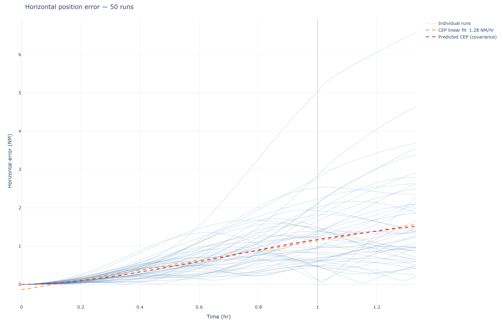
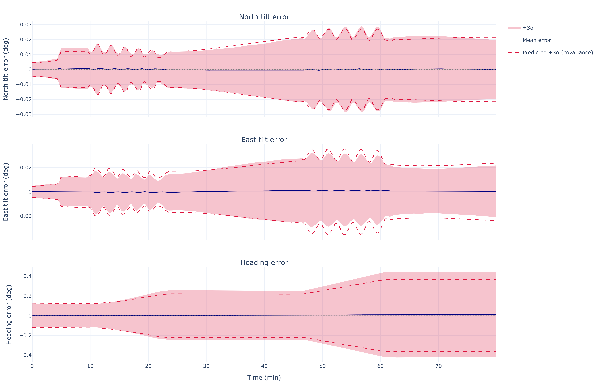
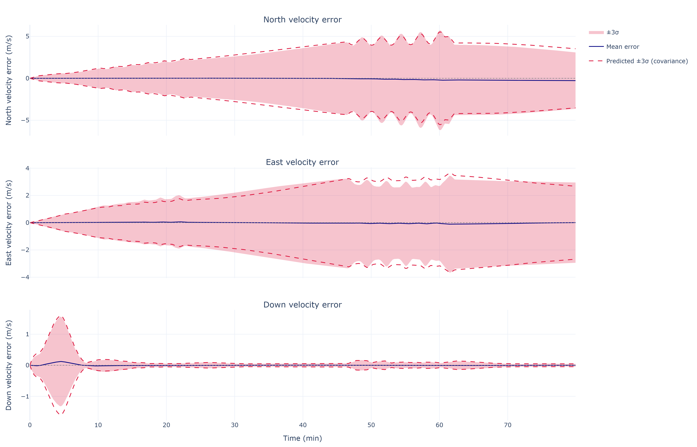
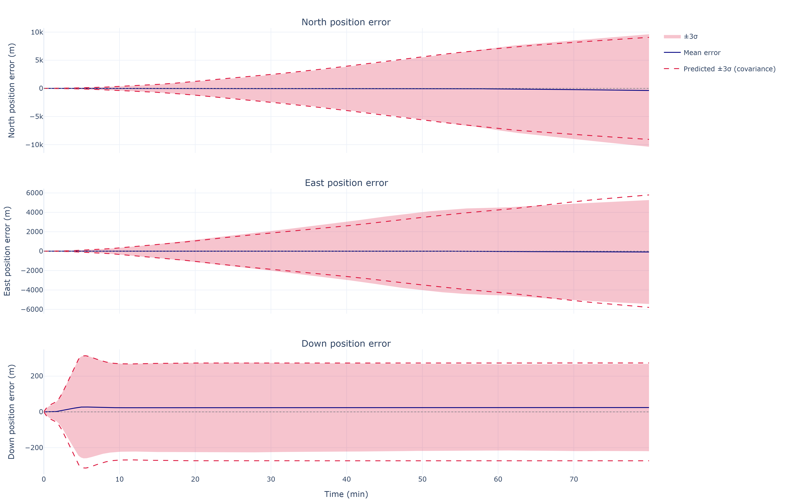
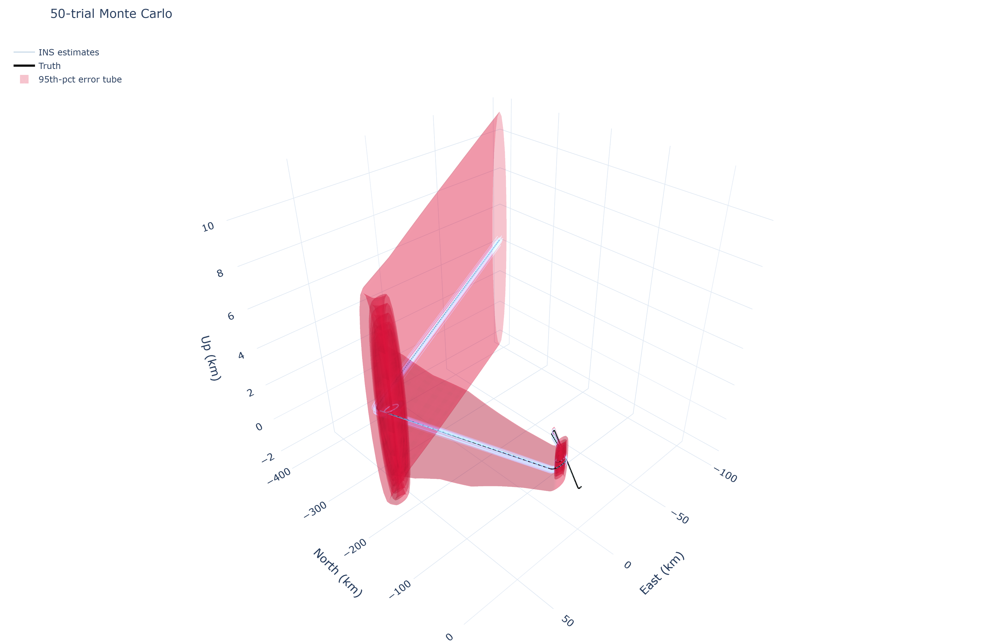
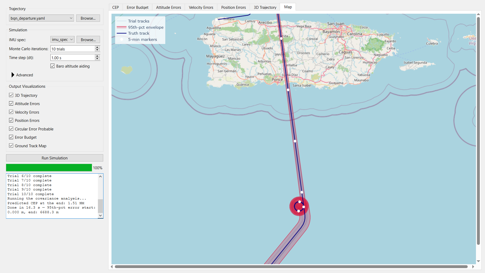
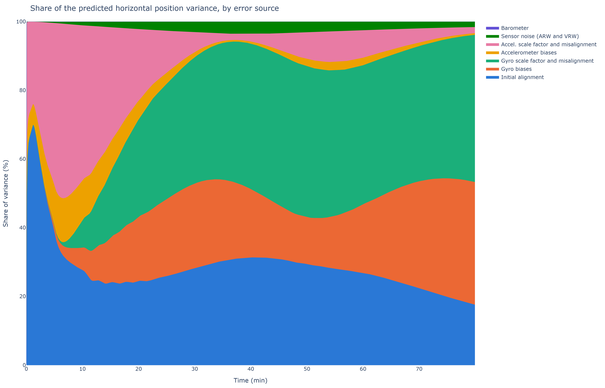

# Reading the results

After a run, the app shows one tab per result. Each tab summarizes all the
trials: how far the navigator's estimates drifted from the truth, and how
much that drift varies from one set of sensor errors to another. The
figures on this page come from the packaged mission and IMU spec at the
app's default settings: 50 trials at a 0.1 s time step.

## What every tab has in common

- **An error is the estimate minus the truth.** A positive North position
  error means the navigator thinks it is north of where it really is.
- **Errors are measured along North, East and Down at the true
  position.** Position errors are in metres; the latitude, longitude and
  height errors are converted to distances along those three directions.
- **Bands are ±3σ.** Where a tab shows a band, it is centred on the
  average error over the trials and extends three standard deviations each
  side of it. For normally distributed errors it holds 99.7% of the
  trials.
- **Percentiles count trials.** The CEP is the 50th percentile of the
  horizontal error: half the trials are within it. The tube and the map
  band use the 95th percentile.
- **Dashed crimson lines are predictions.** After the trials, the app runs
  a [covariance analysis](../theory/covariance.md), which predicts the
  spread of the errors without random trials. The CEP, attitude, velocity
  and position tabs draw it as dashed lines: the predicted CEP, and ±3σ
  about zero. Where the trials' band and the dashed lines part, the
  trials are too few, or the errors too large for the prediction's
  linear model.

The [Monte Carlo evaluation](../theory/monte-carlo.md) page gives the exact
definitions.

### Working with the plots

Every tab is an interactive plot. Hover to read values. Drag a box or
scroll to zoom, and double-click to zoom back out. Click a legend entry to
hide or show it. In the 3D view, drag to rotate. The camera icon at the top
right saves the plot as a PNG image.

Axis labels use SI prefixes: **k** for thousands and **M** for millions,
so 10k m is 10 km.

## CEP

Each faint line is one trial's horizontal position error, in nautical
miles (NM), against time in hours.

- The dashed line is a straight-line fit to the CEP over the first hour,
  marked by the dotted line. Its slope, 1.28 nmi/h here, is the usual
  figure of merit of an INS. The line starts slightly below zero because
  the errors grow slowly at first.
- The dashed crimson line is the CEP the covariance analysis predicts.
- Under the plot, a table gives the 50th percentile (the CEP), the 95th
  percentile of the horizontal error and the predicted CEP at each whole
  hour of flight. Flights shorter than an hour have no table.

The trials fan out because each one has different sensor errors. One
unlucky trial here ends 6.6 nmi off while others end within 0.5 nmi, which
is why the CEP and the 95th percentile, not a single run, describe the
navigator.

## Attitude Errors

The attitude error is the small rotation that would turn the true attitude
into the estimated one, split into three angles: the **North tilt** and
**East tilt**, about the horizontal axes, and the **heading error**, about
the vertical. Unlike differences of roll, pitch and heading, these three
angles mean the same thing whatever the aircraft's attitude. The
[Frames & attitude](../theory/frames-attitude.md) page defines them.

- The tilts stay below about 0.03° (3σ). Each wobble in the bands comes
  from a turn of the holding patterns, at about 10–22 and 47–61 minutes.
- The heading error starts at the alignment spread, 0.12° (3σ), and grows
  in steps during the holding patterns, where the gyros' axis
  misalignments act on the turn rate. It barely changes on the straight
  legs. The [INS error model](../theory/error-model.md#heading-error)
  explains how heading error turns into position error.

## Velocity Errors

The North and East velocity errors grow to a few metres per second, but
not steadily. An INS's velocity errors oscillate with an 84-minute period,
the Schuler period, so the bands swell and shrink: on this flight the North
band peaks at about an hour and then narrows. The
[INS error model](../theory/error-model.md#the-schuler-loop) page explains
the oscillation.

The Down velocity error reaches about ±1.5 m/s during the climb, while the
navigator follows the barometer's height error as it grows, and then stays
within about 0.2 m/s, held by the barometric loop.

## Position Errors

The position errors are the integral of the velocity errors. By the end of
the 80-minute flight the bands reach about ±10 km North and ±5 km East.
The Down band grows to about ±250 m during the climb and then stays there.
That is the barometer's error, which the navigator's height follows: mostly
its temperature scale factor, which grows with the height above the
departure point (see [Modelling an IMU](imu-specs.md#the-baro-block)).
Without baro aiding the Down error grows exponentially instead; see
[Your first simulation](../get-started/first-run.md#7-switch-off-the-barometer).

The average error, the dark line, stays near zero in all three panels,
because every sensor error is as likely to be positive as negative. What
matters for one flight is the spread.

## 3D Trajectory

The truth track (black), every trial's estimated track (faint blue), and a
red tube around the truth whose radius is the 95th percentile of the 3D
position error. Distances are in kilometres from the starting point, East,
North and Up.

The axes are not to the same scale: the plot stretches the 4.5 km of
climb to the same size as the 450 km the track spans from north to south.
The tube, a circle around the track at every point, therefore looks like a
tall, flat fin. Drag to rotate the view, or scroll to zoom into the climb.

## Map

The ground track over OpenStreetMap: the true track (dark blue), each
trial's estimated track (faint blue), and a red band whose half-width is
the 95th percentile of the horizontal error. White dots mark every five
minutes. Hover over the track to read the time and the 95th-percentile
error at that point.

The background tiles need an internet connection; without one the tracks
and the band appear on a blank background.

## Error Budget

Which error source limits the navigator? The covariance analysis predicts
the error of each source on its own, and since its model is linear, their
variances add up to the total. The plot stacks each source's share of the
predicted horizontal position variance over the flight; the shares always
fill 100%. Hover to read them at any time.

The table under the plot lists, at each whole hour of flight (or at the
end, for a shorter flight), each source's predicted CEP on its own and its
share of the variance, then the predicted CEP of all sources together. The
CEPs of single sources do not add up to the total; their variances do.

On the packaged mission the initial alignment errors dominate the first
few minutes, and the accelerometer scale factors and misalignments the
climb-out. From about 15 minutes the gyro scale factors and
misalignments, fed by every turn, take the largest share, and by the end
the gyro biases have caught up with them. After the first half hour a
better accelerometer would barely change the result; better gyros would.
[Recipes](recipes.md#find-the-dominant-error-source) shows how to act on a
budget.

## How many trials?

The statistics are estimates from a finite number of trials. With 50
trials a standard deviation, and so a ±3σ band, is uncertain by about 10%,
and the 95th percentile rests on the two or three worst trials.
[Recipes](recipes.md#how-many-trials) gives a rule of thumb, and the
[Monte Carlo evaluation](../theory/monte-carlo.md#sampling-uncertainty)
page the details.
