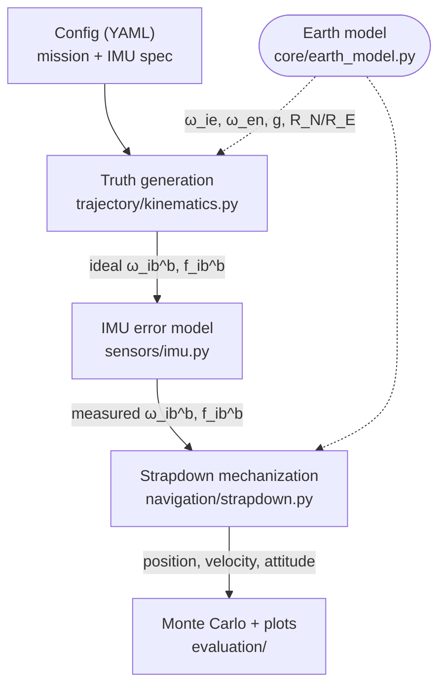

# Inertial Navigation Simulation & GUI

`ins_sim` is an open-source **6-DOF, WGS-84 strapdown INS Monte Carlo
simulator** with a desktop GUI. It generates a truth flight trajectory,
derives the gyro and accelerometer outputs a perfect IMU would produce along
it, corrupts them with the errors of a real IMU, and runs a strapdown
mechanization to recover position, velocity, and attitude. A Monte Carlo
ensemble over independent draws of the sensor errors shows how navigation
error grows over time for a given IMU.

[Download the app](download.md){ .md-button .md-button--primary }
[View on GitHub](https://github.com/jorgieo/ins_sim){ .md-button }

## Pick your path

-   **Run the app**

    ---

    Run the packaged mission in ten minutes, then fly your own missions
    with your own IMU.

    [Your first simulation](get-started/first-run.md) ·
    [User guide](guide/index.md)

-   **Learn inertial navigation**

    ---

    How an INS works and why its errors grow, step by step in the notation
    of Groves (2013), next to the code that computes it.

    [Theory & Math](theory/index.md) ·
    [Validation](validation/index.md)

-   **Script it in Python**

    ---

    Run simulations from your own scripts: compare IMUs, budget the errors,
    or fly a trajectory of your own.

    [Your first script](get-started/first-script.md) ·
    [Python API](reference/api/index.md)

-   **Upgrading from 0.2?**

    ---

    Version 0.3 renames the Python API, and its results differ from 0.2.

    [Migrating from 0.2](project/migrating-from-0.2.md) ·
    [Changelog](project/changelog.md)

## Core features

- **Truth trajectories from YAML missions**: take-off, climbs and
  descents, waypoint legs, holding patterns and speed changes, written in
  aviation units and converted to SI.
- **An IMU error model from the datasheet**: angle and velocity random
  walk, turn-on and in-run biases with the bias instability entered as
  the datasheet gives it, scale-factor and misalignment errors, and
  initial alignment errors.
- **Rotating-Earth strapdown mechanization**: Earth rate, transport rate,
  WGS-84 radii of curvature and normal gravity, evaluated at the current
  position every step, not a flat-Earth approximation. An optional
  precision update, with coning and sculling corrections, can be tested
  against the outputs of an integrating IMU.
- **Vertical channel physics**: a third-order baro-damped loop by default,
  aided by a barometer with its own errors (temperature, altimeter setting,
  weather, noise), or free-inertial to watch the channel's instability.
- **Monte Carlo evaluation**: independent error draws for every trial,
  errors measured as the textbook defines them, and CEP, ±3σ and
  percentile statistics.
- **Covariance analysis and error budget**: the same statistics predicted
  in one pass by a 43-state linearized error model, and each error
  source's share of them.
- **Interactive visualizations**: every tab is a plotly page rendered in
  the app: CEP growth with an hourly table, attitude, velocity and
  position errors with ±3σ bands, a 3D trajectory with its 95th-percentile
  error tube, and a ground-track map.
- **Checked against the textbook**: the Schuler oscillation, the bias
  responses, the vertical channel and the noise statistics all match their
  analytic predictions on the [Validation](validation/index.md) page.

## Architecture

Data flows from truth generation, through the IMU error model, into the
strapdown navigator, and is summarized by the Monte Carlo evaluation:

## Conventions in brief

- **Notation**: the symbols of Groves (2013), in these pages and in the
  Python names. `v_eb_n` is \(\vvec{eb}{n}\), the velocity of the body (b)
  relative to the Earth (e), resolved along North-East-Down axes (n).
  [Notation & conventions](theory/notation.md) defines every symbol.
- **Frames**: the North-East-Down navigation frame (n) at the current
  position, and the body frame (b): x forward, y right, z down.
- **Attitude**: the body-to-NED transformation \(\Cmat{b}{n}\), held as a
  `scipy.spatial.transform.Rotation`. Quaternions are scalar-last,
  `[x, y, z, w]`.
- **Radii of curvature**: \(R_N\) is the meridian radius and \(R_E\) the
  transverse one. Many texts use \(R_N\) for the transverse radius.
- **Errors**: always the estimate minus the truth.
- **Units**: SI inside the simulator. The YAML files and the app use
  datasheet and aviation units (degrees, feet, knots, °/h, µg), converted
  when read; see [Units & constants](reference/units-constants.md).
