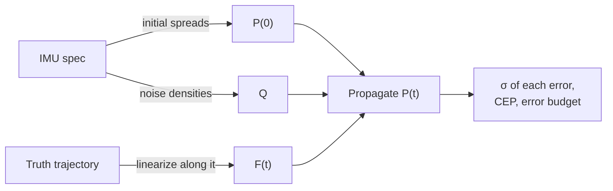
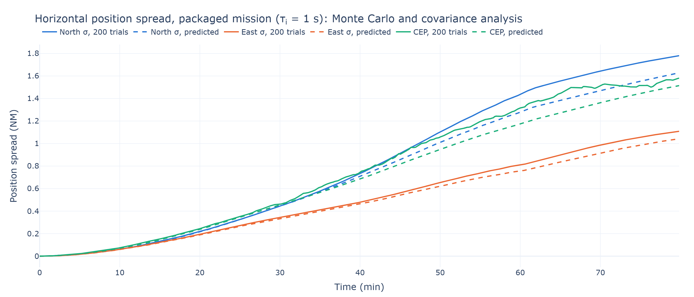
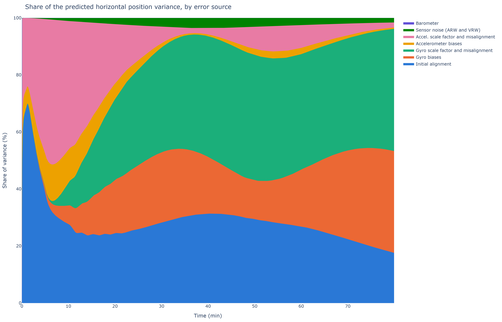

# Covariance analysis

A [Monte Carlo evaluation](monte-carlo.md) measures the spread of the
navigation errors by flying the mission many times with random sensor
errors. A covariance analysis predicts the same spread in a single pass. It
propagates the covariance of the errors, the matrix of their variances and
correlations, through the navigator's error equations linearized along the
truth trajectory. When the errors stay small, the two agree. The prediction
then costs about as much as one Monte Carlo trial, has no sampling noise,
and splits the total into each error source's share, because a linear
model's variances add. In the app, the prediction is the dashed lines on
the error tabs and the **Error Budget** tab.

!!! abstract "Key results"
    - The error state has 43 components, one for each error the
      simulator draws: navigation errors, the barometer loop's integrator,
      biases, scale factors and misalignments, and the barometer's errors.
    - The system matrix \(\mathbf{F}\) is the exact first-order expansion
      of the navigator's equations along the truth. Fed one trial's
      constant errors, the linear model follows the navigator to within 1%.
    - On the packaged mission, the spread of 200 Monte Carlo trials lies
      within the 95% sampling band of the prediction, 34 times out of 36 (see
      [Validation](../validation/index.md#covariance-checks)).
    - The error budget gives each source's share of the variance; the
      shares add up to the total exactly.

## Physical picture



The [INS error model](error-model.md) page derives how each error source
grows, one source at a time on a stationary IMU. A covariance analysis
keeps every source and every coupling at once, along the real flight: the
turns that swing a heading error into the horizontal channels, the climbs
that excite the scale factors, the barometer loop that holds the height.
It does so for the whole distribution of errors at once, rather than for
one draw of them.

## Continuous-time model

### Error state

| States | Symbols | Count | Unit |
| ------ | ------- | ----- | ---- |
| Attitude error | \(\delta\psivec{nb}{n}\) | 3 | rad |
| Velocity error | \(\delta\vvec{eb}{n}\) | 3 | m/s |
| Position error | \(\delta L_b\), \(\delta\lambda_b\), \(\delta h_b\) | 3 | rad, rad, m |
| Barometer loop integrator | \(\delta a_c\) | 1 | m/s² |
| Accelerometer biases, static and Gauss–Markov | \(\mathbf{b}_{as}\), \(\mathbf{b}_{ad}\) | 6 | m/s² |
| Gyro biases, static and Gauss–Markov | \(\mathbf{b}_{gs}\), \(\mathbf{b}_{gd}\) | 6 | rad/s |
| Scale factor and misalignment | \(\mathbf{M}_a\), \(\mathbf{M}_g\), row by row | 18 | – |
| Barometer errors | \(s_b\), \(b_{bs}\), \(b_{bd}\) | 3 | –, m, m |

The errors are those of [Notation & conventions](notation.md#errors):
estimate minus truth. Position is kept as latitude, longitude and height,
whose equations are simplest, and converted to metres North, East and Down
at the end.

### Navigation errors

Subtracting the true navigation equations from the navigator's, and
keeping the first-order terms, gives

$$
\delta\psivec[\dot]{nb}{n} = -\wvec{in}{n}\times\delta\psivec{nb}{n}
- \delta\wvec{in}{n} + \Cmat{b}{n}\,\delta\wvec{ib}{b}
$$

$$
\delta\vvec[\dot]{eb}{n} = -\left(\Cmat{b}{n}\fvec{ib}{b}\right)\times\delta\psivec{nb}{n}
+ \Cmat{b}{n}\,\delta\fvec{ib}{b}
- \left(2\wvec{ie}{n} + \wvec{en}{n}\right)\times\delta\vvec{eb}{n}
+ \vvec{eb}{n}\times\left(2\,\delta\wvec{ie}{n} + \delta\wvec{en}{n}\right)
+ \delta g\,\mathbf{u}_D
$$

$$
\delta\dot L_b = \delta\!\left(\frac{v_N}{R_N + h_b}\right),\qquad
\delta\dot\lambda_b = \delta\!\left(\frac{v_E}{(R_E + h_b)\cos L_b}\right),\qquad
\delta\dot h_b = -\delta v_D
$$

where:

- \(\delta\wvec{ib}{b}\) and \(\delta\fvec{ib}{b}\) are the gyro and
  accelerometer errors, below [rad/s, m/s²];
- \(\delta\wvec{ie}{n} = \partial\wvec{ie}{n}/\partial L_b\;\delta L_b\) and
  \(\delta\wvec{en}{n}\) are the errors in the computed Earth and transport
  rates, which follow from the velocity, latitude and height errors through
  \(\wvec{en}{n} = \left(\tfrac{v_E}{R_E + h_b},\ -\tfrac{v_N}{R_N + h_b},\
  -\tfrac{v_E\tan L_b}{R_E + h_b}\right)\) [rad/s];
- \(\delta\wvec{in}{n} = \delta\wvec{ie}{n} + \delta\wvec{en}{n}\) [rad/s];
- \(\delta g\) is the error in the computed gravity, from the latitude and
  height errors, and \(\mathbf{u}_D\) the Down unit vector [m/s²];
- the position equations are expanded to first order in \(\delta v_N\),
  \(\delta v_E\), \(\delta L_b\) and \(\delta h_b\), including the change of
  \(R_N\) and \(R_E\) with latitude [rad/s, m/s].

Every coefficient is evaluated on the truth trajectory, so \(\mathbf{F}\)
changes along the flight. The simplified equations of the
[INS error model](error-model.md#linearized-error-equations) page are these
with the transport-rate and vertical terms dropped.

### Sensor and barometer errors

$$
\delta\wvec{ib}{b} = \mathbf{b}_{gs} + \mathbf{b}_{gd} + \mathbf{M}_g\wvec{ib}{b} + \mathbf{w}_g,
\qquad
\delta\fvec{ib}{b} = \mathbf{b}_{as} + \mathbf{b}_{ad} + \mathbf{M}_a\fvec{ib}{b} + \mathbf{w}_a
$$

$$
\dot{\mathbf{b}}_{gd} = -\frac{\mathbf{b}_{gd}}{\tau_g} + \mathbf{w}_{gd},
\qquad
\dot{\mathbf{b}}_{ad} = -\frac{\mathbf{b}_{ad}}{\tau_a} + \mathbf{w}_{ad},
\qquad
\dot b_{bd} = -\frac{b_{bd}}{\tau_b} + w_{bd}
$$

The static biases, scale factors, misalignments, \(s_b\) and \(b_{bs}\) are
constant. With baro aiding the height residual

$$
\rho = \delta h_b - s_b\,(h_b - h_{b0}) - b_{bs} - b_{bd} - w_b
$$

drives the [damping loop](vertical-channel.md):
\(\delta\dot h_b \mathrel{-}= K_1\rho\),
\(\delta\dot v_D \mathrel{+}= K_2\rho + \delta a_c\) and
\(\delta\dot a_c = K_3\rho\).

where:

- \(\mathbf{w}_g\), \(\mathbf{w}_a\) and \(w_b\) are white noises of
  density ARW, VRW and the barometer's noise density;
- \(\tau_g\), \(\tau_a\) and \(\tau_b\) are the Gauss–Markov correlation
  times, and \(\mathbf{w}_{gd}\), \(\mathbf{w}_{ad}\), \(w_{bd}\) their
  driving noises, of density \(2\sigma^2/\tau\) for a steady-state spread
  \(\sigma\);
- \(K_1 = 3/\tau\), \(K_2 = 3/\tau^2\), \(K_3 = 1/\tau^3\) are the loop gains,
  \(\tau\) = 100 s.

### Covariance

With \(\mathbf{x}\) the 43-component state, these equations are
\(\dot{\mathbf{x}} = \mathbf{F}(t)\,\mathbf{x} + \mathbf{w}\), and the
covariance \(\mathbf{P} = \mathrm{E}[\mathbf{x}\mathbf{x}^{\mathsf T}]\)
obeys

$$
\dot{\mathbf{P}} = \mathbf{F}\mathbf{P} + \mathbf{P}\mathbf{F}^{\mathsf T} + \mathbf{Q}
$$

where:

- \(\mathbf{P}(0)\) holds the spreads the Monte Carlo draws from: the
  alignment errors, the turn-on biases, scale factors and misalignments,
  the barometer's scale factor and bias, and the Gauss–Markov biases at
  their steady-state spreads [state units²];
- \(\mathbf{Q}\) holds the white-noise densities: ARW² on the attitude
  errors and VRW² on the velocity errors (the same in every axis, so the
  rotation \(\Cmat{b}{n}\) leaves them unchanged), \(2\sigma^2/\tau\) on the
  Gauss–Markov biases, and the barometer noise through the loop gains
  [state units²/s].

## Discrete-time, as implemented

**1. System matrix** at every propagation step along the truth, here its
attitude and velocity rows:

=== "Equation"

    $$
    \mathbf{F}_{\psi\psi} = -\skew{\wvec{in}{n}},\quad
    \mathbf{F}_{\psi b} = \Cmat{b}{n},\quad
    \mathbf{F}_{v\psi} = -\skew{\Cmat{b}{n}\fvec{ib}{b}},\quad
    \mathbf{F}_{vb} = \Cmat{b}{n}
    $$

=== "Code"

    ```python
    --8<-- "ins_sim/evaluation/covariance.py:attitude_error_dynamics"
    --8<-- "ins_sim/evaluation/covariance.py:velocity_error_dynamics"
    ```

**2. Propagation** over a step \(\Delta\), 1 s by default, with
\(\bar{\mathbf{F}}\) the mean of \(\mathbf{F}\) at the two ends:

=== "Equation"

    $$
    \boldsymbol{\Phi} = \exp\!\left(\bar{\mathbf{F}}\Delta\right),\qquad
    \mathbf{P}(+) = \boldsymbol{\Phi}\,\mathbf{P}(-)\,\boldsymbol{\Phi}^{\mathsf T}
    + \tfrac12\left(\boldsymbol{\Phi}\mathbf{Q}\boldsymbol{\Phi}^{\mathsf T} + \mathbf{Q}\right)\Delta
    $$

=== "Code"

    ```python
    --8<-- "ins_sim/evaluation/covariance.py:propagation"
    ```

The trapezoidal noise term is accurate while \(\Delta\) is short against
the model's time constants. A step longer than a tenth of the shortest of
them (a Gauss–Markov correlation time, or the baro loop's 100 s) is
therefore split into equal substeps; that keeps a Gauss–Markov bias's
variance within 0.4% of its true value. The prediction times are every
\(\Delta\) from the start, plus the end of the flight, so the last step
may be shorter.

**3. Outputs.** The position variances are converted to metres with
\(R_N + h_b\) and \((R_E + h_b)\cos L_b\), as for the
[Monte Carlo errors](monte-carlo.md#errors). The CEP is the exact median
radius of the two-dimensional Gaussian with the North–East covariance,
found from its principal axes, rather than the 0.59·(σ_N + σ_E)
approximation.

**4. Error budget.** The error sources are independent, so
\(\mathbf{P}(0)\) and \(\mathbf{Q}\) are sums of one term per source, and
since the propagation is linear in them, so is \(\mathbf{P}(t)\). Each
source is propagated on its own, and the total is their sum.

!!! note "Compared with Groves (2013)"
    This is the NED form of Groves' INS error-state system model[^groves],
    the model a GNSS/INS Kalman filter propagates between measurements,
    with the simulator's own error sources as states. It keeps two terms
    Groves' model drops as small: the change of the radii of curvature
    with latitude, and of gravity with latitude. They make
    \(\mathbf{F}\) the exact linearization of ins_sim's navigator.

## What it looks like



The packaged mission, flown 200 times at \(\tau_i\) = 1 s, against the
prediction. The Monte Carlo spreads differ from the prediction by a few
percent, as 200 trials should; the
[Validation](../validation/index.md#covariance-checks) page checks all
nine errors.



The packaged mission's error budget. The initial alignment errors
dominate the first few minutes, and the accelerometer scale factors and
misalignments the climb-out. From about 15 minutes the gyro scale factors
and misalignments, fed by every turn, take the largest share, and the gyro
biases, whose error keeps growing, catch up with them by the end.

## Assumptions & limitations

!!! warning "Assumptions & limitations"
    - **Small errors.** The model is linear, which suits a
      navigation-grade INS over hours. Large errors, such as a heading
      error of several degrees, make the Monte Carlo spread differ from the
      prediction.
    - **Gaussian statistics.** The predicted CEP assumes Gaussian errors;
      with a linear model and Gaussian sources that holds exactly. The
      Monte Carlo makes no such assumption.
    - **Continuous time.** The model integrates the error equations
      exactly; the navigator integrates its own equations in steps of
      \(\tau_i\). At \(\tau_i\) = 1 s on the packaged mission the two
      differ by a few percent in the turns, and at 0.1 s by under 0.5%.
    - **Sensor errors only.** The navigator's own integration error, which
      the precision mechanization reduces, is not in the model. With the
      default truth it is zero, and with an oversampled truth it is
      usually far below the sensor errors.
    - **The mean is zero.** The prediction is a spread about zero error.
      The Monte Carlo's mean error is zero too, up to its sampling noise.

## In the code

| Quantity | Equation | Implemented in |
| -------- | -------- | -------------- |
| System matrix | \(\mathbf{F}(t)\) | [`error_dynamics`][ins_sim.evaluation.covariance.error_dynamics] |
| Propagation, by source | \(\mathbf{P}(t)\) | [`error_budget`][ins_sim.evaluation.covariance.error_budget], [`ErrorBudget`][ins_sim.evaluation.covariance.ErrorBudget] |
| Total prediction | σ of each error | [`covariance_analysis`][ins_sim.evaluation.covariance.covariance_analysis], [`CovarianceResult`][ins_sim.evaluation.covariance.CovarianceResult] |
| CEP | median radius | [`gaussian_cep`][ins_sim.evaluation.covariance.gaussian_cep] |
| Dashed lines and Error Budget tab | – | `figure_error_budget` and `_bands_figure` in `ins_sim/gui/figures.py` |

This example prints the error budget of the half-hour training flight of
[Writing a mission](../guide/missions.md), and the CEP of 50 Monte Carlo
trials of the same flight for comparison:

=== "Script"

    ```python
    --8<-- "docs/examples/error_budget.py"
    ```

=== "Output"

    ```text
    --8<-- "docs/examples/error_budget.txt"
    ```

## References

[^groves]: [Groves (2013)](../reference/bibliography.md#groves2013), Chapter 14
    for the INS error-state system model, and Chapter 3 for the propagation
    of the error covariance.
