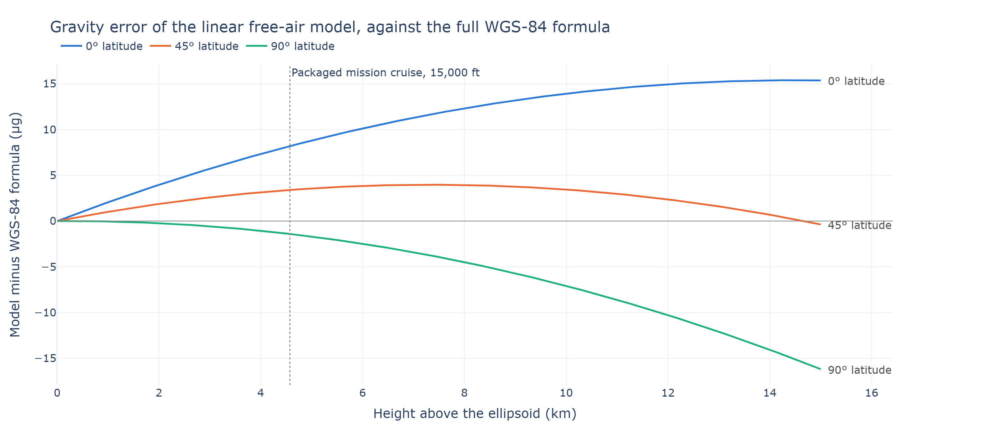

# Earth & gravity

The navigator works on a rotating, slightly flattened Earth. Three of the
Earth's properties enter the navigation equations:

- its **shape**, which sets how many metres a change in latitude or
  longitude is;
- its **rotation**, which the gyros sense and the navigator must remove;
- its **gravity**, which accelerometers cannot sense, so the navigator must
  add it back.

ins_sim takes all three from the WGS-84 model. Gravity matters most: to the
navigator, an error in the gravity model looks exactly like an accelerometer
bias.

!!! abstract "Key results"
    - Position is curvilinear: latitude \(L_b\), longitude \(\lambda_b\) and
      height \(h_b\). Two radii of curvature turn their rates into metres:
      the meridian radius \(R_N\) for north-south motion and the transverse
      radius \(R_E\) for east-west motion.
    - Earth rate (15.04 °/h) and the transport rate of an aircraft
      (8 °/h at 250 m/s) are of the same size, and the navigator accounts
      for both every step.
    - Gravity is Somigliana normal gravity with a linear height correction.
      Below 10 km it is within 14 µg of the full WGS-84 formula.
    - Gravity weakens by about 314 µg for every kilometre of height. That
      gradient is what makes the [vertical channel](vertical-channel.md)
      unstable.

## Physical picture

<figure class="ins-figure">
--8<-- "includes/diagrams/ellipsoid.svg"
<figcaption>A meridian section of the ellipsoid, with the flattening exaggerated. The geodetic latitude L<sub>b</sub> is the angle between the equatorial plane and the normal to the ellipsoid, and the height h<sub>b</sub> is measured along that normal. The normal meets the polar axis a distance R<sub>E</sub> from the surface.</figcaption>
</figure>

The Earth is modelled as an ellipsoid of revolution whose equatorial radius
is 21 km longer than its polar radius. Position on it is **curvilinear**: the
geodetic latitude is the angle the local vertical, the normal to the
ellipsoid, makes with the equatorial plane. That normal misses the Earth's
centre except at the equator and the poles, so geodetic latitude differs
slightly from the angle seen from the centre.

Because the surface is curved differently in different directions, a metre
of northward travel and a metre of eastward travel change latitude and
longitude by different amounts. Two **radii of curvature** capture this:

- the **meridian** radius \(R_N\) is the radius of the circle that best fits
  the north-south meridian at that point;
- the **transverse** radius \(R_E\), at right angles to it, is the distance
  along the normal from the surface to the polar axis, as drawn above.

From the equator to the poles \(R_N\) grows by 1% and \(R_E\) by 0.3%,
until the two are equal at the poles.

## Continuous-time model

### The ellipsoid and the radii of curvature

| Constant | Symbol | Value |
| -------- | ------ | ----- |
| Equatorial radius (semi-major axis) | \(R_0\) | 6,378,137.0 m |
| Flattening | \(f\) | 1 / 298.257223563 |
| Eccentricity squared | \(e^2 = f\,(2 - f)\) | 6.69437999 × 10⁻³ |
| Earth rotation rate | \(\omega_{ie}\) | 7.2921151467 × 10⁻⁵ rad/s |

$$
R_N = \frac{R_0\,(1 - e^2)}{\left(1 - e^2\sin^2 L_b\right)^{3/2}},
\qquad
R_E = \frac{R_0}{\sqrt{1 - e^2\sin^2 L_b}}
$$

where:

- \(R_N\) and \(R_E\) are the meridian and transverse radii of curvature [m];
- \(L_b\) is the geodetic latitude of the body [rad].

The curvilinear position then changes with the velocity
\(\vvec{eb}{n} = (v_N, v_E, v_D)\) as

$$
\dot L_b = \frac{v_N}{R_N + h_b},
\qquad
\dot\lambda_b = \frac{v_E}{(R_E + h_b)\cos L_b},
\qquad
\dot h_b = -v_D
$$

where \(\lambda_b\) is the longitude [rad], \(h_b\) the height above the
ellipsoid [m], and \(v_N\), \(v_E\), \(v_D\) the North, East and Down
velocity [m/s].

### Earth rate

The Earth's rotation, seen from the NED frame, points along the polar axis:
north and up.

$$
\wvec{ie}{n} = \omega_{ie}
\begin{bmatrix} \cos L_b \\ 0 \\ -\sin L_b \end{bmatrix}
$$

where \(\wvec{ie}{n}\) is the angular rate of the Earth frame relative to
inertial space, resolved in NED [rad/s]. At the equator it lies along North;
at the poles it is vertical.

### Transport rate

To stay level and pointing north while the vehicle moves over the curved
Earth, the NED frame has to turn. Its angular rate relative to the Earth is
the **transport rate**:

$$
\wvec{en}{n} =
\begin{bmatrix}
\dfrac{v_E}{R_E + h_b} \\[2ex]
\dfrac{-v_N}{R_N + h_b} \\[2ex]
\dfrac{-v_E\tan L_b}{R_E + h_b}
\end{bmatrix}
$$

where \(\wvec{en}{n}\) is the angular rate of the NED frame relative to the
Earth frame, resolved in NED [rad/s]. Flying north pitches the frame
nose-down about East. Flying east rolls it about North and also turns it
about Down, because the meridians converge towards the poles. An aircraft
flying east at 250 m/s at 45° N turns its NED frame at 8.1 °/h about North
and about Down, nearly as fast as the Earth's rotation turns it (10.6 °/h
about each).

### Gravity

An accelerometer measures **specific force**: its acceleration relative to
inertial space, minus the gravitational acceleration it is falling under. At
rest on the ground it reads 1 g upwards: the push of the ground holding it
up. The navigator recovers acceleration by adding back the
**acceleration due to gravity** \(\gvec{b}{n}\): gravitation combined with
the centrifugal effect of the Earth's rotation, which is what a plumb line
feels. For the WGS-84 ellipsoid this *normal* gravity points along the
normal, so in NED it has a Down component only.

At the surface, the Somigliana formula gives its magnitude:

$$
g_0(L_b) = g_e\,\frac{1 + k\sin^2 L_b}{\sqrt{1 - e^2\sin^2 L_b}}
$$

and ins_sim reduces it with height by the linear free-air correction:

$$
g(L_b, h_b) = g_0(L_b)\left(1 - \frac{2h_b}{R_0}\right),
\qquad
\gvec{b}{n} = \begin{bmatrix} 0 \\ 0 \\ g(L_b, h_b) \end{bmatrix}
$$

where:

- \(g_e = 9.7803253359\) m/s² is normal gravity at the equator;
- \(k = 1.93185265241 \times 10^{-3}\) is the Somigliana constant of WGS-84;
- \(g(L_b, h_b)\) is the magnitude of gravity at the body [m/s²], from
  9.780 m/s² at the equator to 9.832 m/s² at the poles at sea level.

The height correction implies a gravity gradient of

$$
\frac{\partial g}{\partial h_b} \approx -\frac{2g}{R_0}
\approx -3.08 \times 10^{-6}~\text{s}^{-2},
$$

about 314 µg weaker for every kilometre of height. A navigator that thinks
it is too high therefore computes too little gravity, which pushes it higher
still: the instability of the [vertical channel](vertical-channel.md).

## As implemented

**Radii of curvature.**

=== "Equation"

    $$
    R_N = \frac{R_0\,(1 - e^2)}{\left(1 - e^2\sin^2 L_b\right)^{3/2}},
    \qquad
    R_E = \frac{R_0}{\sqrt{1 - e^2\sin^2 L_b}}
    $$

=== "Code"

    ```python
    --8<-- "ins_sim/core/earth_model.py:radii"
    ```

**Earth rate.**

=== "Equation"

    $$
    \wvec{ie}{n} = \omega_{ie}\begin{bmatrix} \cos L_b & 0 & -\sin L_b \end{bmatrix}^{\mathsf T}
    $$

=== "Code"

    ```python
    --8<-- "ins_sim/core/earth_model.py:earth_rate"
    ```

**Transport rate.**

=== "Equation"

    $$
    \wvec{en}{n} =
    \begin{bmatrix}
    \dfrac{v_E}{R_E + h_b} & \dfrac{-v_N}{R_N + h_b} & \dfrac{-v_E\tan L_b}{R_E + h_b}
    \end{bmatrix}^{\mathsf T}
    $$

=== "Code"

    ```python
    --8<-- "ins_sim/core/earth_model.py:transport_rate"
    ```

**Gravity.**

=== "Equation"

    $$
    g(L_b, h_b) = g_e\,\frac{1 + k\sin^2 L_b}{\sqrt{1 - e^2\sin^2 L_b}}
    \left(1 - \frac{2h_b}{R_0}\right)
    $$

=== "Code"

    ```python
    --8<-- "ins_sim/core/earth_model.py:gravity"
    ```

!!! note "Compared with Groves (2013)"
    The radii of curvature, Earth rate, transport rate and the Somigliana
    surface gravity are the same as in Groves[^groves]. Groves' NED gravity
    model keeps the full height dependence, including terms in the
    flattening and the Earth's rotation, and a small North component that
    grows with height, under 1 µg per kilometre. ins_sim keeps only the
    linear height term, and the Down component.

## What it looks like



The difference between ins_sim's gravity and the full WGS-84 normal-gravity
formula, which adds the flattening and rotation terms and a
second-order height term. At 10 km it ranges from +14 µg at the equator
to −7 µg at the poles. At the packaged mission's cruise height, 15,000 ft
at 18.5° N, it is about +7 µg: comparable to the bias of a
navigation-grade accelerometer. The truth generator and the navigator use
the same model, though, so the approximation has no effect on the simulated
navigation errors. It would matter only when comparing against real data or
another simulator.

Two checks on the [Validation](../validation/index.md) page depend on this
model: the [Schuler period](../validation/index.md#schuler-oscillation),
set by \(g\) and \(R_E\), and the
[vertical-channel time constant](../validation/index.md#vertical-channel),
set by the gravity gradient.

## Assumptions & limitations

!!! warning "Assumptions & limitations"
    - **Normal gravity only.** Real gravity departs from the ellipsoid's
      normal gravity: typically by tens of µg in magnitude, and by a few
      arcseconds in direction (the deflection of the vertical), more over
      mountains. A real INS that uses a normal-gravity model sees these
      departures as accelerometer-bias errors. ins_sim's truth uses the
      same model as its navigator, so they never appear.
    - **Linear height correction**, as in the figure above, and no North
      component of gravity.
    - **No geoid.** Heights are above the ellipsoid; mission altitudes
      given above mean sea level are used as ellipsoidal height (see
      [Notation & conventions](notation.md#position-earth-shape-and-gravity)).
    - **Not over the poles.** The transport rate contains \(\tan L_b\), and
      the NED frame is undefined at the poles. Navigators that cross them use
      other frames, such as wander-azimuth axes, which ins_sim does not
      implement.
    - The Earth rotation rate is the value of the GPS interface
      specification, 7.2921151467 × 10⁻⁵ rad/s. The WGS-84 standard rounds it
      to 7.292115 × 10⁻⁵ rad/s; the difference is negligible.

## In the code

| Quantity | Equation | Implemented in |
| -------- | -------- | -------------- |
| Ellipsoid constants | \(R_0\), \(f\), \(e^2\), \(\omega_{ie}\) | [`WGS84_A`][ins_sim.core.earth_model.WGS84_A], [`WGS84_F`][ins_sim.core.earth_model.WGS84_F], [`WGS84_E2`][ins_sim.core.earth_model.WGS84_E2], [`WGS84_OMEGA`][ins_sim.core.earth_model.WGS84_OMEGA] |
| Radii of curvature | \(R_N\), \(R_E\) | [`wgs84_radii`][ins_sim.core.earth_model.wgs84_radii] |
| Earth rate | \(\wvec{ie}{n}\) | [`earth_rate_n`][ins_sim.core.earth_model.earth_rate_n] |
| Transport rate | \(\wvec{en}{n}\) | [`transport_rate_n`][ins_sim.core.earth_model.transport_rate_n] |
| Gravity | \(g(L_b, h_b)\) | [`normal_gravity`][ins_sim.core.earth_model.normal_gravity] |
| Curvilinear position rates | \(\dot L_b\), \(\dot\lambda_b\), \(\dot h_b\) | [`strapdown_navgrade`][ins_sim.navigation.strapdown.strapdown_navgrade] and [`TruthTrajectory`][ins_sim.trajectory.kinematics.TruthTrajectory], integrated each step |

This example tabulates the radii and surface gravity from the equator to the
pole, the gravity gradient, and the Earth and transport rates of an aircraft
at 45° N:

=== "Script"

    ```python
    --8<-- "docs/examples/earth_gravity.py"
    ```

=== "Output"

    ```text
    --8<-- "docs/examples/earth_gravity.txt"
    ```

## References

[^groves]: [Groves (2013)](../reference/bibliography.md#groves2013), Chapter 2,
    for the ellipsoid, curvilinear position, Earth rotation and gravity
    models. The WGS-84 constants are defined in
    [NGA (2014)](../reference/bibliography.md#nga2014).
