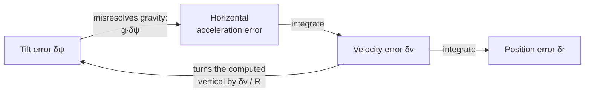
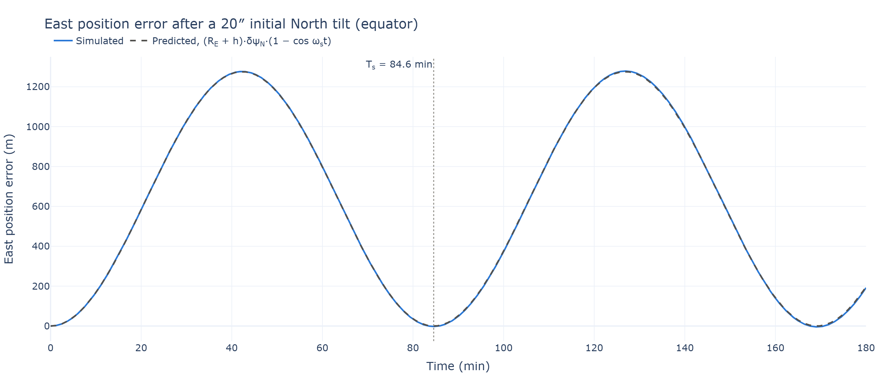
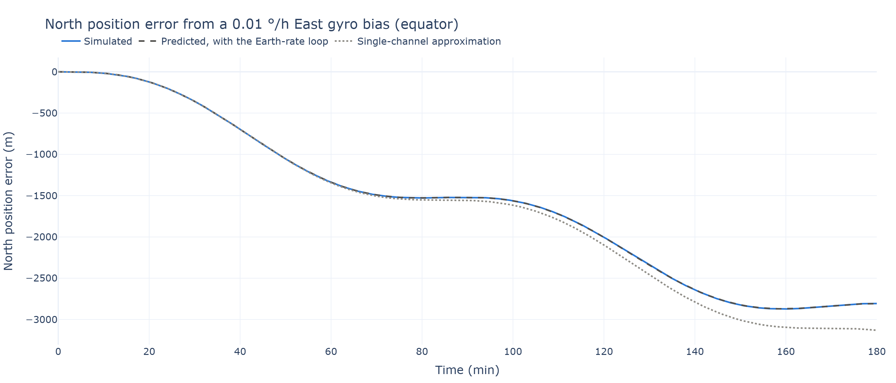

# INS error model

Why does an INS drift the way it does? Small errors in the sensors and in
the initial alignment do not simply add up. Gravity, the Earth's curvature
and its rotation feed them back on each other. A tilt makes the navigator
misread gravity as a horizontal acceleration; the velocity error that
results turns the computed vertical back towards the true one. This
feedback gives inertial navigation errors their characteristic shapes:
bounded oscillations with an 84-minute period, slow 24-hour and Foucault
modulations, steady growth from gyro biases, and an exponential vertical
divergence.

This page derives those shapes from a linearized error model. They are what
the GUI's error tabs show, and the [Validation](../validation/index.md) page
checks the simulator against each one.

!!! abstract "Key results"
    - Horizontal errors are governed by the **Schuler loop**, with a period
      of 84.4 minutes. Initial tilts, initial velocity errors and
      accelerometer biases cause bounded oscillations.
    - A **gyro bias** makes the position error grow, by about 0.6 nmi/h for
      every 0.01 °/h. Over hours the Earth-rate loop bends that growth over.
    - An initial **heading error** acts like an East gyro bias of
      \(\omega_{ie}\cos L_b\,\delta\psi_D\): the packaged spec's 0.04°
      matches its 0.01 °/h gyro biases.
    - Away from the equator, the Earth's rotation turns the Schuler
      oscillation between North and East, like a Foucault pendulum.

## Physical picture



A tilted navigator sees part of gravity as a horizontal acceleration, and
integrates it into a velocity error. But the navigator also turns its local
vertical as it believes it moves over the curved Earth, at the transport
rate \(v/R\). The velocity error therefore turns the computed vertical,
back towards the true one, until the tilt reverses. The result is an
oscillation: a pendulum as long as the Earth's radius, with a period of
84 minutes. Max Schuler showed in 1923 that a pendulum or gyrocompass tuned
to this period would not be disturbed by the vehicle's accelerations. Every
INS is Schuler-tuned by its navigation equations alone.

## Continuous-time model

### Linearized error equations

Write the navigator's equations with every quantity replaced by its
estimate, subtract the true equations, and keep only first-order terms in
the errors. For a vehicle moving slowly compared with the Earth's
rotation, so that transport-rate terms can be dropped, this gives:

$$
\delta\psivec[\dot]{nb}{n} \approx -\wvec{ie}{n}\times\delta\psivec{nb}{n}
- \delta\wvec{in}{n} + \Cmat{b}{n}\,\delta\wvec{ib}{b}
$$

$$
\delta\vvec[\dot]{eb}{n} \approx -\left(\Cmat{b}{n}\fvec{ib}{b}\right)\times\delta\psivec{nb}{n}
+ \Cmat{b}{n}\,\delta\fvec{ib}{b} - 2\,\wvec{ie}{n}\times\delta\vvec{eb}{n}
$$

$$
\delta\wvec{in}{n} \approx
\begin{bmatrix}
\delta v_E/R - \omega_{ie}\sin L_b\,\delta L_b \\
-\delta v_N/R \\
-\delta v_E\tan L_b/R - \omega_{ie}\cos L_b\,\delta L_b
\end{bmatrix},
\qquad
\delta\dot r_N = \delta v_N,
\quad
\delta\dot r_E = \delta v_E
$$

where:

- \(\delta\psivec{nb}{n}\), \(\delta\vvec{eb}{n}\) and \(\delta r_N\),
  \(\delta r_E\) are the attitude, velocity and horizontal position errors,
  as defined on [Notation & conventions](notation.md#errors) [rad, m/s, m];
- \(\delta\wvec{ib}{b}\) and \(\delta\fvec{ib}{b}\) are the gyro and
  accelerometer errors, measured minus true [rad/s, m/s²];
- \(\delta\wvec{in}{n}\) is the error in the computed rotation rate of the
  NED frame, caused by the velocity errors and the latitude error
  \(\delta L_b = \delta r_N/R\) [rad/s];
- \(R\) is the Earth's radius, \(R_N\) or \(R_E\) as appropriate [m].

The vertical channel has its own page: [Vertical channel](vertical-channel.md).

At rest or in steady level flight the specific force is the reaction to
gravity, \(\Cmat{b}{n}\fvec{ib}{b} \approx (0, 0, -g)\), and the first term
of the velocity equation becomes \((-g\,\delta\psi_E,\ g\,\delta\psi_N,\ 0)\):
a tilt of one radian misreads one \(g\) of horizontal acceleration.

### The Schuler loop

Take the North velocity error and the East tilt from the equations above:

$$
\delta\dot\psi_E = \frac{\delta v_N}{R} + \delta\omega_E,
\qquad
\delta\dot v_N = -g\,\delta\psi_E + \delta f_N
\qquad\Longrightarrow\qquad
\delta\ddot\psi_E + \omega_s^2\,\delta\psi_E = \frac{\delta f_N}{R} + \delta\dot\omega_E
$$

The tilt and the velocity error oscillate together at the Schuler frequency

$$
\omega_s = \sqrt{\frac{g}{R}},
\qquad
T_s = \frac{2\pi}{\omega_s} \approx 84.4~\text{min}
$$

where \(\delta\omega_E\) and \(\delta f_N\) are the gyro and accelerometer
errors along East and North [rad/s, m/s²]. Solving for one error source at
a time gives the North position error:

| Error source | North position error \(\delta r_N(t)\) | Size |
| ------------ | ------------------------------------ | ---- |
| Initial velocity error \(\delta v_N(0)\) | \(\delta v_N(0)\,\sin(\omega_s t)/\omega_s\) | up to 0.8 km per m/s |
| Initial tilt \(\delta\psi_E(0)\) | \(-R\,\delta\psi_E(0)\,(1 - \cos\omega_s t)\) | up to 62 m per arcsecond |
| North accelerometer bias \(b_a\) | \((b_a/\omega_s^2)\,(1 - \cos\omega_s t)\) | up to 12.7 m per µg |
| East gyro bias \(b_g\) | \(-R\,b_g\,(t - \sin(\omega_s t)/\omega_s)\) | grows at 1.1 km/h per 0.01 °/h |

The East channel behaves the same way, with the signs of the tilt and gyro
terms reversed. Only the gyro bias produces an error that grows; every other
source is bounded.

### Gyro bias

A gyro bias keeps rotating the computed attitude. The Schuler loop balances
it the only way it can: with a steady velocity error, \(-R\,b_g\) on
average, whose transport-rate error cancels the bias. The position error
therefore grows at \(R\,b_g\): 0.31 m/s, or 0.6 nmi/h, for a 0.01 °/h gyro
bias, with the Schuler oscillation riding on top.

Over hours a second loop bends that growth over. The North position error
is a latitude error, so the navigator computes the Earth-rate vector at the
wrong latitude. At the equator that error lies along Down and turns into a
heading error, and Earth rate acting on a heading error tilts the frame
about East. With \(\wvec{ie}{n} = (\omega_{ie}, 0, 0)\) at the equator:

$$
\delta\dot\psi_E = \frac{\delta v_N}{R} + \omega_{ie}\,\delta\psi_D + b_g,
\qquad
\delta\dot\psi_D = -\omega_{ie}\,\delta\psi_E + \omega_{ie}\,\frac{\delta r_N}{R},
\qquad
\delta\dot v_N = -g\,\delta\psi_E
$$

Its modes are the Schuler frequency \(\omega_s\) and the Earth rate
\(\omega_{ie}\), one cycle per sidereal day. From an East gyro bias \(b_g\):

$$
\delta r_N(t) = -R\,b_g\,\frac{\omega_s^2}{\omega_s^2 - \omega_{ie}^2}
\left(\frac{\sin\omega_{ie}t}{\omega_{ie}} - \frac{\sin\omega_s t}{\omega_s}\right)
$$

which equals the single-channel result while \(\omega_{ie}t\) is small, and
is 10% below it after three hours.

### Heading error

The same coupling makes an initial heading error \(\delta\psi_D\) matter.
The navigator subtracts the Earth's rotation from the gyro outputs using
its own attitude; with a heading error it subtracts the wrong vector. From
the attitude equation, the result is an East tilt rate of
\(\omega_{ie}\cos L_b\,\delta\psi_D\): exactly what an East gyro bias of that
size would do. At the packaged mission's 18.5° N, the spec's 0.04° heading
error acts like a 0.01 °/h gyro bias. That is no coincidence: gyrocompass
alignment finds North only to within the gyro bias over
\(\omega_{ie}\cos L_b\).

In manoeuvres a heading error does more. When the vehicle accelerates, a
heading error misresolves the acceleration, turning every change of
velocity \(\Delta v\) into a sideways velocity error \(\delta\psi_D\,\Delta v\).
The packaged mission's takeoff to 250 knots, with a 0.04° heading error,
leaves 0.09 m/s of cross-track velocity error.

### Foucault modulation

Away from the equator the Earth's rotation has a vertical component,
\(\omega_{ie}\sin L_b\), which couples the North and East channels through
both the attitude and the Coriolis terms. The Schuler oscillation then turns
slowly between North and East, as a Foucault pendulum's swing does. A full
turn takes \(2\pi/(\omega_{ie}\sin L_b)\): 34 hours at 45° N, 75 hours at
18.5° N.

### Summary

| Behaviour | Period or time constant | Driven by |
| --------- | ----------------------- | --------- |
| Schuler oscillation | 84.4 min | Tilts, velocity errors, accelerometer biases |
| Steady drift | – | Gyro biases, heading errors |
| Earth-rate loop | 23.9 h | Latitude errors, through the computed Earth rate |
| Foucault modulation | \(2\pi/(\omega_{ie}\sin L_b)\) | The vertical component of Earth rate |
| Vertical divergence | 573 s, without aiding | Height errors, through the gravity gradient |

## As implemented

ins_sim does not integrate these linear equations. Every error it reports
comes from running the full nonlinear [navigator](mechanization.md) with
erroneous sensor outputs and initial conditions. The closed forms on this
page are predictions, which the Validation page tests against the
navigator. For example, the gyro-bias prediction:

=== "Equation"

    $$
    \delta r_N(t) = -R_N\,b_g\,\frac{\omega_s^2}{\omega_s^2 - \omega_{ie}^2}
    \left(\frac{\sin\omega_{ie}t}{\omega_{ie}} - \frac{\sin\omega_s t}{\omega_s}\right),
    \qquad
    \delta r_N^\text{single}(t) = -R_N\,b_g\left(t - \frac{\sin\omega_s t}{\omega_s}\right)
    $$

=== "Code"

    ```python
    --8<-- "tools/validation_scenarios.py:gyro_bias_prediction"
    ```

!!! note "Compared with Groves (2013)"
    These are the classical short-term error modes of a local-level INS,
    as analysed by Groves[^groves] and by Titterton and Weston[^tw]. The
    error equations above are a simplified form of the full error-state
    model, which keeps the transport-rate terms, the vertical channel and
    every sensor error as states; ins_sim's
    [covariance analysis](covariance.md) uses it.

## What it looks like



A level IMU at rest at the equator, started with a 20″ tilt and no other
error. The East position error swings between zero and 1.3 km and returns
to zero every 84.6 minutes, as predicted.



The same IMU with a 0.01 °/h East gyro bias. The error grows at about
0.6 nmi/h, and the Earth-rate loop bends it below the single-channel
approximation within hours. The simulation follows the full prediction to
within 0.1%: the navigator's rotating-Earth terms produce the coupling
without being told about it. Both are checks on the
[Validation](../validation/index.md#schuler-oscillation) page.

On a real mission the error sources act together and change form in every
manoeuvre: see the packaged mission's
[Monte Carlo results](monte-carlo.md#what-it-looks-like).

## Assumptions & limitations

!!! warning "Assumptions & limitations"
    - **Small errors.** The equations are linear in the errors, which suits
      a navigation-grade INS over hours. Large errors, such as a heading
      error of several degrees, need the full nonlinear equations; the
      simulator always uses those.
    - **Slow vehicle.** The transport-rate terms are dropped. At aircraft
      speeds they shift the Schuler and Foucault frequencies slightly.
    - **One error at a time.** The closed forms take a single error source
      on a stationary, level IMU. In flight the sources combine, and
      manoeuvres couple heading, scale-factor and misalignment errors into
      the navigation errors in ways these formulas do not capture. That is
      what the Monte Carlo simulation is for.
    - **The full model is elsewhere.** The
      [Covariance analysis](covariance.md) page keeps every term and every
      error source, and propagates the statistics of the errors along a
      real flight.

## In the code

| Prediction | Scenario in `tools/validation_scenarios.py` | Test in `tests/validation/` |
| ---------- | ------------------------------------------- | --------------------------- |
| Schuler oscillation from an initial tilt | `schuler_tilt` | `test_inertial_errors.py` |
| Accelerometer bias | `accel_bias` | `test_inertial_errors.py` |
| Gyro bias, with the Earth-rate loop | `gyro_bias` | `test_inertial_errors.py` |
| Vertical channel | `vertical_channel` | `test_inertial_errors.py` |

This example computes the Schuler period at the equator, then gives the
navigator a 10″ initial tilt and checks the peak East error against
\(2(R_E + h_b)\,\delta\psi_N\):

=== "Script"

    ```python
    --8<-- "docs/examples/schuler.py"
    ```

=== "Output"

    ```text
    --8<-- "docs/examples/schuler.txt"
    ```

## References

[^groves]: [Groves (2013)](../reference/bibliography.md#groves2013), Chapter 5
    for the propagation of INS errors, and Chapter 14 for the full INS
    error-state model.

[^tw]: [Titterton & Weston (2004)](../reference/bibliography.md#titterton2004).
