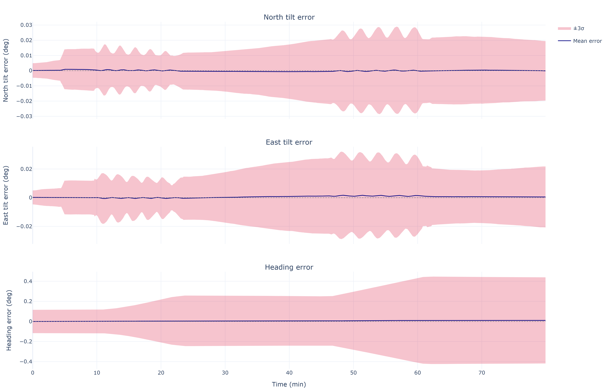

# Frames & attitude

An inertial navigator keeps track of several reference frames at once. Its
gyros and accelerometers measure motion relative to inertial space. It
reports position relative to the rotating Earth, velocity along the local
North, East and Down directions, and the vehicle's orientation relative to
those same local directions. Converting between these frames is most of
the bookkeeping in inertial navigation.

The most important conversion is the vehicle's **attitude**: the rotation
between its own axes and the local North-East-Down axes. The navigator uses
it to turn every accelerometer output into an acceleration along North,
East and Down, so an attitude error becomes a navigation error. The GUI's
*Attitude Errors* tab shows how far the computed attitude drifts from the
truth.

!!! abstract "Key results"
    - ins_sim uses five frames: inertial (i), Earth (e), local navigation
      (n, North-East-Down), body (b), and a local tangent plane at the start
      point (l) that is used only to draw tracks.
    - The attitude \(\Cmat{b}{n}\) is built from heading, pitch and roll, in
      that order, and stored as a scipy `Rotation`.
    - The attitude error \(\delta\psivec{nb}{n}\) is a small rotation
      resolved in NED: a North tilt, an East tilt and a heading error. Unlike
      roll and pitch errors, its tilts do not depend on which way the vehicle
      points.

## Physical picture

<figure class="ins-figure">
--8<-- "includes/diagrams/frames.svg"
<figcaption>Left: the Earth-centred frames and the local navigation frame at a point on the Earth, seen from the side. Right: the body frame of an aircraft seen from above, and its heading ψ<sub>nb</sub>.</figcaption>
</figure>

- The **inertial frame** (i) has its origin at the Earth's centre and axes
  that do not rotate relative to the distant stars. Gyros and accelerometers
  measure motion relative to it.
- The **Earth frame** (e) shares that origin and the polar axis, but turns
  with the Earth at \(\omega_{ie}\), 15.04 °/h. Its x axis points to 0°
  latitude, 0° longitude. A gyro at rest on the ground measures this
  rotation.
- The **local navigation frame** (n) sits at the vehicle, with axes North,
  East and Down. Down is along the normal to the WGS-84 ellipsoid, which
  does not pass through the Earth's centre (see
  [Earth & gravity](earth-gravity.md)). As the vehicle moves, the frame
  turns with it so that it stays level and pointing north.
- The **body frame** (b) is fixed to the IMU, and the IMU to the vehicle (a
  *strapdown* installation): x forward, y along the right wing, z down.
- The **local tangent plane** (l) is NED at the start point, fixed to the
  Earth. ins_sim uses it only to draw tracks relative to the start.

The labels and roles of the frames are listed on
[Notation & conventions](notation.md#frames).

## Continuous-time model

### Euler angles and the attitude matrix

The attitude \(\Cmat{b}{n}\) resolves a vector given along the body axes
into its North, East and Down components; for example
\(\fvec{ib}{n} = \Cmat{b}{n}\,\fvec{ib}{b}\). It is built from three Euler
angles: turn through the heading \(\psi_{nb}\) about Down, then through the
pitch \(\theta_{nb}\) about the new y axis, then through the roll
\(\phi_{nb}\) about the new x axis:

$$
\Cmat{b}{n} =
\begin{bmatrix}
\cos\theta\cos\psi & -\cos\phi\sin\psi + \sin\phi\sin\theta\cos\psi & \sin\phi\sin\psi + \cos\phi\sin\theta\cos\psi \\
\cos\theta\sin\psi & \cos\phi\cos\psi + \sin\phi\sin\theta\sin\psi & -\sin\phi\cos\psi + \cos\phi\sin\theta\sin\psi \\
-\sin\theta & \sin\phi\cos\theta & \cos\phi\cos\theta
\end{bmatrix}
$$

where:

- \(\phi\), \(\theta\) and \(\psi\) are short for the roll \(\phi_{nb}\),
  pitch \(\theta_{nb}\) and heading \(\psi_{nb}\) of the body relative to
  NED [rad].

Going the other way, with \(C_{ij}\) the element in row \(i\), column \(j\):

$$
\phi_{nb} = \operatorname{atan2}\left(C_{32},\, C_{33}\right),
\qquad
\theta_{nb} = -\arcsin C_{31},
\qquad
\psi_{nb} = \operatorname{atan2}\left(C_{21},\, C_{11}\right)
$$

At a pitch of ±90° roll and heading become indistinguishable. This
singularity is one reason the simulator stores attitude as a rotation, not
as angles.

### Quaternions and rotation vectors

The same attitude can be written as a quaternion, four numbers instead of
nine:

$$
\qvec{b}{n} = \begin{bmatrix} \cos(\alpha/2) \\ \sin(\alpha/2)\,\mathbf{u} \end{bmatrix}
$$

where \(\alpha\) is the angle [rad] and \(\mathbf{u}\) the unit axis of the
single rotation that takes the NED axes onto the body axes. The code stores
the scalar part last; see the
[quaternion warning](notation.md#attitude) on the Notation page.

A **rotation vector** \(\boldsymbol{\rho}\) points along the rotation axis
and has the rotation angle \(\rho = |\boldsymbol{\rho}|\) as its length. Its
transformation matrix is the matrix exponential of its skew-symmetric
matrix, given in closed form by Rodrigues' formula:

$$
\exp\left(\skew{\boldsymbol{\rho}}\right) =
\Ithree + \frac{\sin\rho}{\rho}\,\skew{\boldsymbol{\rho}}
+ \frac{1 - \cos\rho}{\rho^2}\,\skew{\boldsymbol{\rho}}^2
$$

Rotation vectors are how the navigator applies each step's small change of
attitude, and how attitude errors are measured.

### Attitude kinematics

The attitude changes as the body rotates, and also as the NED frame itself
rotates:

$$
\Cmat[\dot]{b}{n} = \Cmat{b}{n}\Wmat{ib}{b} - \Wmat{in}{n}\Cmat{b}{n}
= \Cmat{b}{n}\Wmat{nb}{b},
\qquad
\wvec{nb}{b} = \wvec{ib}{b} - \Cmat{n}{b}\wvec{in}{n}
$$

where:

- \(\Wmat{ib}{b} = \skew{\wvec{ib}{b}}\) holds the angular rate of the body
  relative to inertial space, which the gyros measure [rad/s];
- \(\wvec{in}{n} = \wvec{ie}{n} + \wvec{en}{n}\) is the angular rate of the
  NED frame: Earth rate plus transport rate (see
  [Earth & gravity](earth-gravity.md)) [rad/s];
- \(\wvec{nb}{b}\) is the angular rate of the body relative to NED, the
  rate at which roll, pitch and heading actually change [rad/s].

A gyro at rest measures only the Earth's rotation. The second term removes
exactly that, so a stationary vehicle's attitude stays constant.

### Attitude error

The computed attitude \(\Cmat[\hat]{b}{n}\) differs from the truth by a
small rotation, the **attitude error** \(\delta\psivec{nb}{n}\), resolved in
NED:

$$
\Cmat[\hat]{b}{n} = \exp\left(\skew{\delta\psivec{nb}{n}}\right)\Cmat{b}{n}
\approx \left(\Ithree + \skew{\delta\psivec{nb}{n}}\right)\Cmat{b}{n}
$$

Its components are the North tilt, the East tilt and the heading error. To
first order they relate to errors in the Euler angles by

$$
\delta\psivec{nb}{n} \approx
\begin{bmatrix}
\cos\theta\cos\psi & -\sin\psi & 0 \\
\cos\theta\sin\psi & \cos\psi & 0 \\
-\sin\theta & 0 & 1
\end{bmatrix}
\begin{bmatrix} \delta\phi_{nb} \\ \delta\theta_{nb} \\ \delta\psi_{nb} \end{bmatrix}
$$

where:

- \(\delta\phi_{nb}\), \(\delta\theta_{nb}\) and \(\delta\psi_{nb}\) are the
  errors in roll, pitch and heading [rad].

Flying north and level, a roll error is a North tilt and a pitch error an
East tilt; flying east, they swap. The tilts that drive the navigation
errors are the geographic ones (see [INS error model](error-model.md)), so
the GUI plots \(\delta\psivec{nb}{n}\) rather than Euler-angle errors.

## As implemented

**Euler angles to attitude.** The truth trajectory builds its attitude from
its Euler angles with scipy, heading first:

=== "Equation"

    $$
    \Cmat{b}{n} = \mathbf{R}_z(\psi_{nb})\,\mathbf{R}_y(\theta_{nb})\,\mathbf{R}_x(\phi_{nb})
    $$

    where \(\mathbf{R}_z\), \(\mathbf{R}_y\) and \(\mathbf{R}_x\) are
    rotations about the z, y and x axes.

=== "Code"

    ```python
    --8<-- "ins_sim/trajectory/kinematics.py:attitude_from_euler"
    ```

**Attitude error.** The error is the rotation vector of the computed
attitude composed with the inverse of the true one:

=== "Equation"

    $$
    \delta\psivec{nb}{n} = \operatorname{rotvec}\left(\Cmat[\hat]{b}{n}\,\Cmat{n}{b}\right)
    $$

=== "Code"

    ```python
    --8<-- "ins_sim/evaluation/errors.py:attitude_error"
    ```

**Position relative to the start point.** To draw tracks, the navigator and
the truth convert the curvilinear position into metres from the start
point, using the radii of curvature there:

=== "Equation"

    $$
    \rvec{lb}{l} \approx
    \begin{bmatrix}
    (L_b - L_{b0})\,(R_{N0} + h_{b0}) \\
    (\lambda_b - \lambda_{b0})\,(R_{E0} + h_{b0})\cos L_{b0} \\
    -(h_b - h_{b0})
    \end{bmatrix}
    $$

    where the subscript 0 marks values at the start point.

=== "Code"

    ```python
    --8<-- "ins_sim/navigation/strapdown.py:relative_position"
    ```

!!! note "Compared with Groves (2013)"
    The Euler-angle sequence, the attitude kinematics and the definition of
    the attitude error, an error rotation applied to the true attitude and
    resolved in NED, follow Groves' conventions[^groves]. Groves writes the
    quaternion scalar-first; scipy stores it scalar-last.

## What it looks like



The *Attitude Errors* tab for 50 trials of the packaged mission with the
navigation-grade IMU spec. The North and East tilts stay within a few
hundredths of a degree throughout, rippling in the turns: the Schuler loop
bounds them (see [INS error model](error-model.md)). The heading error starts
at the spread of the initial alignment, 0.04° (1σ), and steps up during the
two loiters. There the gyros' axis misalignments act on large turn rates;
with the misalignments switched off, the heading error stays at 0.04°.
Nothing bounds the heading error of a free-inertial navigator.

The [Validation](../validation/index.md#initial-attitude-error) page checks
that the attitude error at the first sample equals the alignment error each
trial draws.

## Assumptions & limitations

!!! warning "Assumptions & limitations"
    - The inertial and Earth frames share the polar axis. Precession,
      nutation and polar motion are ignored; over a flight they are
      negligible.
    - Euler angles are singular at a pitch of ±90°. ins_sim integrates and
      stores attitude as rotations, so only the truth construction uses
      Euler angles, and aircraft missions stay far from ±90°.
    - The NED frame is undefined at the poles, where there is no North.
      Missions must keep clear of them.
    - \(\rvec{lb}{l}\) is a linearized drawing aid, not an exact
      tangent-plane position. Error statistics use the position error at the
      true position instead (see [Monte Carlo evaluation](monte-carlo.md)).

## In the code

| Quantity | Equation | Implemented in |
| -------- | -------- | -------------- |
| Attitude from Euler angles | \(\Cmat{b}{n}(\phi_{nb}, \theta_{nb}, \psi_{nb})\) | [`TruthTrajectory`][ins_sim.trajectory.kinematics.TruthTrajectory], with scipy's `Rotation.from_euler("ZYX", ...)` |
| Euler angles from attitude | \(\operatorname{atan2}\) forms above | [`run_monte_carlo`][ins_sim.evaluation.monte_carlo.run_monte_carlo], with `Rotation.as_euler("ZYX")` |
| Attitude kinematics | \(\Cmat[\dot]{b}{n} = \Cmat{b}{n}\Wmat{nb}{b}\) | [`strapdown_navgrade`][ins_sim.navigation.strapdown.strapdown_navgrade]; see [Strapdown mechanization](mechanization.md) |
| Attitude error | \(\delta\psivec{nb}{n}\) | [`attitude_error`][ins_sim.evaluation.errors.attitude_error] |
| Position relative to the start | \(\rvec{lb}{l}\) | [`strapdown_navgrade`][ins_sim.navigation.strapdown.strapdown_navgrade], [`TruthTrajectory`][ins_sim.trajectory.kinematics.TruthTrajectory] |

This example writes one attitude three ways, then measures a 0.1° pitch
error as an attitude error vector. At a heading of 30° it splits between the
North and East tilts as the matrix above predicts:

=== "Script"

    ```python
    --8<-- "docs/examples/attitude.py"
    ```

=== "Output"

    ```text
    --8<-- "docs/examples/attitude.txt"
    ```

## References

[^groves]: [Groves (2013)](../reference/bibliography.md#groves2013), Chapter 2:
    coordinate frames, attitude representations and kinematics.
