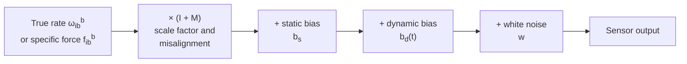
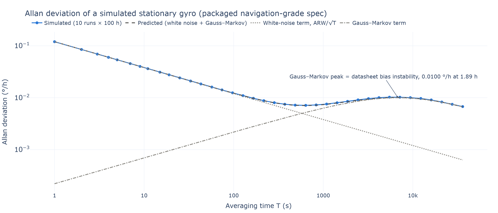

# IMU error model

Gyros and accelerometers are never perfect. Each output carries a bias that
differs every time the IMU is switched on and wanders slowly during a run,
gain and alignment errors that grow with the motion, and white noise. The
navigator integrates all of these, which is why an INS drifts. The IMU spec
you choose in the GUI sets the size of each error, in the units of a sensor
datasheet. ins_sim models them with the sensor error model of
Groves[^groves], one realization per Monte Carlo trial.

!!! abstract "Key results"
    - Each sensor output is the true value, scaled and cross-coupled by a
      matrix \(\Ithree + \mathbf{M}\), plus a static bias, a slowly varying
      dynamic bias and white noise.
    - Bias instability is entered as the datasheet value \(B\). The dynamic
      bias is a Gauss–Markov process with spread \(B/0.617\), so that its
      Allan deviation peaks at exactly \(B\).
    - The white noise per sample is the random-walk density divided by
      \(\sqrt{\tau_i}\), so results do not depend on the IMU's sample rate.
    - Every trial draws its own errors, from separate random streams for
      the gyros, the accelerometers and the initial alignment.

## Physical picture



The error terms behave very differently:

- **Scale factor and misalignment.** A sensor's gain is slightly wrong, by
  parts per million, and its axes are not exactly orthogonal or exactly
  along the body axes, by microradians. These errors are proportional to
  what the sensor measures, so they are present even at rest, where the
  accelerometers measure gravity and the gyros the Earth's rotation, and
  largest in turns and accelerations.
- **Static bias.** Every time the IMU is switched on, each bias settles at a
  slightly different value, then stays there for the run. Datasheets call
  its spread the turn-on bias repeatability.
- **Dynamic bias.** During the run the bias wanders slowly, over minutes to
  hours. Datasheets quantify this as the bias instability.
- **White noise.** Every sample is noisy. Integrated by the navigator, gyro
  noise becomes a random walk in angle (angle random walk, ARW) and
  accelerometer noise a random walk in velocity (VRW).

The packaged spec is typical of a ring-laser-gyro aircraft INS:

| Error | Gyro | Accelerometer | YAML keys |
| ----- | ---- | ------------- | --------- |
| Random walk | 0.002 °/√h | 0.005 m/s/√h | `arw_deg_per_rt_hr`, `vrw_m_per_s_per_rt_hr` |
| Bias instability (datasheet) | 0.01 °/h | 5 µg | `bias_instab_deg_per_hr`, `bias_instab_ug` |
| Bias correlation time | 1 h | 1 h | `bias_tau_s` |
| Turn-on bias repeatability | 0.01 °/h | 25 µg | `repeatability_deg_per_hr`, `repeatability_ug` |
| Scale factor | 5 ppm | 100 ppm | `scale_factor_ppm` |
| Misalignment | 50 µrad | 50 µrad | `misalignment_urad` |

and its initial alignment leaves a tilt of 0.0015° and a heading error of
0.04° (1σ), set in its `alignment:` block.

## Continuous-time model

### The measurement equations

$$
\fvec[\tilde]{ib}{b} = \mathbf{b}_a + \left(\Ithree + \mathbf{M}_a\right)\fvec{ib}{b} + \mathbf{w}_a,
\qquad
\wvec[\tilde]{ib}{b} = \mathbf{b}_g + \left(\Ithree + \mathbf{M}_g\right)\wvec{ib}{b} + \mathbf{w}_g
$$

where:

- \(\fvec[\tilde]{ib}{b}\) and \(\wvec[\tilde]{ib}{b}\) are the
  accelerometer and gyro outputs [m/s², rad/s], and \(\fvec{ib}{b}\),
  \(\wvec{ib}{b}\) the true specific force and angular rate (see
  [Truth trajectory & ideal IMU](truth-kinematics.md));
- \(\mathbf{b}_a = \mathbf{b}_{as} + \mathbf{b}_{ad}\) and
  \(\mathbf{b}_g = \mathbf{b}_{gs} + \mathbf{b}_{gd}\) are the biases, each
  a static part (subscript s) and a dynamic part (subscript d) [m/s², rad/s];
- \(\mathbf{M}_a\) and \(\mathbf{M}_g\) are the scale-factor and
  misalignment matrices [dimensionless];
- \(\mathbf{w}_a\) and \(\mathbf{w}_g\) are white noise [m/s², rad/s].

### Scale factor and misalignment

$$
\mathbf{M} =
\begin{bmatrix}
s_x & m_{xy} & m_{xz} \\
m_{yx} & s_y & m_{yz} \\
m_{zx} & m_{zy} & s_z
\end{bmatrix}
$$

where the scale-factor errors \(s\) and the six misalignments \(m\) are
independent, zero-mean and normally distributed, with the spreads of the
spec's `scale_factor_ppm` and `misalignment_urad` [dimensionless, rad].

### Dynamic bias: a first-order Gauss–Markov process

Each axis's dynamic bias \(b_d\) relaxes towards zero while being kicked by
white noise:

$$
\dot b_d = -\frac{b_d}{\tau_c} + w_b,
\qquad
\mathrm{E}\left[w_b(t)\,w_b(t')\right] = \frac{2\sigma^2}{\tau_c}\,\delta(t - t')
$$

where \(\tau_c\) is the correlation time (`bias_tau_s`) [s] and \(\sigma\) the
steady-state spread of the bias [rad/s or m/s²]. Its correlation with itself
decays as \(e^{-|\Delta t|/\tau_c}\): over times much shorter than
\(\tau_c\) it looks like a constant bias, over much longer times like noise.

A datasheet does not quote \(\sigma\). It quotes the **bias instability**
\(B\), the floor of the sensor's Allan deviation, the standard measure of how
much a sensor's average output varies between successive averaging windows
of length \(T\). For white noise plus a Gauss–Markov bias:

$$
\sigma_A^2(T) = \frac{N^2}{T}
+ \frac{\sigma^2\tau_c^2}{T^2}\left(\frac{2T}{\tau_c} - 3
+ 4e^{-T/\tau_c} - e^{-2T/\tau_c}\right)
$$

where \(\sigma_A\) is the Allan deviation [rad/s or m/s²], \(T\) the
averaging time [s] and \(N\) the white-noise density defined below. The
Gauss–Markov term peaks at \(0.6174\,\sigma\) when \(T = 1.89\,\tau_c\).
ins_sim therefore sets

$$
\sigma = \frac{B}{0.6174}
$$

so the simulated Allan deviation peaks at exactly the datasheet value. See
[Validation](../validation/index.md#allan-deviation) for how to choose
\(\tau_c\) from a datasheet's Allan plot.

### White noise

White noise of density \(N\) integrates into a random walk whose spread
grows with the square root of time:

$$
\sigma_\theta(t) = N\sqrt{t}
$$

where \(N\) is the ARW (gyro) [rad/√s] or VRW (accelerometer) [m/s/√s], and
\(\sigma_\theta\) the spread of the integrated angle [rad] or velocity [m/s].

### Initial alignment

Before navigating, an INS aligns itself at rest. It levels by finding which
way gravity points, which leaves a tilt error of about the accelerometer
bias over \(g\). It finds North by gyrocompassing, measuring the direction
of the Earth's rotation, which leaves a heading error of about the
East-pointing gyro's bias over \(\omega_{ie}\cos L_b\). Each trial draws
this residual alignment error as the initial attitude error:

$$
\delta\psivec{nb}{n}(0) \sim \mathcal{N}\left(\mathbf{0},\;
\operatorname{diag}\left(\sigma_\text{tilt}^2,\ \sigma_\text{tilt}^2,\ \sigma_\text{heading}^2\right)\right)
$$

For the packaged spec, 25 µg over \(g\) is 0.0014°, and 0.01 °/h over the
Earth's horizontal rotation at 18.5° N is 0.04°: the spec's tilt and
heading values.

## As implemented

**1. Datasheet units to SI.** The YAML spec is converted as it is loaded:

=== "Equation"

    | Datasheet unit | Factor to SI | SI unit |
    | -------------- | ------------ | ------- |
    | °/√h | \(\pi/180/60\) | rad/√s |
    | °/h | \(\pi/180/3600\) | rad/s |
    | µg | \(9.80665 \times 10^{-6}\) | m/s² |
    | m/s/√h | \(1/60\) | m/s/√s |
    | ppm, µrad | \(10^{-6}\) | –, rad |

=== "Code"

    ```python
    --8<-- "ins_sim/sensors/imu.py:datasheet_units"
    ```

**2. Scale factor and misalignment**, drawn once per trial:

=== "Equation"

    $$
    \mathbf{y}_\text{scaled} = \left(\Ithree + \mathbf{M}\right)\mathbf{y}
    $$

    where \(\mathbf{y}\) is the true angular rate or specific force.

=== "Code"

    ```python
    --8<-- "ins_sim/sensors/imu.py:scale_misalignment"
    ```

**3. Static bias**, drawn once per trial:

=== "Equation"

    $$
    \mathbf{b}_s \sim \mathcal{N}\left(\mathbf{0},\ \sigma_\text{BR}^2\Ithree\right)
    $$

    where \(\sigma_\text{BR}\) is the turn-on bias repeatability.

=== "Code"

    ```python
    --8<-- "ins_sim/sensors/imu.py:static_bias"
    ```

**4. Dynamic bias.** The exact discrete form of the Gauss–Markov process,
started in its steady state:

=== "Equation"

    $$
    b_{d,k+1} = a\,b_{d,k} + \sqrt{1 - a^2}\,\sigma\,u_{k+1},
    \qquad a = e^{-\tau_i/\tau_c},
    \qquad b_{d,0} \sim \mathcal{N}(0, \sigma^2)
    $$

    where \(u_k\) are independent standard normal numbers. The variance is
    \(\sigma^2\) at every sample, whatever the sample interval.

=== "Code"

    ```python
    --8<-- "ins_sim/sensors/imu.py:dynamic_bias"
    ```

**5. White noise.** The per-sample spread that integrates to \(N\sqrt{t}\):

=== "Equation"

    $$
    w_k \sim \mathcal{N}\left(0,\ \frac{N^2}{\tau_i}\right)
    $$

=== "Code"

    ```python
    --8<-- "ins_sim/sensors/imu.py:white_noise"
    ```

**6. Initial alignment error**, drawn once per trial:

=== "Equation"

    $$
    \delta\psivec{nb}{n}(0) \sim \mathcal{N}\left(\mathbf{0},\;
    \operatorname{diag}\left(\sigma_\text{tilt}^2,\ \sigma_\text{tilt}^2,\ \sigma_\text{heading}^2\right)\right)
    $$

=== "Code"

    ```python
    --8<-- "ins_sim/sensors/imu.py:initial_misalignment"
    ```

The gyro triad, the accelerometer triad and the alignment error each draw
from their own random stream, and each triad draws its terms in a fixed
order, whether or not their spreads are zero. Changing one error's spread
therefore leaves every other error's realization unchanged, which makes
comparisons between specs fair (see
[Monte Carlo evaluation](monte-carlo.md#random-streams)).

!!! note "Compared with Groves (2013)"
    The structure is Groves' sensor model[^groves]: a bias, a matrix of
    scale-factor and cross-coupling errors, and noise. Groves also includes
    a gyro bias proportional to specific force (the g-dependent bias) and
    output quantization; ins_sim models neither.

## What it looks like



The Allan deviation of a simulated stationary gyro with the packaged spec's
noise. At short averaging times the white noise dominates, falling with a
slope of −½. At long times the Gauss–Markov bias takes over and peaks at the
datasheet bias instability, 0.01 °/h, at 1.89 hours. The
[Validation](../validation/index.md#allan-deviation) page checks this curve
against the formula above, together with the
[angle random walk](../validation/index.md#angle-random-walk) and the
[stationarity](../validation/index.md#gaussmarkov-bias) of the
Gauss–Markov bias.

The example output below shows why the bias, not the noise, sets an INS's
long-term performance. At 10 Hz each gyro sample's noise is 0.38 °/h, 38
times the bias instability, but it averages away; the bias does not.

## Assumptions & limitations

!!! warning "Assumptions & limitations"
    - **Not modelled:** g-dependent gyro bias, quantization, rate random
      walk, scale-factor nonlinearity and asymmetry, temperature effects,
      and errors driven by vibration.
    - **One Gauss–Markov hump.** A real sensor's Allan deviation is often
      flat near its floor over a decade or more of averaging time. One
      Gauss–Markov process matches the datasheet value only at its peak,
      and falls below the real sensor on either side.
    - **Independent alignment errors.** A real INS aligns with its biases
      present, so the initial tilt largely cancels the accelerometer bias,
      and the initial heading error is tied to the East gyro's bias. ins_sim
      draws them independently, which is pessimistic early in a flight.
    - **Constant parameters.** The spreads do not change with temperature or
      time, and nothing estimates or corrects the errors during the run:
      there is no aiding apart from the barometer.

## In the code

| Quantity | Equation | Implemented in |
| -------- | -------- | -------------- |
| Datasheet spec, in SI | Units table | [`IMUSpec`][ins_sim.sensors.imu.IMUSpec], [`load_imu_spec`][ins_sim.sensors.imu.load_imu_spec] |
| Gauss–Markov spread | \(\sigma = B/0.6174\) | [`IMUSpec.gyro_gm_std`][ins_sim.sensors.imu.IMUSpec.gyro_gm_std], [`IMUSpec.accel_gm_std`][ins_sim.sensors.imu.IMUSpec.accel_gm_std], [`GM_ALLAN_PEAK`][ins_sim.sensors.imu.GM_ALLAN_PEAK] |
| Sensor outputs | \(\fvec[\tilde]{ib}{b}\), \(\wvec[\tilde]{ib}{b}\) | [`generate_imu_samples`][ins_sim.sensors.imu.generate_imu_samples] |
| Error terms of one triad | \(\mathbf{M}\), \(\mathbf{b}_s\), \(b_d\), \(w\) | `_triad_measurement` and `_error_matrix` in `ins_sim/sensors/imu.py` |
| Initial alignment error | \(\delta\psivec{nb}{n}(0)\) | [`draw_initial_misalignment`][ins_sim.sensors.imu.draw_initial_misalignment] |

This example loads the packaged spec and prints its datasheet values next
to the model parameters derived from them:

=== "Script"

    ```python
    --8<-- "docs/examples/imu_spec.py"
    ```

=== "Output"

    ```text
    --8<-- "docs/examples/imu_spec.txt"
    ```

## References

[^groves]: [Groves (2013)](../reference/bibliography.md#groves2013), Chapter 4,
    for inertial sensor errors and the sensor error model. The Allan
    variance and the datasheet terms come from
    [IEEE Std 952](../reference/bibliography.md#ieee952) and
    [El-Sheimy et al. (2008)](../reference/bibliography.md#elsheimy2008).
