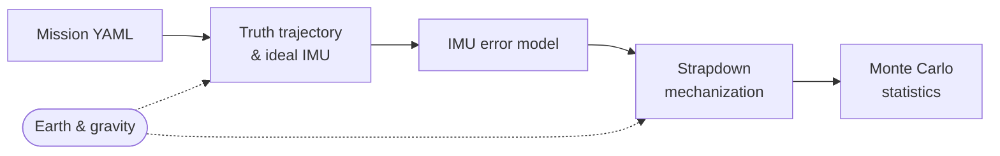

# Theory & Math

These pages explain how ins_sim works: the physics it simulates and the
mathematics it uses, exactly as implemented. Each equation appears next to
the lines of code that evaluate it, pulled from the source when the site is
built, so the two cannot drift apart. The symbols are those of
[Groves (2013)](../reference/bibliography.md#groves2013), defined once on
[Notation & conventions](notation.md).

## How the simulator fits together

A run starts from a mission. The simulator builds the truth trajectory and
works out what a perfect IMU would measure along it. It corrupts those
measurements with the errors of a real IMU, feeds them to a strapdown
navigator, and compares the navigator's answer with the truth. Repeating
that many times, with fresh errors each time, gives the error statistics
that the GUI plots. The Earth model supplies the shape, rotation and
gravity of the Earth to both the truth and the navigator.

Each part has its own page:

| Page | The question it answers | Code |
| ---- | ----------------------- | ---- |
| [Notation & conventions](notation.md) | What does each symbol mean? | – |
| [Frames & attitude](frames-attitude.md) | Which reference frames are involved, and how is attitude described? | `scipy.spatial.transform` |
| [Earth & gravity](earth-gravity.md) | How do latitude and longitude become metres, how fast does the Earth turn, and how strong is gravity? | `ins_sim.core.earth_model` |
| [Truth trajectory & ideal IMU](truth-kinematics.md) | How is the reference motion built, and what would a perfect IMU measure? | `ins_sim.trajectory` |
| [IMU error model](imu-errors.md) | How do real gyros and accelerometers differ from perfect ones? | `ins_sim.sensors.imu` |
| [Strapdown mechanization](mechanization.md) | How does the navigator turn sensor outputs into position, velocity and attitude? | `ins_sim.navigation.strapdown` |
| [Vertical channel](vertical-channel.md) | Why does height diverge, and how does the barometer hold it? | `ins_sim.navigation.strapdown` |
| [INS error model](error-model.md) | Why do navigation errors grow the way they do? | – |
| [Monte Carlo evaluation](monte-carlo.md) | How do many runs become error statistics? | `ins_sim.evaluation` |

## Reading paths

- **New to inertial navigation:** [Frames & attitude](frames-attitude.md),
  then [Earth & gravity](earth-gravity.md),
  [Strapdown mechanization](mechanization.md) and the
  [INS error model](error-model.md). The [Validation](../validation/index.md)
  page then shows the simulator reproducing each prediction.
- **Choosing or comparing IMUs:** the [IMU error model](imu-errors.md), the
  [INS error model](error-model.md) and
  [Monte Carlo evaluation](monte-carlo.md).
- **Reading or extending the code:** [Notation & conventions](notation.md),
  [Truth trajectory & ideal IMU](truth-kinematics.md) and
  [Strapdown mechanization](mechanization.md). Every page ends with an
  *In the code* table that links each equation to its function in the
  [Python API](../reference/api/index.md).

## How the pages are organized

Each page starts with what its topic is and why it matters for navigation,
then sums up its key results. A picture comes before any equation. The model
follows, with every symbol defined where it is used, then the model as
implemented, step by step, beside its code. A figure from the simulator
shows the result, linked to the validation check that tests it. Each page
then states its assumptions and limitations, and ends with the functions
that implement it and an example that the test suite runs.
