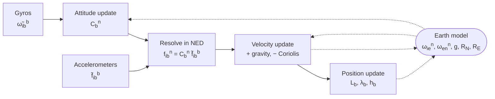
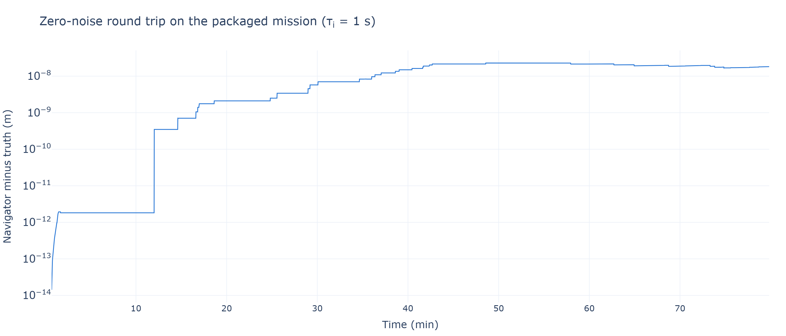

# Strapdown mechanization

The mechanization is the navigator itself: the equations that turn the gyro
and accelerometer outputs back into attitude, velocity and position. It
integrates the measured angular rate into attitude. It uses that attitude to
resolve the measured specific force along North, East and Down, adds
gravity back, and removes the apparent forces of the rotating Earth. It then
integrates the result twice, into velocity and position. Every sensor error
passes through these equations, and the [INS error model](error-model.md)
follows from them. ins_sim implements the local-navigation-frame form of
Groves[^groves].

!!! abstract "Key results"
    - Each step performs four updates (attitude, specific-force resolution,
      velocity, position) after re-evaluating Earth rate, transport rate,
      gravity and the radii of curvature at the current state.
    - The attitude update applies the exact rotation-vector exponential of
      the body's rate relative to NED.
    - The velocity and position updates are first-order (forward Euler), on
      purpose: the truth generator inverts exactly these steps.
    - There are no coning or sculling corrections. The truth's
      piecewise-constant IMU outputs leave them nothing to correct.

## Physical picture



The sensors are strapped to the vehicle, so they measure along the body
axes. The navigator keeps track of the attitude and uses it to resolve each
specific-force measurement in NED. What it measures is not acceleration,
though. Specific force excludes gravity, which the navigator must add from
its [gravity model](earth-gravity.md#gravity). It also includes the
apparent accelerations of a rotating, curved frame, which the navigator must
remove: the Coriolis term, and the transport term that keeps a vehicle
following the curved Earth. The Earth model needs the current position and
velocity, so every update feeds the next.

## Continuous-time model

In the local navigation frame, the navigation equations are:

$$
\Cmat[\dot]{b}{n} = \Cmat{b}{n}\Wmat{ib}{b} - \left(\Wmat{ie}{n} + \Wmat{en}{n}\right)\Cmat{b}{n}
$$

$$
\vvec[\dot]{eb}{n} = \Cmat{b}{n}\fvec{ib}{b} + \gvec{b}{n}
- \left(\Wmat{en}{n} + 2\,\Wmat{ie}{n}\right)\vvec{eb}{n}
$$

$$
\dot L_b = \frac{v_N}{R_N + h_b},
\qquad
\dot\lambda_b = \frac{v_E}{(R_E + h_b)\cos L_b},
\qquad
\dot h_b = -v_D
$$

where:

- \(\Cmat{b}{n}\) is the attitude, and \(\vvec{eb}{n} = (v_N, v_E, v_D)\)
  the velocity relative to the Earth, resolved in NED [m/s];
- \(\Wmat{ib}{b}\) and \(\fvec{ib}{b}\) hold the gyro and accelerometer
  outputs [rad/s, m/s²];
- \(\Wmat{ie}{n}\) and \(\Wmat{en}{n}\) are the skew-symmetric matrices of
  Earth rate and transport rate [rad/s];
- \(\gvec{b}{n}\) is gravity [m/s²], and \(L_b\), \(\lambda_b\), \(h_b\),
  \(R_N\), \(R_E\) are as on [Earth & gravity](earth-gravity.md).

The attitude equation is explained on
[Frames & attitude](frames-attitude.md#attitude-kinematics). In the velocity
equation, \(2\Wmat{ie}{n}\vvec{eb}{n}\) is the Coriolis acceleration of a
body moving over the rotating Earth, and \(\Wmat{en}{n}\vvec{eb}{n}\) the
acceleration needed to follow the Earth's curvature. A vehicle at rest
senses only the Earth's rotation and the reaction to gravity, and every
derivative is then zero.

## As implemented

Each step takes the state at sample \(k\) to sample \(k+1\), one IMU
interval \(\tau_i\) later. A tilde marks the sensor outputs; every other
quantity is the navigator's own.

**1. Frame rates and gravity** at the current state:

=== "Equation"

    $$
    \wvec{in}{n} = \wvec{ie}{n}(L_{b,k}) + \wvec{en}{n}(\vvec{eb}{n}(k), L_{b,k}, h_{b,k}),
    \qquad
    \gvec{b}{n} = \begin{bmatrix} 0 & 0 & g(L_{b,k}, h_{b,k}) \end{bmatrix}^{\mathsf T}
    $$

=== "Code"

    ```python
    --8<-- "ins_sim/navigation/strapdown.py:frame_rates"
    ```

**2. Body rate relative to NED.** Remove the NED frame's own rotation,
resolved in body axes, from what the gyros measured:

=== "Equation"

    $$
    \wvec{nb}{b} = \wvec[\tilde]{ib}{b} - \Cmat{n}{b}\,\wvec{in}{n}
    $$

=== "Code"

    ```python
    --8<-- "ins_sim/navigation/strapdown.py:body_rate"
    ```

**3. Attitude update.** Rotate the attitude by the body's rotation over the
step, as an exact rotation vector:

=== "Equation"

    $$
    \Cmat{b}{n}(k+1) = \Cmat{b}{n}(k)\,\exp\left(\skew{\wvec{nb}{b}\,\tau_i}\right)
    $$

    This is the exact solution of the attitude equation when
    \(\wvec{nb}{b}\) is constant over the step.

=== "Code"

    ```python
    --8<-- "ins_sim/navigation/strapdown.py:attitude_update"
    ```

**4. Specific force in NED**, with the attitude at the start of the step:

=== "Equation"

    $$
    \fvec{ib}{n} = \Cmat{b}{n}(k)\,\fvec[\tilde]{ib}{b}
    $$

=== "Code"

    ```python
    --8<-- "ins_sim/navigation/strapdown.py:specific_force_transform"
    ```

**5. Velocity update**, forward Euler. The code also holds the barometric
damping terms, explained on [Vertical channel](vertical-channel.md):

=== "Equation"

    $$
    \vvec{eb}{n}(k+1) = \vvec{eb}{n}(k) + \left[\fvec{ib}{n}
    - \left(2\wvec{ie}{n} + \wvec{en}{n}\right)\times\vvec{eb}{n}(k)
    + \gvec{b}{n}\right]\tau_i
    $$

=== "Code"

    ```python
    --8<-- "ins_sim/navigation/strapdown.py:velocity_update"
    ```

**6. Position update**, forward Euler, with the radii of curvature at the
start of the step:

=== "Equation"

    $$
    L_{b,k+1} = L_{b,k} + \frac{v_{N,k}\,\tau_i}{R_N + h_{b,k}},
    \quad
    \lambda_{b,k+1} = \lambda_{b,k} + \frac{v_{E,k}\,\tau_i}{(R_E + h_{b,k})\cos L_{b,k}},
    \quad
    h_{b,k+1} = h_{b,k} - v_{D,k}\,\tau_i
    $$

=== "Code"

    ```python
    --8<-- "ins_sim/navigation/strapdown.py:position_update"
    ```

Finally, the new position is also converted to metres from the start point,
\(\rvec{lb}{l}\), for drawing tracks (see
[Frames & attitude](frames-attitude.md#as-implemented)).

!!! note "Compared with Groves (2013)"
    This is Groves' local-navigation-frame mechanization[^groves], with
    three deliberate differences:

    - **Attitude.** Groves' basic attitude update is the first-order
      truncation \(\Cmat{b}{n}(\Ithree + \Wmat{ib}{b}\tau_i) -
      \Wmat{in}{n}\Cmat{b}{n}\tau_i\). ins_sim applies the exact
      exponential of the same rotation, which agrees with it to first
      order and keeps the attitude a pure rotation.
    - **Position.** Groves averages the velocities at the start and end of
      the step; ins_sim uses the velocity at the start.
    - **No precision corrections.** Groves' precision mechanization adds
      coning and sculling corrections and a mid-step attitude for
      resolving the specific force[^savage]. ins_sim does not.

    The first-order choices keep the navigator the exact inverse of the
    [truth generator](truth-kinematics.md#as-implemented).

## What it looks like



The navigator, fed the ideal outputs of the packaged mission's truth,
reproduces the truth to within \(2.3 \times 10^{-8}\) m over the whole
80 minutes. The difference is floating-point rounding, which accumulates in
small steps. This is the
[zero-noise round trip](../validation/index.md#zero-noise-round-trip) of the
Validation page. It proves that the navigator and the truth generator are
consistent. It cannot show how accurately the navigator integrates
continuous motion, because the truth is built from the navigator's own
discrete steps.

The example below runs the navigator on a level IMU at rest at 45° N. With
perfect sensors it stays exactly at rest: the gyros' Earth rate is removed
by step 2, and the accelerometers' reaction to gravity is cancelled by
step 5. A 0.01 °/h gyro bias moves it 1.3 km in an hour.

## Assumptions & limitations

!!! warning "Assumptions & limitations"
    - **First-order integration.** The velocity and position updates are
      forward Euler, the specific force is resolved with the attitude at
      the start of each step, and there are no coning or sculling
      corrections. In a real INS, or against a truth that varies within each
      step, these would add errors in fast manoeuvres. In ins_sim they are
      invisible, because the truth inverts them exactly (see
      [Truth trajectory & ideal IMU](truth-kinematics.md#assumptions-limitations)).
    - **Known start.** Each run starts from the true position and velocity.
      Only the attitude starts in error, by the drawn alignment error; the
      alignment itself is not simulated.
    - **Vertical channel.** Without a height reference the vertical channel
      diverges. By default a barometric loop holds it (see
      [Vertical channel](vertical-channel.md)).
    - **No aiding.** Apart from the barometer, nothing corrects the
      navigator: there is no GNSS or other measurement update.
    - **Not over the poles**, where the NED frame is undefined.

## In the code

| Quantity | Equation | Implemented in |
| -------- | -------- | -------------- |
| The whole mechanization | Steps 1 to 6 | [`strapdown_navgrade`][ins_sim.navigation.strapdown.strapdown_navgrade] |
| Initial state | \(L_b\), \(\lambda_b\), \(h_b\), \(\vvec{eb}{n}\), \(\qvec{b}{n}\) | [`NavState`][ins_sim.navigation.strapdown.NavState] |
| Output history | Every state, plus \(\rvec{lb}{l}\) | [`NavSolution`][ins_sim.navigation.strapdown.NavSolution] |
| Earth rate, transport rate, gravity, radii | Step 1 | [`earth_rate_n`][ins_sim.core.earth_model.earth_rate_n], [`transport_rate_n`][ins_sim.core.earth_model.transport_rate_n], [`normal_gravity`][ins_sim.core.earth_model.normal_gravity], [`wgs84_radii`][ins_sim.core.earth_model.wgs84_radii] |

This example runs the navigator for an hour on a level IMU at rest at 45° N,
first with perfect sensors and then with a 0.01 °/h bias on the gyro that
points East:

=== "Script"

    ```python
    --8<-- "docs/examples/stationary_navigator.py"
    ```

=== "Output"

    ```text
    --8<-- "docs/examples/stationary_navigator.txt"
    ```

The 1.3 km is close to the single-channel prediction for a gyro bias,
\(R\,b_g\,(t - \sin\omega_s t/\omega_s)\) = 1.35 km after an hour (see
[INS error model](error-model.md#gyro-bias)).

## References

[^groves]: [Groves (2013)](../reference/bibliography.md#groves2013), Chapter 5,
    for the inertial navigation equations in the local navigation frame,
    and their precision versions.

[^savage]: [Savage (1998a)](../reference/bibliography.md#savage1998a) and
    [Savage (1998b)](../reference/bibliography.md#savage1998b) derive the
    coning and sculling algorithms.
