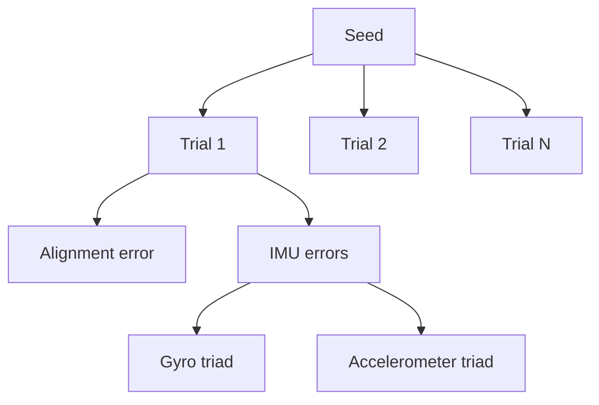
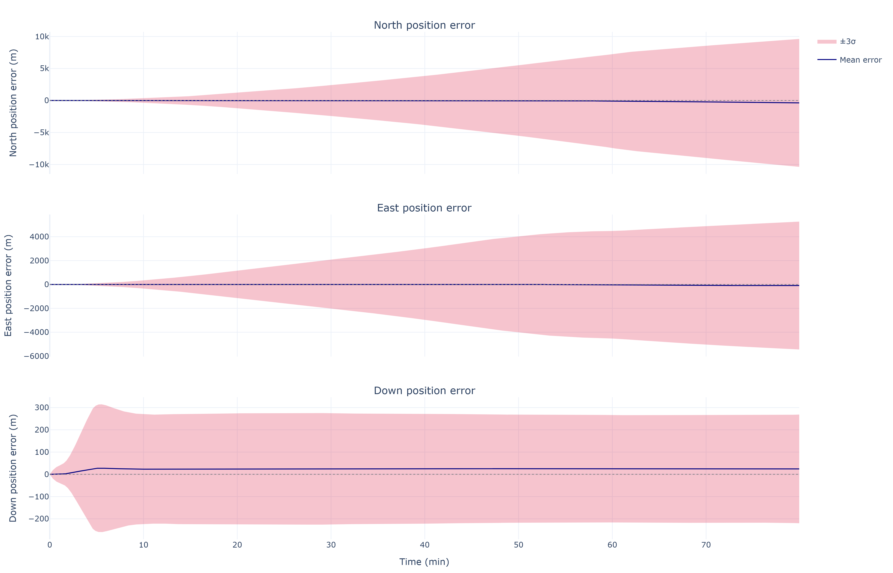
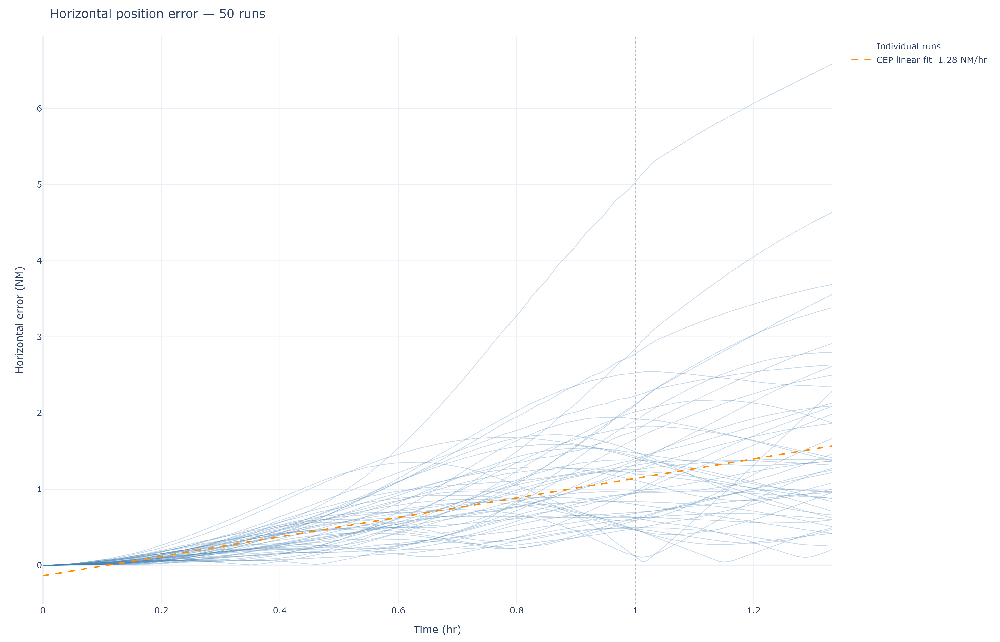

# Monte Carlo evaluation

One simulated flight shows one possible outcome of one set of sensor
errors. To say how good a navigator is, you need the spread of outcomes
over all the errors its IMU might have. ins_sim estimates that spread
empirically: it flies the same truth trajectory many times, each time with
an independent draw of every sensor and alignment error, and summarizes the
ensemble with statistics such as ±3σ bands and the CEP. Every results tab
in the GUI is such a summary, and the GUI's *Monte Carlo iterations* setting
is the number of trials.

!!! abstract "Key results"
    - Each trial flies the same truth with an independent draw of the
      initial alignment error and of every gyro and accelerometer error,
      through the full nonlinear navigator.
    - Errors are the estimate minus the truth, resolved in NED at the true
      position.
    - At every sample the trials are summarized as a mean with ±3σ bands,
      the CEP (the median horizontal error) and the 95th percentile.
    - With \(N\) trials, an estimated σ is uncertain by about
      \(1/\sqrt{2(N - 1)}\): 10% for 50 trials.

## Physical picture



The navigation error of an INS is random: it depends on the particular
biases, noise and alignment error of a particular run. Running many trials
turns that randomness into a distribution. The spread of that distribution
at each moment is the simulator's measure of performance, and how it grows
with time is the IMU's signature.

Each trial gets its own random stream, split again for each error source.
Every number a trial draws therefore depends only on the seed and on which
trial and source it belongs to.

## The statistics

### Errors

Each trial's errors are formed exactly as defined on
[Notation & conventions](notation.md#errors): the attitude error
\(\delta\psivec{nb}{n}\) (North tilt, East tilt, heading), the velocity error
\(\delta\vvec{eb}{n}\), and the position error \(\delta\rvec{eb}{n}\) in metres
along North, East and Down at the true position.

### Mean and ±3σ bands

For any error component \(x\), with \(x_i(t)\) its value in trial \(i\):

$$
\bar x(t) = \frac{1}{N}\sum_{i=1}^{N} x_i(t),
\qquad
s(t) = \sqrt{\frac{1}{N - 1}\sum_{i=1}^{N}\left(x_i(t) - \bar x(t)\right)^2}
$$

where \(N\) is the number of trials, \(\bar x\) the ensemble mean and \(s\)
the sample standard deviation. The *Attitude Errors*, *Velocity Errors* and
*Position Errors* tabs draw \(\bar x\) and the band \(\bar x \pm 3s\). For a
normally distributed error the band holds 99.7% of trials. Together, the
three components' spreads are the diagonal of the empirical covariance

$$
\mathbf{P}(t) = \frac{1}{N - 1}\sum_{i=1}^{N}
\left(\mathbf{x}_i(t) - \bar{\mathbf{x}}(t)\right)
\left(\mathbf{x}_i(t) - \bar{\mathbf{x}}(t)\right)^{\mathsf T}
$$

### CEP and percentiles

The horizontal radial error of trial \(i\) is
\(\rho_i(t) = \sqrt{\delta r_{N,i}^2 + \delta r_{E,i}^2}\). Its median across
trials is the **circular error probable**:

$$
\mathrm{CEP}(t) = \operatorname{median}_i\,\rho_i(t)
$$

Half of the trials lie inside a circle of that radius. The *CEP* tab fits
a straight line to the CEP over the first hour; its slope, in nautical
miles per hour, is the usual one-number figure of merit for an INS. The
95th percentile of the 3-D error \(|\delta\rvec{eb}{n}|\) draws the error
tube of the *3D Trajectory* tab, and that of the horizontal error the
envelope on the *Map*.

For a circular normal distribution with spread \(\sigma\) on each axis,
\(\mathrm{CEP} = \sigma\sqrt{2\ln 2} \approx 1.18\,\sigma\). ins_sim takes
the median of the trials instead, which assumes nothing about the
distribution.

### Sampling uncertainty

Statistics from \(N\) trials are estimates. The relative uncertainty of an
estimated standard deviation is about \(1/\sqrt{2(N - 1)}\):

| Trials \(N\) | 10 | 20 | 50 | 100 | 200 |
| ------------ | -- | -- | -- | --- | --- |
| Uncertainty of \(s\) | 24% | 16% | 10% | 7% | 5% |

Tails converge more slowly than the middle. With 50 trials the 95th
percentile rests on the two or three largest errors, so the error tube
settles only with more trials than the CEP needs.

### Random streams

The random numbers come from a tree of independent streams, spawned from
the seed: one per trial, then one per error source within the trial (the
alignment error, the gyro triad, the accelerometer triad). Each triad draws
its error terms in a fixed order (see
[IMU error model](imu-errors.md#as-implemented)). Two properties follow:

- A trial's errors do not depend on how many trials run: trial 7 is the
  same whether you run 10 trials or 100.
- Changing one error source leaves every other source's realization
  unchanged. Two runs with the same seed and specs that differ only in, say,
  the accelerometer bias therefore differ only because of that bias. These
  *common random numbers* make comparisons sharp with few trials.

The GUI and the command-line tool both use the seed 42, so the same
settings always give the same results.

## As implemented

**1. One trial.** Draw the alignment error, start the navigator from the
truth with that attitude error, generate the noisy IMU outputs and
navigate:

=== "Equation"

    $$
    \Cmat[\hat]{b}{n}(0) = \exp\left(\skew{\delta\psivec{nb}{n}(0)}\right)\Cmat{b}{n}(0),
    \qquad
    \left(\wvec[\tilde]{ib}{b}, \fvec[\tilde]{ib}{b}\right) = \text{IMU}\left(\wvec{ib}{b}, \fvec{ib}{b}\right)
    $$

=== "Code"

    ```python
    --8<-- "ins_sim/evaluation/monte_carlo.py:trial"
    ```

**2. Position error** in metres, at the true position:

=== "Equation"

    $$
    \delta\rvec{eb}{n} =
    \begin{bmatrix}
    (R_N + h_b)\,\delta L_b \\
    (R_E + h_b)\cos L_b\,\delta\lambda_b \\
    -\delta h_b
    \end{bmatrix}
    $$

=== "Code"

    ```python
    --8<-- "ins_sim/evaluation/errors.py:position_error"
    ```

**3. Mean and spread** for the bands:

=== "Equation"

    $$
    \bar x(t) \pm 3\,s(t)
    $$

=== "Code"

    ```python
    --8<-- "ins_sim/gui/figures.py:bands"
    ```

**4. CEP and its growth rate.** The horizontal errors are in nautical miles
and the time in hours:

=== "Equation"

    $$
    \mathrm{CEP}(t) = \operatorname{median}_i\,\rho_i(t),
    \qquad
    \text{rate} = \text{slope of the least-squares line through } \mathrm{CEP}(t),\ t \le 1~\text{h}
    $$

=== "Code"

    ```python
    --8<-- "ins_sim/gui/figures.py:cep"
    ```

**5. Percentile envelope** of the 3-D error:

=== "Equation"

    $$
    r_{95}(t) = \text{95th percentile over the trials of } \left|\delta\rvec{eb}{n}(t)\right|
    $$

=== "Code"

    ```python
    --8<-- "ins_sim/evaluation/monte_carlo.py:percentile"
    ```

## What it looks like



The *Position Errors* tab for 50 trials of the packaged mission with the
navigation-grade spec. The mean error stays near zero, because every error
source is zero-mean across trials, while the ±3σ bands grow to about 10 km
North and 5 km East by the end of the 80-minute mission. The Down band
levels off at about ±250 m once the climb ends: it is the barometer's own
error, which the [barometric loop](vertical-channel.md#barometer-error-model)
passes into the height.



The *CEP* tab for the same run: every trial's horizontal error, and the
straight-line fit to the CEP over the first hour, 1.3 nmi/h. That is close
to what the gyro biases alone predict: the turn-on and in-run biases add
up to about 0.02 °/h per axis, and each 0.01 °/h gives 0.6 nmi/h (see
[INS error model](error-model.md#gyro-bias)).

## Assumptions & limitations

!!! warning "Assumptions & limitations"
    - **Not a covariance analysis.** ins_sim propagates no linearized
      error-state model and no error covariance. Every statistic comes from
      nonlinear trials, so it costs \(N\) full simulations, and it is only
      as accurate as \(N\) allows.
    - **Sampling error.** Bands from a few trials are noisy, and tails need
      more trials than medians; see the table above.
    - **One trajectory.** Every trial flies the same truth trajectory. Only
      the sensor and alignment errors vary.
    - **Only the modelled errors.** A trial contains only the error sources
      on the [IMU error model](imu-errors.md) page, and the barometer's on
      the [Vertical channel](vertical-channel.md#barometer-error-model) page.
    - **Normality is not assumed, but the bands read best with it.** The
      ±3σ bands hold 99.7% of trials only if the errors are normally
      distributed. The CEP and percentiles make no such assumption.

## In the code

| Quantity | Equation | Implemented in |
| -------- | -------- | -------------- |
| The trials | One trial per stream | [`run_monte_carlo`][ins_sim.evaluation.monte_carlo.run_monte_carlo], [`MonteCarloResult`][ins_sim.evaluation.monte_carlo.MonteCarloResult] |
| Errors | \(\delta\psivec{nb}{n}\), \(\delta\vvec{eb}{n}\), \(\delta\rvec{eb}{n}\) | [`attitude_error`][ins_sim.evaluation.errors.attitude_error], [`velocity_error`][ins_sim.evaluation.errors.velocity_error], [`position_error`][ins_sim.evaluation.errors.position_error] |
| Percentile envelope | \(r_{95}(t)\) | [`percentile_envelope`][ins_sim.evaluation.monte_carlo.percentile_envelope] |
| Bands and CEP | \(\bar x \pm 3s\), \(\mathrm{CEP}(t)\) | `_bands_figure` and `figure_cep` in `ins_sim/gui/figures.py` |

This example runs 25 trials of a short flight and summarizes them the way
the GUI does: mean and 3σ for each axis, the CEP and the 95th percentile.
Its exact numbers depend on the random draws, so this page does not show
them:

```python
--8<-- "docs/examples/monte_carlo_stats.py"
```
