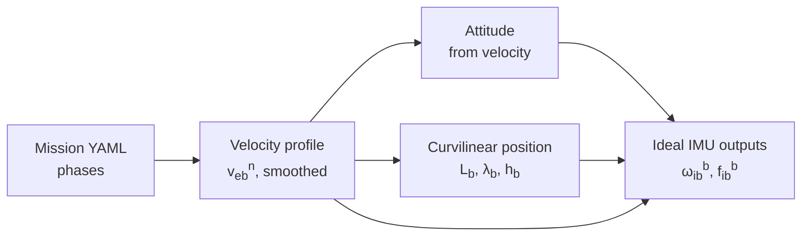
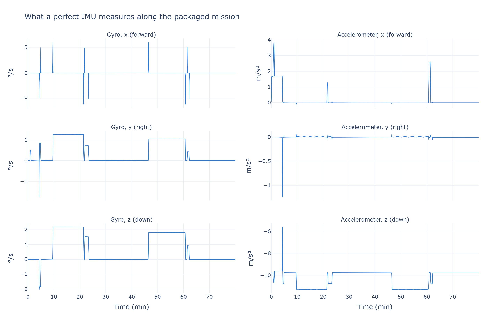

# Truth trajectory & ideal IMU

To test a navigator you need to know the right answer. ins_sim builds a
**truth trajectory** from a mission written in YAML: the vehicle's actual
position, velocity and attitude at every sample. It then works out what a
perfect IMU would have measured along that trajectory. Those ideal gyro and
accelerometer outputs feed the [IMU error model](imu-errors.md); the truth
itself is what every navigation error is measured against. The mission you
pick in the GUI is the one this page builds.

!!! abstract "Key results"
    - The mission is assembled phase by phase in metres along North, East
      and Down from the start point. Its velocity is then smoothed, so every
      manoeuvre starts and ends over a few seconds.
    - The attitude follows the velocity: the nose points along the flight
      path, and every turn is coordinated. There is no angle of attack, no
      sideslip and no wind.
    - By default the ideal IMU outputs are computed as the exact inverse of
      the navigator's basic update. Fed back through the navigator, they
      reproduce the truth to about \(10^{-8}\) m over the whole mission.
    - The simulator then measures how sensor errors propagate, not how
      accurately the navigator integrates continuous motion.
    - An [oversampled truth](#integrating-imu) instead reports what a real,
      integrating IMU would: the average rates over each interval of a
      motion that is continuous within it. Against it the navigator's own
      integration error shows up.

## Physical picture



A mission is a list of phases flown one after another: a ground roll, the
takeoff, a climb, legs to waypoints with optional loiters, and speed
changes. Each phase produces a stretch of position and velocity in metres
from the start point, in that point's North, East and Down axes:

| Phase | Motion |
| ----- | ------ |
| `ground_roll` | Constant acceleration along the runway heading, up to the rotation speed |
| `takeoff` | Pitch and speed ramp up together over a set time |
| `climb` | Constant speed and flight-path angle, up to a target altitude |
| `waypoint` | A coordinated turn to the waypoint's bearing at the departure's `nav_bank_angle_deg`, then a straight or climbing leg to it; optionally a loiter of whole circles at a set bank angle |
| `speed_ramp` | A linear change of speed, optionally to a Mach number at the standard-atmosphere temperature of the current altitude |

A turn at speed \(v\) and bank angle \(\phi\) has radius
\(v^2/(g_0\tan\phi)\), with \(g_0\) = 9.80665 m/s². The phases join with
corners in their velocity, so the whole velocity profile is smoothed with a
Gaussian filter of 2 s standard deviation. A roll into a turn then takes
4 to 6 s, as it would in a transport aircraft.

## Continuous-time model

### Attitude from velocity

The truth vehicle flies like an idealized aircraft: its nose points along
its velocity, and it banks exactly as much as a coordinated turn needs.

$$
\psi_{nb} = \operatorname{atan2}\left(v_E,\, v_N\right),
\qquad
\theta_{nb} = \operatorname{atan2}\left(-v_D,\, v_h\right),
\qquad
\phi_{nb} = \operatorname{atan2}\left(v_h\,\dot\psi_{nb},\, g_\text{ref}\right)
$$

where:

- \(\psi_{nb}\), \(\theta_{nb}\) and \(\phi_{nb}\) are the heading, pitch
  and roll [rad];
- \(v_N\), \(v_E\), \(v_D\) are the components of \(\vvec{eb}{n}\), and
  \(v_h = \sqrt{v_N^2 + v_E^2}\) is the horizontal speed [m/s];
- \(\dot\psi_{nb}\) is the rate of change of heading [rad/s];
- \(g_\text{ref}\) is gravity at the departure point [m/s²].

The roll formula is the coordinated-turn condition: the lift, tilted by the
bank angle, supplies the centripetal acceleration \(v_h\dot\psi_{nb}\)
sideways while still balancing gravity. Nothing pushes the aircraft
sideways relative to its own axes, so the lateral accelerometer reads
almost zero, even in a turn.

### What a perfect IMU measures

A perfect gyro triad measures the body's angular rate relative to inertial
space, \(\wvec{ib}{b}\). That is the body's rate relative to the NED frame,
plus the NED frame's own rotation (Earth rate and transport rate):

$$
\wvec{ib}{b} = \wvec{nb}{b} + \Cmat{n}{b}\left(\wvec{ie}{n} + \wvec{en}{n}\right)
$$

A perfect accelerometer triad measures specific force, \(\fvec{ib}{b}\): the
acceleration the vehicle needs, relative to the rotating Earth, plus the
Coriolis and transport terms, minus gravity:

$$
\fvec{ib}{n} = \vvec[\dot]{eb}{n} + \left(2\wvec{ie}{n} + \wvec{en}{n}\right)\times\vvec{eb}{n} - \gvec{b}{n},
\qquad
\fvec{ib}{b} = \Cmat{n}{b}\,\fvec{ib}{n}
$$

where \(\Cmat{n}{b} = (\Cmat{b}{n})^{\mathsf T}\) resolves NED vectors in
body axes, and \(\gvec{b}{n}\) is gravity
(see [Earth & gravity](earth-gravity.md)). These are the
[navigation equations](mechanization.md) solved for the sensor outputs:
given the motion, they return the measurements that would produce it.

## As implemented

The truth is built on the same time grid as the navigator, one sample per
IMU interval \(\tau_i\), and its outputs are written as the exact inverse of
the navigator's discrete update rather than of the continuous equations.

**1. Smoothing.** The phases' velocity profile is low-pass filtered:

=== "Equation"

    $$
    \vvec{eb}{n}(t) \leftarrow \left(G_\sigma * \vvec{eb}{n}\right)(t),
    \qquad \sigma = 2~\text{s}
    $$

    where \(G_\sigma\) is a Gaussian kernel and \(*\) is convolution.

=== "Code"

    ```python
    --8<-- "ins_sim/trajectory/kinematics.py:velocity_smoothing"
    ```

**2. Attitude from velocity.** The heading rate is a finite difference of
the sampled heading:

=== "Equation"

    $$
    \psi_{nb} = \operatorname{atan2}(v_E, v_N),
    \quad
    \theta_{nb} = \operatorname{atan2}(-v_D, v_h),
    \quad
    \phi_{nb} = \operatorname{atan2}(v_h\,\dot\psi_{nb},\, g_\text{ref})
    $$

=== "Code"

    ```python
    --8<-- "ins_sim/trajectory/kinematics.py:attitude_from_velocity"
    ```

**3. Curvilinear position.** Latitude, longitude and height are integrated
from the velocity, one forward-Euler step per sample, exactly as the
navigator integrates them:

=== "Equation"

    $$
    L_{b,k+1} = L_{b,k} + \frac{v_{N,k}\,\tau_i}{R_N + h_{b,k}},
    \quad
    \lambda_{b,k+1} = \lambda_{b,k} + \frac{v_{E,k}\,\tau_i}{(R_E + h_{b,k})\cos L_{b,k}},
    \quad
    h_{b,k+1} = h_{b,k} - v_{D,k}\,\tau_i
    $$

    with the radii evaluated at \(L_{b,k}\).

=== "Code"

    ```python
    --8<-- "ins_sim/trajectory/kinematics.py:truth_position"
    ```

**4. Specific force.** The velocity's rate of change over each step is a
forward difference, the same difference the navigator's velocity update
will take:

=== "Equation"

    $$
    \fvec{ib}{n}(k) = \frac{\vvec{eb}{n}(k+1) - \vvec{eb}{n}(k)}{\tau_i}
    + \left(2\wvec{ie}{n} + \wvec{en}{n}\right)_k \times \vvec{eb}{n}(k)
    - \gvec{b}{n}(k),
    \qquad
    \fvec{ib}{b}(k) = \Cmat{n}{b}(k)\,\fvec{ib}{n}(k)
    $$

=== "Code"

    ```python
    --8<-- "ins_sim/trajectory/kinematics.py:truth_specific_force"
    ```

**5. Angular rate.** The body's rotation over each step is taken from the
two attitudes at either end of it, exactly, as a rotation vector:

=== "Equation"

    $$
    \wvec{nb}{b}(k) = \frac{1}{\tau_i}\operatorname{rotvec}\left(\Cmat{n}{b}(k)\,\Cmat{b}{n}(k+1)\right),
    \qquad
    \wvec{ib}{b}(k) = \wvec{nb}{b}(k) + \Cmat{n}{b}(k)\,\wvec{in}{n}(k)
    $$

=== "Code"

    ```python
    --8<-- "ins_sim/trajectory/kinematics.py:truth_angular_rate"
    ```

The navigator undoes each of these steps exactly: its attitude update
applies the same rotation vector, its velocity update the same difference,
and its position update the same Euler step. The last sample, which has no
next sample to difference against, repeats the previous outputs.

!!! note "Compared with Groves (2013)"
    The specific force and angular rate are the kinematic definitions of
    Groves' navigation equations[^groves], solved for the sensor outputs.
    What is specific to ins_sim is that they are discretized to invert the
    navigator's own first-order update, so the truth and the navigator
    agree exactly when the sensors are perfect.

### Integrating IMU { #integrating-imu }

The default outputs describe a vehicle that moves in jumps, one step at a
time. To test how well the navigator integrates continuous motion, ins_sim
can instead give the outputs of a real IMU, which integrates the rates over
each interval. With `oversample` set to \(M\), the mission is built at the
finer step \(\tau_f = \tau_i/M\), and the truth is the continuous motion
through those fine samples: between two of them the body turns relative to
NED at a constant rate, the velocity changes at a constant rate, and the
specific force in NED is constant. The states are kept every \(M\)-th
sample, and the outputs are the averages of \(\wvec{ib}{b}\) and
\(\fvec{ib}{b}\) over each interval \(\tau_i\), which is what an integrating
IMU reports.

**1. Position**, by the trapezoidal rule, since the velocity changes
linearly between fine samples:

=== "Equation"

    $$
    h_{b,j+1} = h_{b,j} - \tfrac12\left(v_{D,j} + v_{D,j+1}\right)\tau_f,
    \qquad
    L_{b,j+1} = L_{b,j} + \tfrac12\left(\frac{v_{N,j}}{R_N + h_{b,j}} + \frac{v_{N,j+1}}{R_N + h_{b,j+1}}\right)\tau_f
    $$

    and likewise for \(\lambda_b\).

=== "Code"

    ```python
    --8<-- "ins_sim/trajectory/kinematics.py:fine_position"
    ```

**2. Integrated outputs.** Over the fine step \(j\) the body turns through
\(\boldsymbol{\phi}_j = \operatorname{rotvec}(\Cmat{n}{b}(j)\,\Cmat{b}{n}(j+1))\)
relative to NED, so the NED-to-body matrix is
\(\exp(-s\skew{\boldsymbol{\phi}_j})\Cmat{n}{b}(j)\) a fraction \(s\) of
the way through it. Averaging that over the step gives the matrix
\(\boldsymbol{\Gamma}(-\boldsymbol{\phi}_j)\Cmat{n}{b}(j)\), with
\(\boldsymbol{\Gamma}(\mathbf{x}) = \Ithree + \frac{1 - \cos x}{x^2}\skew{\mathbf{x}} +
\frac{x - \sin x}{x^3}\skew{\mathbf{x}}^2\) and \(x = |\mathbf{x}|\):

=== "Equation"

    $$
    \avec{ib,j}{b} = \boldsymbol{\phi}_j + \tau_f\,\boldsymbol{\Gamma}(-\boldsymbol{\phi}_j)\,\Cmat{n}{b}(j)\,\wvec{in}{n}(j),
    \qquad
    \uvec{ib,j}{b} = \tau_f\,\boldsymbol{\Gamma}(-\boldsymbol{\phi}_j)\,\Cmat{n}{b}(j)\,\fvec{ib}{n}(j)
    $$

    with \(\fvec{ib}{n}(j)\) as in step 4 above, at the fine step. The
    outputs are the sums over the \(M\) fine steps of each interval,
    divided by \(\tau_i\).

=== "Code"

    ```python
    --8<-- "ins_sim/trajectory/kinematics.py:integrated_imu"
    ```

The truth is still built from fine samples, so it is continuous motion only
to the extent that the fine step resolves it. Against it, a navigator at
\(\tau_i\) shows its own error plus a floor from the fine step that falls
with \(\tau_f^2\): on the packaged mission, about 3 m of horizontal error at
\(\tau_f\) = 0.01 s, and 1 m at 0.005 s. Keep \(M\) large enough that the
floor stays below the error you want to see. The
[Strapdown mechanization](mechanization.md#precision-mechanization) page
describes the navigator that integrates these outputs accurately.

## What it looks like



What a perfect IMU measures along the packaged mission, at the app's default
\(\tau_i\) = 0.1 s. Every feature has a simple physical reading:

- **Accelerometer z**: −9.8 m/s² in level flight, the reaction to gravity.
  It reaches −11.3 m/s² in the 30° banks of the two loiters,
  \(g/\cos 30°\), and −10.8 m/s² in the 25° turns to the waypoints. In the
  10° climb it is \(-g\cos 10°\) = −9.6 m/s².
- **Accelerometer x**: the takeoff run, then +1.7 m/s² during the climb,
  where the pitched-up accelerometer feels \(g\sin 10°\) of gravity. Later
  come the two speed changes.
- **Accelerometer y** stays close to zero throughout, because every turn is
  coordinated.
- **Gyros**: in a banked turn the turn rate splits between the body's z axis
  (\(\dot\psi_{nb}\cos\phi_{nb}\)) and its y axis
  (\(\dot\psi_{nb}\sin\phi_{nb}\)). The x gyro shows the brief roll into and
  out of each turn.

Earth rate, 15 °/h or 0.004 °/s, is in the gyro outputs too, but far too
small to see at this scale.

The [zero-noise round trip](../validation/index.md#zero-noise-round-trip)
on the Validation page feeds these outputs back through the navigator, which
reproduces the truth to \(2.3 \times 10^{-8}\) m. The
[Strapdown mechanization](mechanization.md#what-it-looks-like) page plots
that residual.

## Assumptions & limitations

!!! warning "Assumptions & limitations"
    - **Point-mass flight.** The body axes follow the velocity: no angle of
      attack, no sideslip, no wind, no vibration, and no lever arm between
      the IMU and the vehicle's reference point.
    - **No integration error to find, by default.** The default outputs are
      piecewise constant over each step and invert the navigator's own
      basic discretization. The navigator's integration errors, such as
      coning, sculling and its first-order velocity update, are therefore
      invisible: the simulator behaves as if the navigation algorithm were
      perfect. An [oversampled truth](#integrating-imu) makes them visible.
    - **The sample interval shows up in turns.** The specific force is the
      forward difference across a step, so during a turn it has a small
      component along the direction of flight, about
      \(-v_h\dot\psi_{nb}^2\tau_i/2\). At \(\tau_i\) = 1 s that is about
      −0.1 m/s² in the loiters, as the example below prints; at 0.1 s it is
      ten times smaller. The navigator undoes it exactly.
    - **Waypoints are approximate.** Bearings and distances to waypoints use
      a spherical Earth, and legs are straight lines in the start point's
      NED axes, so a distant waypoint is reached only approximately.
    - **Standard atmosphere.** Mach numbers are converted to speed with the
      ISA temperature at the current altitude. The departure altitude, given
      above mean sea level, is used as the ellipsoidal height.

## In the code

| Quantity | Equation | Implemented in |
| -------- | -------- | -------------- |
| Mission phases and smoothing | Phase table, \(G_\sigma * \vvec{eb}{n}\) | [`build_trajectory`][ins_sim.trajectory.kinematics.build_trajectory] |
| Attitude from velocity | \(\psi_{nb}\), \(\theta_{nb}\), \(\phi_{nb}\) | `_euler_from_velocity` in `ins_sim/trajectory/kinematics.py` |
| Curvilinear position | Forward-Euler \(L_b\), \(\lambda_b\), \(h_b\) | [`TruthTrajectory`][ins_sim.trajectory.kinematics.TruthTrajectory] |
| Ideal IMU outputs | \(\fvec{ib}{b}\), \(\wvec{ib}{b}\) | [`TruthTrajectory`][ins_sim.trajectory.kinematics.TruthTrajectory] |
| Integrating IMU | \(\avec{ib}{b}\), \(\uvec{ib}{b}\) over each interval | `oversample` in [`TruthTrajectory`][ins_sim.trajectory.kinematics.TruthTrajectory] and [`build_trajectory`][ins_sim.trajectory.kinematics.build_trajectory] |
| Smooth test paths | Cubic spline through NED waypoints, flown at constant speed | [`NEDSplinePath`][ins_sim.trajectory.spline.NEDSplinePath], [`TruthTrajectory.from_spline`][ins_sim.trajectory.kinematics.TruthTrajectory.from_spline] |

This example builds the packaged mission at \(\tau_i\) = 1 s, prints the
ideal accelerometer output in level flight and in the most steeply banked
turn, and runs the zero-noise round trip:

=== "Script"

    ```python
    --8<-- "docs/examples/truth_imu.py"
    ```

=== "Output"

    ```text
    --8<-- "docs/examples/truth_imu.txt"
    ```

In level flight the accelerometers also sense 0.008 m/s² sideways and a
little more than gravity vertically. Holding a constant velocity relative
to the rotating, curved Earth is an accelerated motion in inertial space,
and those are the Coriolis and transport terms of the specific force.

## References

[^groves]: [Groves (2013)](../reference/bibliography.md#groves2013), Chapter 2,
    for specific force and the kinematics of rotating frames, and Chapter 5
    for the navigation equations that the ideal outputs invert.
