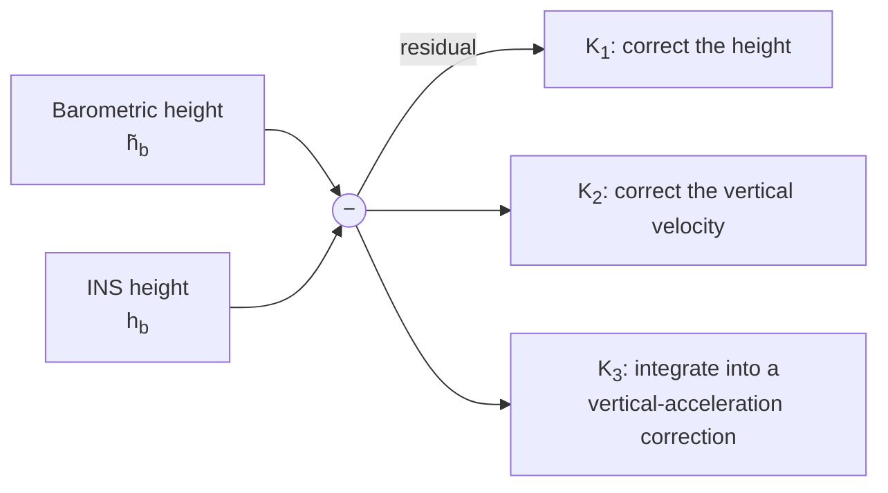
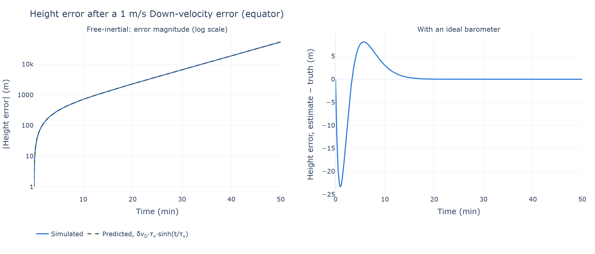
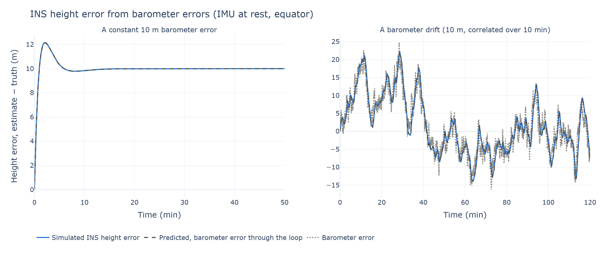

# Vertical channel

Height is the one direction in which an INS cannot navigate on its own for
long. Gravity weakens with height, so a navigator that believes it is
higher than it is computes too little gravity. The resulting acceleration
error pushes it higher still, and the error grows exponentially, with a
time constant of under ten minutes. Every practical INS therefore blends in
a height measurement, usually from a barometric altimeter. ins_sim does
this with a third-order damping loop, which is on by default. Untick
*Baro altitude aiding* in the GUI to watch the free-inertial vertical
channel diverge.

!!! abstract "Key results"
    - Free-inertial, a height error grows as \(\sinh(t/\tau_v)\), with
      \(\tau_v\) = 573 s at the equator. A 1 m/s vertical-velocity error
      becomes 6.6 km of height error in 30 minutes.
    - The barometric loop places all three of its poles at \(-1/\tau\), with
      \(\tau\) = 100 s. The same 1 m/s error then causes a 23 m transient
      that dies away within about 20 minutes.
    - The loop's integrator cancels a constant vertical accelerometer bias.
    - The INS height follows the barometer, errors included. A constant
      barometer error ends up in full in the INS height, a slow drift is
      followed with a lag, and white noise is filtered down to
      \(1.44\,N/\sqrt\tau\). With the packaged spec the barometer, not the
      IMU, sets the Down position error.

## Physical picture



Without a height reference, the vertical channel is a positive feedback
loop. A height error \(\delta h_b\) makes the computed gravity wrong by the
free-air gradient, \(-(2g/R_0)\,\delta h_b\): too weak if the navigator is
too high. Too little gravity means a computed upward acceleration, which
makes the height error grow faster.

With a barometric altimeter, the navigator compares its height with the
barometer's and feeds the difference back into three places: the height
itself, the vertical velocity, and an integrator that learns any steady
vertical-acceleration error, such as an accelerometer bias.

## Continuous-time model

### The free-inertial instability

Linearizing the vertical velocity equation about the true trajectory gives
the height error's dynamics:

$$
\delta\ddot h_b = \left(\frac{2g}{R_0} - 4\,\omega_{ie}^2\cos^2 L_b\right)\delta h_b - \delta f_D
= \frac{\delta h_b}{\tau_v^2} - \delta f_D
$$

where:

- \(\delta h_b\) is the height error [m] and \(\delta f_D\) the error in the
  Down specific force [m/s²];
- \(R_0\) is the equatorial radius [m] and \(\omega_{ie}\) the Earth rotation
  rate [rad/s];
- \(\tau_v\) is the time constant of the divergence [s].

The first term is the gravity gradient. The second, much smaller, is
Coriolis coupling: a vertical velocity error causes an East velocity error
through the Earth's rotation, which in turn feeds back into the vertical.
From a vertical velocity error \(\delta v_D(0)\) and no other error,

$$
\delta h_b(t) = -\delta v_D(0)\,\tau_v\sinh\frac{t}{\tau_v},
\qquad
\tau_v = \left(\frac{2g}{R_0} - 4\,\omega_{ie}^2\cos^2 L_b\right)^{-1/2}
\approx 573~\text{s}
$$

and from a constant Down accelerometer bias \(b_D\),
\(\delta h_b(t) = -b_D\,\tau_v^2\left(\cosh(t/\tau_v) - 1\right)\). Both
grow by a factor of \(e\) every 9.5 minutes.

### The barometric damping loop

Writing \(\tilde h_b\) for the barometric height, the loop adds three
corrections, driven by the residual \(r = h_b - \tilde h_b\):

$$
\dot h_b = -v_D - K_1\,r,
\qquad
\dot v_D = \left(\dot v_D\right)_\text{inertial} + K_2\,r + a_c,
\qquad
\dot a_c = K_3\,r
$$

$$
K_1 = \frac{3}{\tau}, \qquad K_2 = \frac{3}{\tau^2}, \qquad K_3 = \frac{1}{\tau^3}
$$

where:

- \(r\) is the residual, INS height minus barometric height [m];
- \(\left(\dot v_D\right)_\text{inertial}\) is the Down component of the
  velocity equation on [Strapdown mechanization](mechanization.md) [m/s²];
- \(a_c\) is the integrator's vertical-acceleration correction [m/s²];
- \(\tau\) is the loop's time constant, 100 s by default [s].

If the INS is too high (\(r > 0\)), the loop lowers its height directly
through \(K_1\), commands a descent through \(K_2\), and slowly builds up a
downward acceleration through \(K_3\). With an ideal barometer the
residual is the height error itself, and the closed loop's error dynamics
have the characteristic polynomial

$$
s^3 + K_1 s^2 + \left(K_2 - \frac{2g}{R_0}\right)s + K_3 \approx \left(s + \frac{1}{\tau}\right)^3
$$

The gravity gradient \(2g/R_0\) is only 1% of \(K_2\) at \(\tau\) = 100 s,
so the three poles sit very close to \(-1/\tau\): critically damped, without
oscillation. For a vertical velocity error \(\delta v_D(0)\) the height
error is then

$$
\delta h_b(t) \approx -\delta v_D(0)\,t\,e^{-t/\tau}\left(1 - \frac{t}{2\tau}\right)
$$

which reaches \(-0.23\,\delta v_D(0)\,\tau\) at \(t = 0.59\,\tau\), changes
sign at \(t = 2\tau\), and overshoots by \(+0.08\,\delta v_D(0)\,\tau\) at
\(t = 3.4\,\tau\). A constant accelerometer bias leaves no steady height
error: the integrator settles at \(a_c = -b_D\).

### Barometer errors { #barometer-error-model }

A pressure altimeter measures static pressure and converts it to height
through a standard atmosphere, so its height is wrong whenever the day's
atmosphere differs from that standard[^groves]. ins_sim models the
barometric height as

$$
\tilde h_b = h_b + s_b\left(h_b - h_{b0}\right) + b_{bs} + b_{bd}(t) + w_b
$$

where:

- \(h_{b0}\) is the height of the departure point [m]. There the altimeter
  setting makes the barometer read correctly, apart from \(b_{bs}\);
- \(s_b\) is the scale-factor error [dimensionless]. Air colder than
  standard is denser, so pressure falls off faster with height, and the
  altimeter misreads the height above the departure point by about
  \(\Delta T/T\);
- \(b_{bs}\) is the static bias [m], from the error in the altimeter
  setting (QNH) and the sensor's offset;
- \(b_{bd}\) is the weather drift [m], a first-order Gauss–Markov process,
  the same model as the in-run biases on the
  [IMU error model](imu-errors.md) page;
- \(w_b\) is white noise of density \(N\) [m/√Hz].

Writing \(e = \tilde h_b - h_b\) for the barometer's error, the residual is
\(r = \delta h_b - e\). The loop equations above then give the INS height
error as \(e\) passed through a filter:

$$
\frac{\delta h_b(s)}{e(s)}
= \frac{K_1 s^2 + K_2 s + K_3}{s^3 + K_1 s^2 + \left(K_2 - 1/\tau_v^2\right)s + K_3}
\approx \frac{3\tau^2 s^2 + 3\tau s + 1}{\left(\tau s + 1\right)^3}
$$

Its gain at \(s = 0\) is exactly 1, gravity gradient included. That has
three consequences:

- **A constant error ends up in full in the INS height.** After a step
  \(e_0\), the height error is
  \(e_0\left[1 - e^{-t/\tau}\left(1 - 2t/\tau + t^2/2\tau^2\right)\right]\).
  It overshoots by 21% at \(t = 1.27\,\tau\), then settles on \(e_0\): the
  navigator cannot tell a barometer bias from a true height.
- **A slow drift is followed with a lag.** Drifts much slower than \(\tau\)
  pass almost unchanged; the faster the drift, the further the INS height
  lags behind it.
- **White noise is filtered.** The INS height error becomes stationary
  noise with the spread below, where \(h(t)\) is the filter's impulse
  response.

$$
\sigma_{\delta h} = N\sqrt{\int_0^\infty h(t)^2\,dt}
\approx \sqrt{\frac{33}{16}}\,\frac{N}{\sqrt\tau}
\approx 1.44\,\frac{N}{\sqrt\tau}
$$

With \(N\) = 0.1 m/√Hz and \(\tau\) = 100 s that is 1.4 cm, against
0.32 m per sample from the barometer itself at 10 Hz.

The scale factor and the bias are fixed for a run, and the weather drift
is much slower than the loop, so all three pass almost in full into the
INS height. With the packaged spec, on a mission that climbs 4.5 km, the
scale factor alone gives about 90 m (1σ).

## As implemented

**1. Barometric height.** `run_monte_carlo` draws each trial's barometer
errors from a random stream of their own, so switching them on leaves the
IMU and alignment errors of every trial unchanged:

=== "Equation"

    $$
    \tilde h_b = h_b + s_b\left(h_b - h_{b0}\right) + b_{bs} + b_{bd} + w_b,
    \qquad \sigma_{w_b} = N/\sqrt{\tau_i}
    $$

=== "Code"

    ```python
    --8<-- "ins_sim/sensors/baro.py:baro_errors"
    ```

**2. Gains**, set once from `baro_tau`:

=== "Equation"

    $$
    K_1 = \frac{3}{\tau}, \qquad K_2 = \frac{3}{\tau^2}, \qquad K_3 = \frac{1}{\tau^3}
    $$

=== "Code"

    ```python
    --8<-- "ins_sim/navigation/strapdown.py:baro_gains"
    ```

**3. Vertical velocity and integrator.** Inside the velocity update, the
residual corrects the Down acceleration through \(K_2\) and the
integrator, and the integrator accumulates \(K_3\,r\):

=== "Equation"

    $$
    v_{D,k+1} = v_{D,k} + \left[\left(\dot v_D\right)_\text{inertial} + K_2\,r_k + a_{c,k}\right]\tau_i,
    \qquad
    a_{c,k+1} = a_{c,k} + K_3\,r_k\,\tau_i
    $$

=== "Code"

    ```python
    --8<-- "ins_sim/navigation/strapdown.py:velocity_update"
    ```

**4. Height.** Inside the position update, the residual corrects the height
through \(K_1\):

=== "Equation"

    $$
    h_{b,k+1} = h_{b,k} - v_{D,k}\,\tau_i - K_1\,r_k\,\tau_i
    $$

=== "Code"

    ```python
    --8<-- "ins_sim/navigation/strapdown.py:position_update"
    ```

!!! note "Compared with Groves (2013)"
    Groves[^groves] explains the vertical channel's instability and
    barometric height measurement, and combines sensors with Kalman
    filters. ins_sim instead uses a classical fixed-gain, third-order
    baro-inertial loop[^tw], with its gains chosen to place a triple pole.

## What it looks like



A level IMU at rest at the equator, with a 1 m/s Down-velocity error and no
other error. Free-inertial, the height error follows the \(\sinh\)
prediction, reaching 6.6 km after 30 minutes; its fitted time constant is
within 0.1% of \(\tau_v\). With the barometric loop it peaks at 23 m and
decays, as the closed form above predicts. Both are checks on the
[Validation](../validation/index.md#vertical-channel) page.



The same IMU at rest, now with a barometer that errs. On the left, a
constant 10 m barometer error: the INS height overshoots by about 21% and
settles on 10 m. On the right, a fast barometer drift, 10 m correlated
over 10 minutes: the INS height follows it a little late, as the filter
above predicts. Both are checks on the
[Validation](../validation/index.md#barometer-errors) page.

## Assumptions & limitations

!!! warning "Assumptions & limitations"
    - **A simple barometer model.** The temperature error is one scale
      factor for the whole flight, and the weather one Gauss–Markov drift.
      Real errors follow the route's actual weather, and an aircraft's
      static-pressure ports add errors that change with speed and
      attitude. Without a `baro` block in the IMU spec the barometer is
      ideal, and the aided vertical errors are then optimistic.
    - **Fixed gains.** The loop does not adapt to the quality of the
      barometer; \(\tau\) is fixed at 100 s in the GUI. The Python API
      accepts other values through `baro_tau`.
    - **Coupling neglected in the closed forms.** The pole placement ignores
      the gravity gradient and the Coriolis coupling with the East channel.
      The simulation includes both, which is why it departs from the
      closed form by about 1%.

## In the code

| Quantity | Equation | Implemented in |
| -------- | -------- | -------------- |
| Loop gains and corrections | \(K_1\), \(K_2\), \(K_3\), \(a_c\) | [`strapdown_navgrade`][ins_sim.navigation.strapdown.strapdown_navgrade], arguments `meas_h_b` and `baro_tau` |
| Barometric height | \(\tilde h_b\) | [`generate_baro_samples`][ins_sim.sensors.baro.generate_baro_samples]; [`run_monte_carlo`][ins_sim.evaluation.monte_carlo.run_monte_carlo], argument `baro_aiding` |
| Barometer error spreads | \(s_b\), \(b_{bs}\), \(b_{bd}\), \(N\) | [`BaroSpec`][ins_sim.sensors.baro.BaroSpec], the `baro` block of the [IMU spec](../reference/imu-yaml.md#baro) |
| Weather drift | \(b_{bd}\) | [`gauss_markov`][ins_sim.sensors.noise.gauss_markov] |
| Gravity gradient | \(-2g/R_0\) | [`normal_gravity`][ins_sim.core.earth_model.normal_gravity] |

This example applies a 1 m/s Down-velocity error to a level IMU at rest at
the equator and compares the simulated height error with both closed forms:

=== "Script"

    ```python
    --8<-- "docs/examples/vertical_channel.py"
    ```

=== "Output"

    ```text
    --8<-- "docs/examples/vertical_channel.txt"
    ```

## References

[^groves]: [Groves (2013)](../reference/bibliography.md#groves2013), Chapter 5
    for the instability of the vertical channel, and Chapter 6 for
    barometric height measurement.

[^tw]: [Titterton & Weston (2004)](../reference/bibliography.md#titterton2004).
