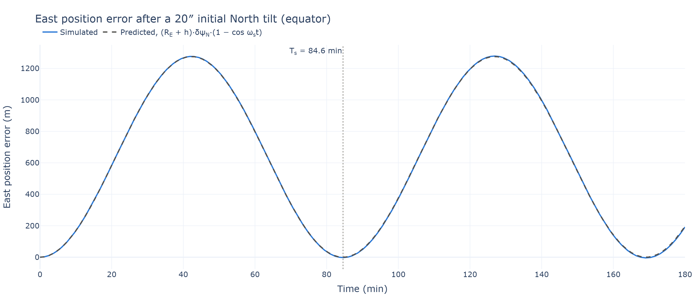
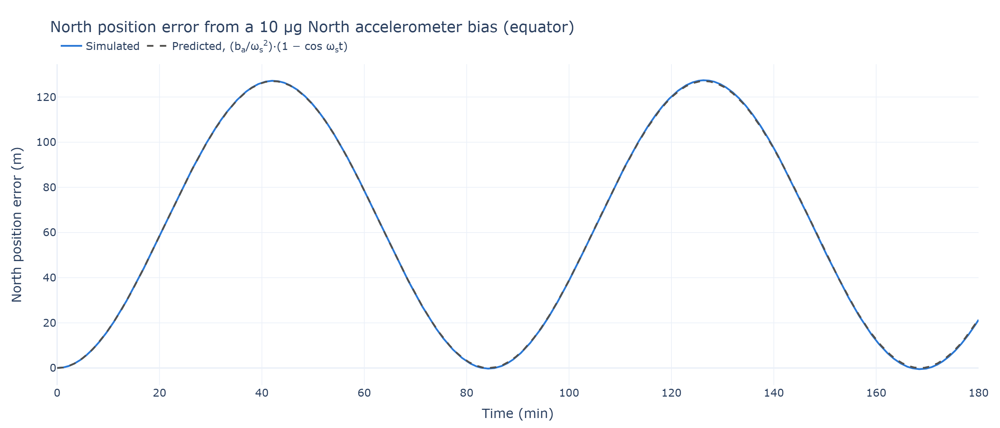
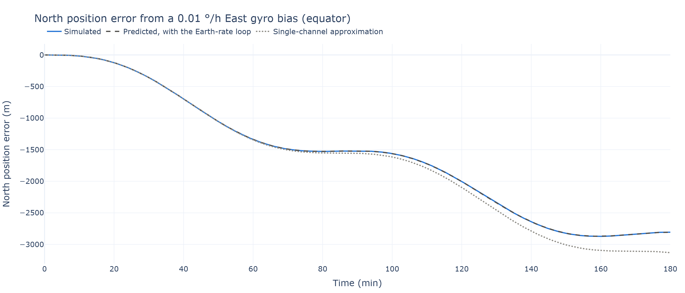
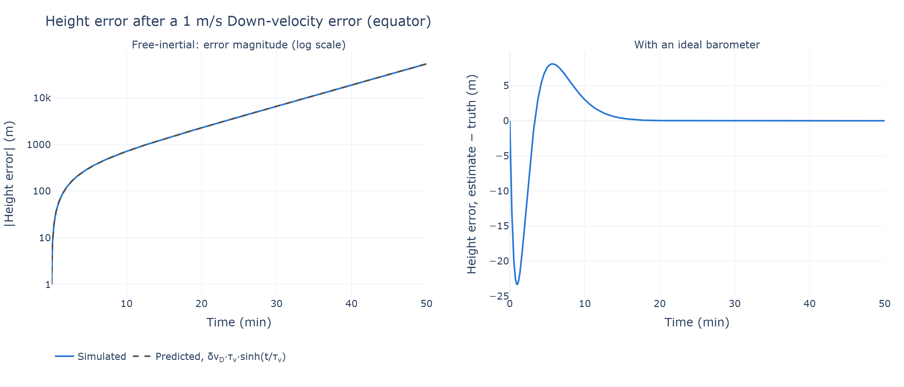
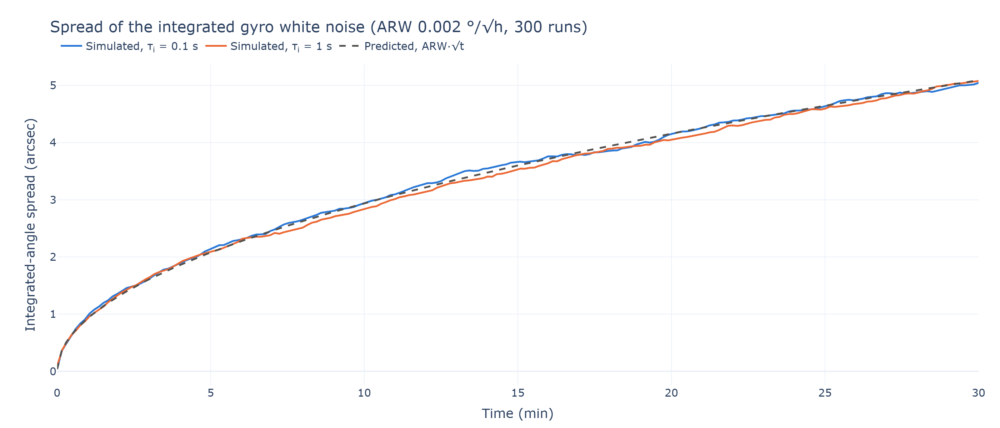
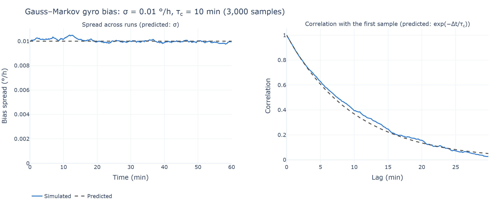
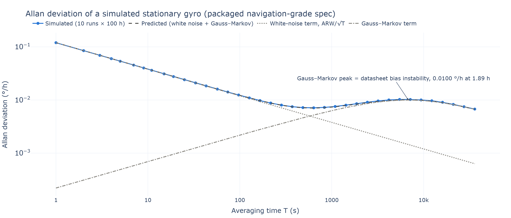

# Validation

A simulator is only useful if it is right. This page checks ins_sim
against results that can be worked out on paper: the textbook behaviour of
inertial navigation errors, and the defining statistics of the sensor noise
models.

Each check runs the simulator's own code (the same truth generator, IMU
error model and strapdown navigator the app uses) on a scenario simple
enough to have an exact answer, usually a stationary IMU with exactly one
error source. The test suite asserts every agreement on each commit, and
the figures and table below are regenerated from the same scenarios.

!!! abstract "Key results"
    - Every inertial check agrees with its prediction to within 0.3%, and
      every noise check to within statistical sampling error.
    - A 0.01 °/h gyro bias starts the position drifting at about 0.6 nmi/h,
      the classic figure for a navigation-grade INS. Over hours the
      Earth-rate loop bends that drift over, and the simulator reproduces
      the bend too.
    - The bias instability in an IMU spec is the datasheet value. ins_sim
      models the in-run bias with a Gauss–Markov process whose spread it
      sets to \(B/0.617\), so the simulated bias's Allan deviation peaks
      at exactly \(B\) (see [Allan deviation](#allan-deviation)).

## Summary

--8<-- "includes/validation_results.md"

## How the checks are set up

The inertial checks use a level IMU at rest at the equator, facing North.
There the vertical component of Earth rate is zero, so the Foucault effect
(Earth rate slowly swapping error between the North and East channels)
vanishes, and the single-axis textbook formulas apply exactly. The truth's
own perfect IMU outputs, plus the one error under test, go through the
navigator:

=== "Code"

    ```python
    --8<-- "tools/validation_scenarios.py:navigate"
    ```

Errors are the estimate minus the truth, resolved along North, East and
Down at the true position: \(\delta\rvec{eb}{n}\) for position and
\(\delta\psivec{nb}{n}\) for attitude (see
[Notation & conventions](../theory/notation.md#errors)). The scenarios live
in `tools/validation_scenarios.py`; the assertions in `tests/validation/`.

## Zero-noise round trip

The truth trajectory's IMU outputs are defined as the exact inverse of the
navigator's update, so feeding them back through the navigator must
reproduce the truth. On the packaged mission the largest difference is a
few times \(10^{-8}\) m, numerical precision. This proves that the truth
generator and the navigator are consistent with each other. It does not
measure how accurately the navigator integrates continuous motion, because
the truth is itself defined by the same discrete steps.

## Schuler oscillation

A tilted INS misreads part of gravity as horizontal acceleration. The
resulting position error moves the computed local vertical, which reduces
the tilt: a pendulum with the Earth's radius as its length, the Schuler
loop. An initial North tilt \(\delta\psi_N(0)\) sets the East channel
oscillating:

$$
\delta r_E(t) = (R_E + h_b)\,\delta\psi_N(0)\,\bigl(1 - \cos\omega_s t\bigr),
\qquad
\omega_s = \sqrt{\frac{g}{R_E + h_b}},
\qquad
T_s = \frac{2\pi}{\omega_s}
$$

where:

- \(\delta r_E\) is the East position error [m];
- \(R_E\) is the transverse radius of curvature and \(h_b\) the height [m];
- \(g\) is the acceleration due to gravity [m/s²];
- \(\omega_s\) is the Schuler frequency [rad/s] and \(T_s\) its period [s].



A 20″ tilt produces up to 1.3 km of position error, yet the error never
grows past that: it returns to zero every 84.6 minutes.

## Accelerometer bias

A constant accelerometer bias \(b_a\) is balanced, on average, by a tilt
of \(b_a/g\). The position error oscillates about a fixed offset and does
not grow:

$$
\delta r_N(t) = \frac{b_a}{\omega_s^2}\,\bigl(1 - \cos\omega_s t\bigr),
\qquad
\omega_s = \sqrt{\frac{g}{R_N + h_b}}
$$

where \(b_a\) is the North accelerometer bias [m/s²] and \(R_N\) the
meridian radius of curvature [m].



## Gyro bias

A constant gyro bias \(b_g\) is different: it keeps rotating the computed
attitude, so the position error grows. At first it grows at the rate
\((R_N + h_b)\,b_g\), about 0.6 nmi/h for 0.01 °/h. Over hours a second
loop bends it over. The North position error is a latitude error, which
misresolves Earth rate into a heading error that feeds back into the tilt.
Solving the coupled tilt, heading, velocity and latitude error equations
at the equator gives:

$$
\delta r_N(t) = -(R_N + h_b)\,b_g\,
\frac{\omega_s^2}{\omega_s^2 - \omega_{ie}^2}
\left(\frac{\sin\omega_{ie}t}{\omega_{ie}} - \frac{\sin\omega_s t}{\omega_s}\right)
$$

where \(b_g\) is the East-axis gyro bias [rad/s] and \(\omega_{ie}\) the
Earth rotation rate [rad/s]. While \(\omega_{ie}t\) is small this reduces
to the single-channel result
\(-(R_N + h_b)\,b_g\,(t - \sin\omega_s t/\omega_s)\).



!!! note "The Earth-rate loop is real physics"
    After three hours the single-channel approximation overstates the error
    by about 10%. The simulation follows the full prediction to within
    0.1%: the simulator's rotating-Earth terms produce this coupling
    without being told about it.

## Vertical channel

Gravity weakens with height, so an INS that thinks it is too low also
thinks gravity is too strong, and accelerates downward: the vertical
channel is unstable. With no external height reference, a Down-velocity
error \(\delta v_D(0)\) grows as

$$
\delta h(t) = -\delta v_D(0)\,\tau_v\sinh\frac{t}{\tau_v},
\qquad
\tau_v = \left(\frac{2g}{R_0} - 4\,\omega_{ie}^2\cos^2 L_b\right)^{-1/2}
$$

where \(R_0\) is the equatorial radius [m] and \(L_b\) the latitude [rad].
The \(\omega_{ie}\) term is Coriolis coupling between the Down and East
velocity errors, which slows the divergence slightly. With an ideal
barometer, the third-order damping loop instead holds the error to a
transient of a few tens of metres.



## Angle random walk

Gyro white noise integrates into an attitude error whose spread grows with
the square root of time, at a rate set by the angle random walk (ARW)
alone:

$$
\sigma_\theta(t) = \mathrm{ARW}\,\sqrt{t}
$$

The per-sample noise is scaled by \(1/\sqrt{\tau_i}\), so the result does
not depend on the sample interval \(\tau_i\). Both simulations below follow
the same curve.



## Gauss–Markov bias

The in-run bias is a first-order Gauss–Markov process with spread \(\sigma\)
and correlation time \(\tau_c\). It starts in its stationary distribution,
so its spread across runs is \(\sigma\) from the first sample, and its
correlation with itself decays as \(e^{-\Delta t/\tau_c}\).



## Allan deviation

The Allan deviation is how sensor datasheets characterize noise. For white
noise of density \(N\) (the ARW) plus a Gauss–Markov bias it is

$$
\sigma_A^2(T) = \frac{N^2}{T}
+ \frac{\sigma^2\tau_c^2}{T^2}\left(\frac{2T}{\tau_c} - 3
+ 4e^{-T/\tau_c} - e^{-2T/\tau_c}\right)
$$

where \(T\) is the averaging time [s]. The Gauss–Markov term peaks at
\(0.617\,\sigma\) when \(T = 1.89\,\tau_c\). ins_sim sets
\(\sigma = B/0.617\) from the datasheet bias instability \(B\), so the peak
lands on \(B\) itself: 0.01 °/h for the packaged spec. The simulated gyro
reproduces the whole curve across five decades of \(T\).



!!! note "Entering bias instability from a datasheet"
    Enter the `bias_instab_*` values exactly as the datasheet gives them:
    the floor of the sensor's Allan deviation. ins_sim converts each to
    the spread of its Gauss–Markov model, \(\sigma = B/0.617\), so that the
    simulated Allan deviation peaks at \(B\) at an averaging time of
    \(1.89\,\tau_c\). Choose `bias_tau_s` so that the peak falls where the
    datasheet's Allan floor is: \(\tau_c \approx T_\text{floor}/1.89\).

    Some datasheets quote the IEEE 952 bias-instability coefficient rather
    than the floor itself. The floor is 0.664 times that coefficient, so
    multiply by 0.664 before entering it.

## Initial attitude error

Each Monte Carlo trial draws its alignment error from its own random
stream, and the attitude error at the first sample must equal that draw.
`tests/evaluation/test_monte_carlo.py` checks it to \(10^{-12}\) rad.

## Rerunning the checks

```bash
python -m pytest tests/validation             # assert every agreement
python tools/generate_doc_plots.py --validation  # redraw the figures and the table
```

The derivations follow [Groves (2013)](../reference/bibliography.md#groves2013)
and [Titterton & Weston (2004)](../reference/bibliography.md#titterton2004);
the Allan-variance analysis follows
[IEEE Std 952](../reference/bibliography.md#ieee952) and
[El-Sheimy et al. (2008)](../reference/bibliography.md#elsheimy2008).
